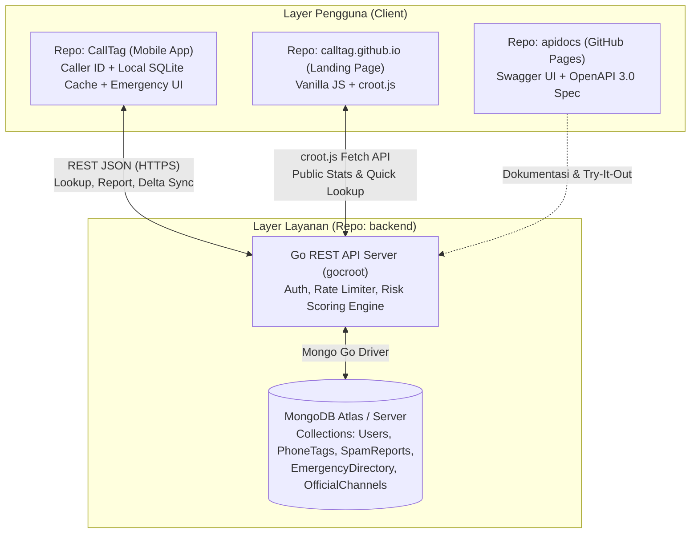
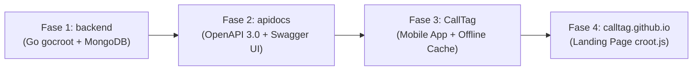

# Product Requirements Document (PRD): Ekosistem CallTag Indonesia

| Metadata Dokumen | Detail |
| :--- | :--- |
| **Nama Produk** | CallTag |
| **Versi Dokumen** | 1.0.0 (Master PRD) |
| **Status** | Draft Final (Siap Eksekusi Engineering) |
| **Target Pasar** | Indonesia (Seluruh Provinsi & Kota/Kabupaten) |
| **Cakupan Repositori** | `CallTag` (Mobile App), `backend` (Go `gocroot` + MongoDB), `apidocs` (Swagger Vanilla JS), `calltag.github.io` (Landing Page `croot.js`) |
| **Tanggal Pembaruan** | 5 November 2026 |

---

## 1. EXECUTIVE SUMMARY & PRODUCT VISION

### 1.1 Latar Belakang Masalah di Indonesia
Masyarakat pengguna telepon seluler di Indonesia menghadapi dua masalah kritis dalam komunikasi harian dan keselamatan darurat:

1. **Eskalasi Kejahatan Siber & Teror Telepon Berpola Lokal:**
   Modus penipuan telepon dan pesan di Indonesia berkembang jauh melampaui telemarketing biasa. Masyarakat diteror oleh intimidasi penagih utang pinjaman online (Pinjol) ilegal, pengiriman file berbahaya berekstensi `.apk` yang menyamar sebagai kurir paket atau undangan pernikahan (APK Sniffing), penyamaran layanan pelanggan (CS) bank/pajak/bea cukai, promosi masif judi online (Judol), hingga rekayasa sosial (hipnotis telepon "keluarga kecelakaan").
2. **Fragmentasi Akses Nomor Darurat Daerah & Kebingungan Pelaporan Resmi:**
   Saat kondisi darurat terjadi (kebakaran, kecelakaan, evakuasi hewan berbisa, atau gangguan medis), banyak warga tidak hafal nomor darurat nasional (`112`, `110`, `113`, `119`). Lebih krusial lagi, di Indonesia, layanan seperti Pemadam Kebakaran (Damkar), Kepolisian Resor/Sektor (Polres/Polsek), dan ambulans RS daerah jauh lebih cepat merespons melalui **nomor telepon lokal atau WhatsApp posko Kota/Kabupaten** dibandingkan jalur sentral. Di sisi lain, korban penipuan siber sering tidak tahu harus melapor ke mana (antara AduanNomor Komdigi, CekRekening/IASC, Satgas PASTI OJK, atau Patroli Siber Polri).

### 1.2 Visi Produk (Product Vision)
Menjadi **perisai komunikasi dan asisten keselamatan darurat nomor satu bagi masyarakat Indonesia** melalui aplikasi seluler yang ringan, mampu mendeteksi ancaman telepon secara *real-time* (baik *online* maupun *offline*), menyediakan akses satu ketukan (*one-tap*) ke layanan darurat nasional maupun posko daerah terdekat, serta menghubungkan warga langsung ke kanal pelaporan resmi negara.

### 1.3 Arsitektur Ekosistem 4 Repositori
Ekosistem CallTag dibagi ke dalam empat repositori terpisah dengan tanggung jawab yang jelas:
1. **`CallTag` (Mobile App):** Aplikasi utama pengguna untuk identifikasi penelepon (*Caller ID*), pemblokiran otomatis (*Spam Guard*), direktori panggilan darurat nasional & lokal berbasis Kota/Kabupaten, pelaporan *crowdsourcing*, serta pusat panduan tindak lanjut resmi.
2. **`backend` (Go `gocroot` + MongoDB):** Mesin layanan mikro REST API berkinerja tinggi menggunakan kerangka kerja `gocroot` dan basis data dokumen MongoDB untuk mengelola reputasi nomor, agregasi skor laporan, direktori darurat, dan sinkronisasi data *offline*.
3. **`apidocs` (OpenAPI/Swagger UI):** Dokumentasi kontrak REST API interaktif berbasis Vanilla JS yang di-hosting di GitHub Pages sebagai rujukan tunggal (*Single Source of Truth*) integrasi antara `backend`, `CallTag`, dan `calltag.github.io`.
4. **`calltag.github.io` (Landing Page `croot.js`):** Situs web publik berbasis `croot.js` untuk edukasi produk, pengecekan reputasi nomor singkat via web, statistik ancaman publik, dan tautan unduhan aplikasi.

---

## 2. GOALS & SUCCESS METRICS

### 2.1 Tujuan Bisnis & Produk (Product Goals)
1. **Proteksi Proaktif:** Mengidentifikasi dan memberi peringatan sebelum pengguna mengangkat telepon dari nomor yang terindikasi Pinjol ilegal, penipuan APK, CS palsu, atau judi online.
2. **Kecepatan Respons Darurat:** Memangkas waktu pencarian kontak darurat (terutama Damkar dan RS/Polres lokal) menjadi kurang dari 5 detik bahkan saat ponsel tidak memiliki koneksi internet.
3. **Literasi & Tindak Lanjut Hukum:** Mengarahkan korban penipuan ke instansi resmi yang tepat sesuai jenis kejahatan (Komdigi, OJK/IASC, Polri) dalam kurang dari 3 ketukan.
4. **Akurasi Komunitas (*Crowdsourcing*):** Membangun basis data reputasi nomor telepon Indonesia yang tahan terhadap manipulasi laporan palsu (*anti-brigading*).

### 2.2 Indikator Kinerja Utama (KPIs & Success Metrics)

| Kategori Metrik | Indikator (KPI) | Target MVP | Metode Pengukuran |
| :--- | :--- | :--- | :--- |
| **Performa Sistem** | Latensi *Lookup Caller ID* (API P95) | `< 150 ms` | Log metrik respons HTTP `backend` (`gocroot`) |
| **Performa Lokal** | Latensi *Lookup Offline Cache* di HP | `< 20 ms` | Benchmark kueri SQLite/Room lokal di `CallTag` |
| **Ketersediaan** | *Offline Emergency Directory Availability* | `100%` tanpa internet | Pengujian mode pesawat (*Airplane Mode*) |
| **Kualitas Data** | *False Positive Rate* (Nomor bersih dilabeli Scam) | `< 0.5%` | Rasio sanggahan (*dispute*) valid dibagi total nomor berlabel `SPAM`/`DANGER_SCAM` |
| **Keterlibatan Pengguna** | Rasio Konversi Laporan Pasca-Panggilan Asing | `>= 8%` | Jumlah laporan `SpamReports` dibagi total panggilan masuk dari nomor tidak dikenal |
| **Keandalan API** | *Uptime* Layanan `backend` | `>= 99.5%` | Pemantauan *health check* endpoint `/health` |

---

## 3. USER PERSONAS & CORE USER STORIES

### 3.1 User Personas

1. **Rina (28 Tahun, Karyawan Swasta & Pembeli Online Aktif di Jabodetabek)**
   - **Masalah:** Sering menerima telepon dari nomor tidak dikenal; khawatir tidak mengangkat telepon kurir paket asli, namun takut terjebak penipuan modus kurir APK atau telemarketing kartu kredit/pinjol.
   - **Kebutuhan:** Identifikasi layar otomatis (*Caller ID*) yang membedakan nomor kurir/bisnis asli dengan nomor penipu atau Pinjol ilegal.
2. **Pak Hendra (52 Tahun, Kepala Keluarga di Kota Semarang)**
   - **Masalah:** Kurang familier dengan modus penipuan digital terbaru (CS bank palsu, hipnotis telepon) dan bingung mencari nomor WhatsApp Damkar atau ambulans lokal ketika ada kejadian darurat di lingkungan rumah.
   - **Kebutuhan:** Peringatan layar merah yang tegas beserta pemblokiran otomatis untuk nomor berbahaya (`DANGER_SCAM`), serta tombol panggil darurat satu ketukan yang langsung menampilkan Damkar/RS Semarang.
3. **Dito (22 Tahun, Mahasiswa yang Menjadi Korban Penipuan Transfer)**
   - **Masalah:** Baru saja tertipu modus CS E-Wallet palsu; panik dan tidak tahu ke mana harus melapor agar nomor dan rekening pelaku segera dibekukan.
   - **Kebutuhan:** Fitur lapor cepat untuk menandai nomor pelaku di komunitas CallTag sekaligus panduan langkah demi langkah menuju CekRekening.id, IASC, dan AduanNomor.id.

### 3.2 Core User Stories (Prioritas MoSCoW)

Prioritas menggunakan metode **MoSCoW**:
- **M (Must Have):** Wajib ada pada rilis MVP.
- **S (Should Have):** Penting dan diupayakan masuk MVP setelah semua *Must Have* selesai.
- **C (Could Have):** Fitur tambahan bernilai tambah untuk iterasi pasca-MVP.
- **W (Won't Have for MVP):** Ditunda ke rilis fase berikutnya.

| ID | Modul | User Story | Prioritas (MoSCoW) | Repo Terkait |
| :--- | :--- | :--- | :---: | :--- |
| **US-01** | Caller ID & Spam Guard | Sebagai pengguna, saya ingin melihat label kategori dan tingkat bahaya nomor asing saat telepon berdering agar saya tahu apakah panggilan tersebut aman diangkat. | **M** | `CallTag`, `backend` |
| **US-02** | Caller ID & Spam Guard | Sebagai pengguna, saya ingin mengaktifkan blokir otomatis (*Auto-Block*) khusus untuk nomor berstatus `DANGER_SCAM` (Pinjol ilegal, APK Sniffing, Judol) agar saya tidak terganggu. | **M** | `CallTag` |
| **US-03** | Caller ID & Spam Guard | Sebagai pengguna, saya ingin melakukan pencarian manual nomor telepon di kolom pencarian aplikasi atau web untuk memeriksa rekam jejak nomor sebelum menghubungi balik. | **M** | `CallTag`, `backend`, `calltag.github.io` |
| **US-04** | Crowdsourcing Report | Sebagai pengguna, saya ingin melaporkan nomor mencurigakan ke dalam 6 kategori taksonomi khas Indonesia disertai komentar singkat agar pengguna lain terlindungi. | **M** | `CallTag`, `backend` |
| **US-05** | Crowdsourcing Report | Sebagai pemilik nomor yang salah dilaporkan, saya ingin mengajukan sanggahan (*dispute*) agar nomor saya ditinjau ulang dan tidak terblokir permanen secara keliru. | **S** | `CallTag`, `backend` |
| **US-06** | Panggilan Darurat | Sebagai warga dalam situasi darurat, saya ingin menekan satu tombol (*One-Tap Direct Dial*) ke nomor darurat nasional (`112`, `110`, `113`, `118`/`119`, `115`, `123`, `14080`) tanpa harus mengetik nomor di keypad. | **M** | `CallTag`, `backend` |
| **US-07** | Panggilan Darurat Lokal | Sebagai warga daerah, saya ingin mencari dan menghubungi nomor telepon atau WhatsApp Damkar, Polres/Polsek, dan RS terdekat berdasarkan Kota/Kabupaten saya, baik untuk kebakaran maupun evakuasi darurat non-kebakaran. | **M** | `CallTag`, `backend` |
| **US-08** | Mode Offline | Sebagai pengguna di area susah sinyal, saya ingin direktori darurat dan daftar *top scammer* tetap berfungsi penuh tanpa koneksi internet. | **M** | `CallTag`, `backend` |
| **US-09** | Official Reporting Hub | Sebagai korban penipuan, saya ingin mendapatkan panduan alur pelaporan dan pintasan langsung ke AduanNomor.id, CekRekening.id/IASC, Satgas PASTI OJK (WA `081157157157`), Patroli Siber Polri, dan LAPOR! sesuai kasus yang saya alami. | **M** | `CallTag`, `backend` |
| **US-10** | Dokumentasi & Web | Sebagai pengembang dan pengunjung publik, saya ingin mengakses dokumentasi OpenAPI interaktif di `apidocs` dan informasi produk serta statistik ancaman di `calltag.github.io`. | **M** | `apidocs`, `calltag.github.io` |
| **US-11** | Proteksi Pesan | Sebagai pengguna, saya ingin mendeteksi tautan berbahaya atau lampiran `.apk` pada notifikasi pesan masuk. | **W** | `CallTag` |

---

## 4. FUNCTIONAL REQUIREMENTS & ACCEPTANCE CRITERIA

### 4.1 Taksonomi Deteksi Spam & Scam Khas Indonesia
Seluruh komponen ekosistem (`CallTag`, `backend`, `apidocs`, `calltag.github.io`) WAJIB menggunakan kode kategori terstandarisasi berikut:

| Kode Kategori (`category_code`) | Nama Tampilan (UI) | Bobot Keparahan Dasar ($W_{cat}$) | Contoh Modus di Indonesia |
| :--- | :--- | :---: | :--- |
| `PINJOL_DC` | Pinjol Ilegal & Debt Collector Meresahkan | `1.5` | Teror penagihan pinjol tidak berizin OJK, ancaman sebar data kontak darurat. |
| `APK_SNIFFING` | Penipuan Modus File APK | `2.0` | Kurir paket palsu ("cek foto resi.apk"), undangan nikah digital `.apk`, surat tilang ETLE `.apk`, tagihan PLN/BPJS `.apk`. |
| `IMPERSONATION` | Impersonasi / CS Palsu | `1.8` | Mengaku CS Bank (konfirmasi perubahan tarif transfer), CS E-Wallet, petugas Pajak/DJP (pemadanan NIK-NPWP), tertahan di Bea Cukai. |
| `JUDOL` | Promosi Judi Online (Judol) | `1.3` | Robocall atau pesan suara/WA menawarkan bonus deposit situs slot/judi online. |
| `SOCIAL_ENG` | Penipuan Sosial / Hipnotis Telepon | `1.8` | Modus "anak/keluarga kecelakaan di RS butuh biaya operasi segera", menang undian palsu. |
| `TELEMARKETING` | Telemarketing / Spam Promosi Agresif | `1.0` | Penawaran KTA, asuransi, atau properti berulang kali di luar jam wajar. |

---

### 4.2 Alur 1: Caller ID & Spam Guard

#### Persyaratan Fungsional:
1. Aplikasi `CallTag` menggunakan layanan penyaringan panggilan sistem operasi (misal Android `CallScreeningService`) untuk menangkap nomor panggilan masuk dalam format E.164 ternormalisasi (contoh: `0812...` menjadi `+62812...`).
2. Pemeriksaan dilakukan secara berjenjang:
   - **Langkah 1 (Buku Telepon Lokal):** Jika nomor ada di kontak pengguna, lewati pemeriksaan spam agar panggilan keluarga/kerabat tidak terhambat.
   - **Langkah 2 (Local Cache SQLite):** Periksa tabel `local_phone_tags` di perangkat (batas waktu `< 20 ms`).
   - **Langkah 3 (Live API Lookup):** Jika perangkat *online* dan data lokal belum ada atau kedaluwarsa (`> 24 jam`), panggil `GET /api/v1/phones/{e164}` dengan batas *timeout* ketat `800 ms`.
3. Berdasarkan status reputasi (`reputation_level`), aplikasi menampilkan *overlay* informasi:
   - `CLEAN`: Tidak menampilkan peringatan bahaya.
   - `SUSPICIOUS` (Skor `15 - 39`): Banner kuning ("Dilaporkan Komunitas: Hati-hati").
   - `SPAM` (Skor `40 - 69`): Banner oranye ("Spam Terdeteksi: [Kategori Dominan]").
   - `DANGER_SCAM` (Skor `>= 70`): Layar peringatan merah penuh ("BAHAYA PENIPUAN: [Kategori Dominan]") + opsi tolak otomatis jika *Spam Guard Auto-Block* aktif.

#### Acceptance Criteria (Gherkin):

```gherkin
Feature: Real-time Caller ID dan Pemblokiran Spam Guard

  Scenario: Panggilan masuk dari nomor berstatus DANGER_SCAM saat perangkat online
    Given pengguna telah mengaktifkan izin Caller ID di aplikasi CallTag
    And pengaturan "Blokir Otomatis Nomor Bahaya (DANGER_SCAM)" berstatus "ON"
    When panggilan masuk diterima dari nomor "+6281299998888" yang tidak ada di kontak pengguna
    And endpoint "/api/v1/phones/+6281299998888" mengembalikan reputation_level "DANGER_SCAM" dengan kategori "APK_SNIFFING"
    Then aplikasi memutus panggilan masuk secara otomatis dalam waktu kurang dari 500 ms
    And aplikasi mencatat riwayat panggilan diblokir dengan label "Penipuan Modus File APK"
    And pengguna menerima notifikasi senyap berisi ringkasan nomor yang diblokir

  Scenario: Panggilan masuk dari nomor scammer teratas saat perangkat offline (Tanpa Internet)
    Given perangkat pengguna berada dalam kondisi tanpa koneksi internet
    And database lokal perangkat menyimpan cache top scammer yang mencakup nomor "+6285711112222" dengan kategori "PINJOL_DC"
    When panggilan masuk diterima dari nomor "+6285711112222"
    Then aplikasi membaca cache lokal dalam waktu kurang dari 20 ms
    And layar menampilkan overlay peringatan merah "Pinjol Ilegal & Debt Collector Meresahkan"
```

---

### 4.3 Alur 2: Sistem Crowdsourcing Report & Algoritma Threshold/Scoring

#### Persyaratan Fungsional & Rumus Skor Bahaya (*Risk Score*):
Untuk mencegah satu laporan langsung menghancurkan reputasi nomor orang lain, `backend` menghitung **Risk Score ($S$)** pada rentang `0 - 100` setiap kali laporan baru masuk ke koleksi `SpamReports`:

$$S = \min\left(100, \sum_{i=1}^{N} \left( B \times W_{cat, i} \times T_{user, i} \times D(\Delta t_i) \right) \right)$$

Dimana:
- $N$: Jumlah laporan unik dari pelapor berbeda (1 akun pengguna hanya dihitung 1 kali per nomor target dalam periode 30 hari).
- $B = 8.0$: Poin dasar per laporan valid.
- $W_{cat, i}$: Bobot keparahan kategori laporan ke-$i$ (lihat Tabel 4.1, rentang `1.0` hingga `2.0`).
- $T_{user, i}$: *Trust Weight* akun pelapor ke-$i$ (rentang `0.2` untuk akun baru belum terverifikasi hingga `1.5` untuk akun terverifikasi dengan riwayat laporan akurat).
- $D(\Delta t_i) = 0.5^{(\Delta t_i / 90)}$: Faktor peluruhan waktu (*Exponential Time Decay*) dengan waktu paruh (*half-life*) **90 hari**, sehingga nomor yang sudah lama tidak aktif menipu atau telah didaur ulang operator seluler dapat pulih secara bertahap.

#### Aturan Ambang Batas (*Threshold*) Pelabelan Status:
1. **`CLEAN` ($S < 15$):** Nomor aman atau belum cukup bukti.
2. **`SUSPICIOUS` ($15 \le S < 40$ dan minimal $N \ge 2$ pelapor unik):** Ditandai "Mencurigakan".
3. **`SPAM` ($40 \le S < 70$ dan minimal $N \ge 3$ pelapor unik):** Ditandai "Spam / Gangguan".
4. **`DANGER_SCAM` ($S \ge 70$ dan minimal $N \ge 5$ pelapor unik, ATAU terverifikasi daftar hitam instansi resmi):** Ditandai "Bahaya / Scam" dan masuk ke dalam paket sinkronisasi *Top Scammer Offline Cache*.

#### Acceptance Criteria (Gherkin):

```gherkin
Feature: Pelaporan Nomor Crowdsourcing dan Perhitungan Skor Reputasi

  Scenario: Pengguna melaporkan nomor penipu modus CS Bank Palsu
    Given pengguna telah masuk (terautentikasi) di aplikasi CallTag dengan trust_weight 1.0
    When pengguna memilih nomor "+6281377776666" dari riwayat panggilan
    And memilih kategori "IMPERSONATION" (Impersonasi / CS Palsu)
    And mengisi catatan "Mengaku CS BCA meminta kode OTP pembatalan limit" lalu menekan tombol "Kirim Laporan"
    Then aplikasi mengirim request POST ke "/api/v1/reports"
    And backend menyimpan dokumen di koleksi "SpamReports" serta memperbarui agregasi di koleksi "PhoneTags"
    And pengguna melihat pesan sukses beserta rekomendasi pintasan menuju "AduanNomor.id" dan "CekRekening.id"

  Scenario: Kenaikan status nomor menjadi DANGER_SCAM setelah mencapai ambang batas
    Given nomor "+6281377776666" telah memiliki 4 laporan unik kategori "APK_SNIFFING" dengan total risk_score 64.0
    When pelapor unik ke-5 dengan trust_weight 1.0 mengirimkan laporan kategori "APK_SNIFFING" (bobot 2.0) untuk nomor tersebut
    Then backend menghitung ulang risk_score menjadi 80.0 dengan unique_reporters sebanyak 5
    And backend mengubah reputation_level nomor "+6281377776666" dari "SPAM" menjadi "DANGER_SCAM"
    And nomor tersebut otomatis disertakan dalam endpoint sinkronisasi offline "/api/v1/sync/top-scammers"
```

---

### 4.4 Alur 3: Panggilan Darurat Nasional & Lokal serta Pusat Panduan Lapor Resmi

#### A. Spesifikasi Modul Panggilan Darurat Indonesia
1. **Nomor Darurat Nasional (*One-Tap Direct Dial*):**
   Ditampilkan di bagian teratas tab **Darurat** dengan tombol panggil instan yang langsung memicu *intent* telepon (`tel:`):
   - **`112`** : Panggilan Darurat Terpadu Nasional
   - **`110`** : Kepolisian RI
   - **`113`** : Pemadam Kebakaran (Damkar)
   - **`118` / `119`** : Ambulans & Gawat Darurat Kemenkes
   - **`115`** : BASARNAS / Pencarian dan Pertolongan (SAR)
   - **`123`** : PLN (Gangguan Kelistrikan)
   - **`14080`** : Jasa Marga (Darurat Jalan Tol)
2. **Direktori Darurat Lokal Berbasis Lokasi/Kota:**
   - Pengguna dapat memilih **Provinsi** dan **Kota/Kabupaten** (atau menggunakan deteksi lokasi GPS otomatis yang dicocokkan ke poligon/daftar kota lokal).
   - Menampilkan daftar instansi lokal: **Damkar Daerah**, **Polres/Polsek**, dan **Rumah Sakit / IGD Terdekat**.
   - Setiap entri lokal menyediakan:
     * Tombol **Telepon PSTN/Seluler** (`tel:+62...`)
     * Tombol **Chat/Panggilan WhatsApp** (`https://wa.me/62...`) khusus instansi yang mendukung laporan via WA (sangat umum pada posko Damkar Kota/Kabupaten di Indonesia).
     * Tag layanan khusus pada posko Damkar: `Kebakaran`, `Evakuasi Hewan Berbisa/Sarang Tawon`, `Penyelamatan Non-Kebakaran (Cincin/Kunci/Pohon Tumbang)`.

#### B. Spesifikasi Pusat Lapor & Panduan Tindak Lanjut Resmi (*Official Reporting Hub*)
Menyediakan direktori terkurasi beserta panduan persiapan bukti (tangkapan layar bukti chat, mutasi rekening, log panggilan, nomor pelaku) sebelum pengguna diarahkan ke kanal resmi:

| Jenis Kasus yang Dialami Korban | Instansi & Kanal Resmi | Aksi Pintasan di Aplikasi |
| :--- | :--- | :--- |
| **Lapor Nomor Seluler Penipu / Pemblokiran MSISDN** | **AduanNomor.id** (Kementerian Komunikasi dan Digital / Komdigi) | Buka Webview/Browser ke `https://aduannomor.id` + tombol salin nomor pelaku otomatis. |
| **Cek & Lapor Rekening Bank / E-Wallet Penipu** | **CekRekening.id** (Komdigi) & **IASC** (*Indonesia Anti-Scam Centre* - OJK) | Buka `https://cekrekening.id` atau `https://iasc.ojk.go.id` + checklist dokumen bukti mutasi. |
| **Lapor Pinjol Ilegal & Investasi Bodong** | **Satgas PASTI / Kontak OJK 157** | *Deep link* langsung ke WhatsApp Resmi OJK (`https://wa.me/6281157157157`), telepon `157`, atau portal `https://sipasti.ojk.go.id`. |
| **Lapor Tindak Pidana Siber (Penipuan / Pemerasan / Phishing)** | **Patroli Siber Polri** | Buka informasi pelaporan `https://patrolisiber.id` + panduan pembuatan Laporan Polisi (LP) di SPKT Polres terdekat. |
| **Lapor Layanan Publik Umum** | **LAPOR!** (SP4N - Kementerian PANRB) | Buka `https://www.lapor.go.id` untuk pengaduan layanan instansi pemerintah. |

#### Acceptance Criteria (Gherkin):

```gherkin
Feature: Direktori Darurat Nasional, Lokal Kota/Kabupaten, dan Pusat Lapor Resmi

  Scenario: Menghubungi WhatsApp Damkar Kota/Kabupaten untuk evakuasi darurat
    Given pengguna membuka menu "Darurat" di aplikasi CallTag
    When pengguna memilih lokasi "Jawa Barat - Kota Bandung"
    And pengguna memilih filter instansi "Damkar Daerah"
    Then aplikasi menampilkan kartu "Dinas Kebakaran dan Penanggulangan Bencana (Diskar PB) Kota Bandung"
    And kartu tersebut menampilkan nomor darurat lokal, nomor WhatsApp resmi, serta tag layanan "Kebakaran & Evakuasi Non-Kebakaran"
    When pengguna menekan tombol "Hubungi via WhatsApp"
    Then aplikasi membuka WhatsApp menuju nomor resmi posko dengan teks template "Halo Petugas Damkar, saya membutuhkan bantuan darurat di lokasi: ..."

  Scenario: Mengakses nomor darurat nasional dan lokal saat tidak ada sinyal internet
    Given ponsel pengguna tidak terhubung ke internet (Offline)
    When pengguna membuka menu "Darurat"
    Then seluruh 7 nomor darurat nasional (112, 110, 113, 118/119, 115, 123, 14080) tampil seketika dari cache lokal
    And direktori darurat Kota/Kabupaten terakhir yang dipilih pengguna tetap dapat dicari dan dihubungi via panggilan telepon seluler

  Scenario: Panduan tindak lanjut korban Pinjol Ilegal menuju Satgas PASTI / Kontak OJK 157
    Given pengguna membuka menu "Pusat Lapor Resmi"
    When pengguna memilih bantuan "Saya Diteror Pinjol Ilegal / Investasi Bodong"
    Then aplikasi menampilkan daftar bukti yang perlu disiapkan (Nama aplikasi pinjol, nomor telepon penagih, tangkapan layar ancaman)
    And menampilkan tombol pintasan "Chat WhatsApp OJK (081157157157)" serta "Hubungi Kontak OJK 157"
```

---

## 5. CROSS-REPO TECHNICAL ARCHITECTURE & MONGODB DATA MODEL

### 5.1 Diagram Arsitektur Lintas 4 Repositori



---

### 5.2 Skema Koleksi MongoDB di `backend`

Database utama menggunakan MongoDB. Berikut adalah definisi skema untuk 5 koleksi inti beserta indeks yang wajib dibuat:

#### 1. Koleksi `Users`
Menyimpan profil pelapor, reputasi kepercayaan akun (*trust weight*), dan kuota laporan harian untuk pencegahan *spam report*.

```json
{
  "_id": "ObjectId('672a10000000000000000001')",
  "phone_hash": "sha256_9f86d081884c7d659a2feaa0c55ad015a3bf4f1b2b0b822cd15d6c15b0f00a08",
  "device_id_hash": "sha256_device_fingerprint_hash",
  "display_name": "Warga Terverifikasi #4821",
  "role": "USER",
  "trust_weight": 1.0,
  "accuracy_stats": {
    "total_reports": 14,
    "confirmed_reports": 12,
    "disputed_reports": 0
  },
  "daily_report_count": 2,
  "last_report_at": "2026-11-05T11:30:00Z",
  "status": "ACTIVE",
  "created_at": "2026-10-01T08:00:00Z",
  "updated_at": "2026-11-05T11:30:00Z"
}
```
- **Indexes:**
  - `idx_users_phone_hash`: `{ "phone_hash": 1 }` (Unique)
  - `idx_users_device_hash`: `{ "device_id_hash": 1 }`

#### 2. Koleksi `PhoneTags`
Menyimpan hasil agregasi reputasi setiap nomor telepon yang pernah dilaporkan atau diverifikasi. Menjadi target utama kueri *Caller ID* berlatensi rendah.

```json
{
  "_id": "ObjectId('672a20000000000000000002')",
  "phone_e164": "+6281299998888",
  "country_code": "ID",
  "carrier": "Telkomsel",
  "reputation_level": "DANGER_SCAM",
  "risk_score": 84.5,
  "primary_category": "APK_SNIFFING",
  "category_breakdown": {
    "PINJOL_DC": 0,
    "APK_SNIFFING": 9,
    "IMPERSONATION": 2,
    "JUDOL": 0,
    "SOCIAL_ENG": 0,
    "TELEMARKETING": 0
  },
  "top_community_label": "Penipu Kurir Paket File APK",
  "unique_reporters": 11,
  "is_official_blacklisted": false,
  "is_whitelisted_verified": false,
  "sync_version": 1042,
  "first_reported_at": "2026-10-15T04:12:00Z",
  "last_reported_at": "2026-11-05T10:05:00Z",
  "updated_at": "2026-11-05T10:05:00Z"
}
```
- **Indexes:**
  - `idx_phonetags_e164`: `{ "phone_e164": 1 }` (Unique - Kunci utama *Caller ID lookup*)
  - `idx_phonetags_sync`: `{ "reputation_level": 1, "sync_version": 1, "risk_score": -1 }` (Digunakan untuk *offline delta sync*)

#### 3. Koleksi `SpamReports`
Menyimpan log laporan individual dari pengguna serta status peninjauan/sanggahan.

```json
{
  "_id": "ObjectId('672a30000000000000000003')",
  "phone_e164": "+6281299998888",
  "reporter_user_id": "ObjectId('672a10000000000000000001')",
  "category_code": "APK_SNIFFING",
  "custom_tag": "Mengirim WA file Lihat_Foto_Paket.apk",
  "comment": "Mengaku kurir ekspedisi meminta buka file APK karena alamat tidak jelas.",
  "call_type": "WHATSAPP_OR_CELLULAR",
  "reporter_trust_snapshot": 1.0,
  "applied_weight": 2.0,
  "status": "VALIDATED",
  "created_at": "2026-11-05T10:05:00Z"
}
```
- **Indexes:**
  - `idx_reports_dedup`: `{ "phone_e164": 1, "reporter_user_id": 1 }` (Mencegah duplikasi bobot laporan oleh user yang sama)
  - `idx_reports_phone_created`: `{ "phone_e164": 1, "created_at": -1 }`

#### 4. Koleksi `EmergencyDirectory`
Menyimpan nomor darurat tingkat Nasional (`scope: "NATIONAL"`) maupun tingkat Kota/Kabupaten (`scope: "LOCAL"`).

```json
{
  "_id": "ObjectId('672a40000000000000000004')",
  "code": "ID-JB-BDG-DAMKAR-01",
  "scope": "LOCAL",
  "agency_type": "DAMKAR",
  "name": "Dinas Kebakaran dan Penanggulangan Bencana (Diskar PB) Kota Bandung",
  "province": "Jawa Barat",
  "city_regency": "Kota Bandung",
  "contacts": {
    "short_code": "113",
    "phone_numbers": ["+6222113", "+62227207113"],
    "whatsapp_number": "+62811207113",
    "whatsapp_template": "Halo Petugas Damkar Kota Bandung, saya membutuhkan bantuan darurat di lokasi: "
  },
  "capabilities": [
    "Pemadaman Kebakaran",
    "Evakuasi Hewan Berbisa & Sarang Tawon",
    "Penyelamatan Darurat Non-Kebakaran (Cincin, Pohon Tumbang, Banjir)"
  ],
  "address": "Jl. Sukabumi No.17, Kacapiring, Kec. Batununggal, Kota Bandung",
  "location": {
    "type": "Point",
    "coordinates": [107.6365, -6.9175]
  },
  "is_24_hours": true,
  "verified_at": "2026-11-01T00:00:00Z",
  "sync_version": 12
}
```
- **Indexes:**
  - `idx_emergency_scope_region`: `{ "scope": 1, "province": 1, "city_regency": 1, "agency_type": 1 }`
  - `idx_emergency_geo`: `{ "location": "2dsphere" }` (Untuk pencarian posko terdekat via GPS)

#### 5. Koleksi `OfficialChannels`
Menyimpan daftar kanal pelaporan resmi pemerintah/otoritas beserta panduan persiapan bukti dan tautan langsung.

```json
{
  "_id": "ObjectId('672a50000000000000000005')",
  "channel_slug": "satgas-pasti-ojk",
  "title": "Satgas PASTI & Kontak OJK 157",
  "authority_name": "Otoritas Jasa Keuangan (OJK)",
  "related_categories": ["PINJOL_DC", "IMPERSONATION"],
  "description": "Kanal pengaduan resmi untuk teror Pinjol Ilegal, penyalahgunaan data pribadi oleh penagih utang, dan penipuan investasi bodong.",
  "action_links": {
    "website_url": "https://sipasti.ojk.go.id",
    "phone_dial": "157",
    "whatsapp_url": "https://wa.me/6281157157157",
    "email": "konsumen@ojk.go.id"
  },
  "required_evidence_checklist": [
    "Nama aplikasi atau entitas Pinjol Ilegal",
    "Nomor telepon dan WhatsApp penagih utang (Debt Collector)",
    "Tangkapan layar ancaman atau bukti transfer"
  ],
  "step_by_step_guide": [
    "Simpan bukti tangkapan layar percakapan atau log panggilan dari pelaku.",
    "Hubungi WhatsApp resmi Kontak OJK di 0811-5715-7157 atau telepon 157.",
    "Lampirkan kronologi singkat beserta bukti untuk pemblokiran entitas oleh Satgas PASTI."
  ],
  "display_order": 3,
  "is_active": true,
  "updated_at": "2026-11-01T00:00:00Z"
}
```
- **Indexes:**
  - `idx_official_slug`: `{ "channel_slug": 1 }` (Unique)
  - `idx_official_categories`: `{ "related_categories": 1, "display_order": 1 }`

---

### 5.3 Kontrak Endpoint REST API (`backend` - `gocroot`) untuk `apidocs`

Seluruh endpoint di bawah ini akan diimplementasikan menggunakan `gocroot` di repo `backend` dan didokumentasikan secara penuh dalam spesifikasi OpenAPI 3.0 di repo `apidocs`:

| Method | Path Endpoint | Auth | Deskripsi Fungsional | Target Pemanggil |
| :---: | :--- | :---: | :--- | :--- |
| `GET` | `/health` | Public | Pemeriksaan status server API dan koneksi MongoDB. | Semua |
| `POST` | `/api/v1/auth/device` | Public | Registrasi perangkat anonim/terverifikasi & penerbitan token JWT. | `CallTag` |
| `GET` | `/api/v1/phones/{e164}` | Bearer / Public Rate-Limited | *Lookup* reputasi nomor telepon (`reputation_level`, `risk_score`, `primary_category`, `top_community_label`). | `CallTag`, `calltag.github.io` |
| `GET` | `/api/v1/phones/{e164}/reports` | Bearer | Mengambil daftar ringkasan komentar laporan komunitas terbaru untuk suatu nomor. | `CallTag` |
| `POST` | `/api/v1/reports` | Bearer | Mengirimkan laporan nomor spam/scam baru (memicu kalkulasi ulang `PhoneTags`). | `CallTag` |
| `POST` | `/api/v1/disputes` | Bearer | Mengajukan sanggahan (*dispute*) apabila nomor milik pengguna salah dilabeli sebagai spam/scam. | `CallTag` |
| `GET` | `/api/v1/emergency/national` | Public | Mengambil daftar 7 nomor darurat nasional Indonesia (`112`, `110`, `113`, `118`/`119`, `115`, `123`, `14080`). | `CallTag`, `calltag.github.io` |
| `GET` | `/api/v1/emergency/local` | Public | Mengambil direktori darurat lokal (Damkar, Polres/Polsek, RS) dengan filter `?province=...&city=...&type=...` atau koordinat `?lat=...&lng=...`. | `CallTag`, `calltag.github.io` |
| `GET` | `/api/v1/official-channels` | Public | Mengambil daftar kanal pelaporan resmi pemerintah (AduanNomor, CekRekening/IASC, OJK 157, Patroli Siber, LAPOR!). | `CallTag`, `calltag.github.io` |
| `GET` | `/api/v1/sync/offline-bundle` | Bearer | Mengunduh *delta sync* nomor darurat dan daftar *Top Scammers* (`DANGER_SCAM`) berdasarkan parameter `?since_version=...` untuk disimpan di cache HP. | `CallTag` |
| `GET` | `/api/v1/stats/public` | Public | Mengambil statistik agregat publik (jumlah nomor scam terdeteksi per kategori) untuk ditampilkan di landing page. | `calltag.github.io` |

---

## 6. EDGE CASES & NON-FUNCTIONAL REQUIREMENTS (NFR)

### 6.1 Mode Offline Wajib (*Offline-First Architecture*)
Mengingat kondisi geografis dan kualitas jaringan seluler yang tidak merata di Indonesia, serta potensi darurat saat listrik/internet padam:
1. **Pre-Packaged Seed Data saat Instalasi:**
   File instalasi aplikasi `CallTag` WAJIB menyertakan database awal (*bundled seed*) yang berisi:
   - Seluruh 7 Nomor Darurat Nasional (`112`, `110`, `113`, `118`/`119`, `115`, `123`, `14080`).
   - Direktori utama Damkar, Polres, dan RS rujukan ibu kota provinsi dan kota/kabupaten.
   - Daftar 5.000 nomor `DANGER_SCAM` aktif teratas di Indonesia.
2. **Background Delta Synchronization:**
   Saat perangkat terhubung ke internet (diutamakan Wi-Fi atau paket data hemat), aplikasi memanggil `/api/v1/sync/offline-bundle?since_version={last_version}` maksimal 1 kali sehari. Ukuran payload kompresi Gzip untuk pembaruan harian dibatasi `< 500 KB`.
3. **Zero-Network Graceful Fallback:**
   Apabila panggilan masuk terjadi saat perangkat tidak memiliki sinyal data (atau API tidak merespons dalam `800 ms`), *Caller ID* langsung memutuskan status berdasarkan tabel SQLite lokal tanpa menampilkan pesan *error* yang mengganggu layar panggilan.

### 6.2 Sistem Anti-Abuse & Pencegahan Laporan Palsu (*Anti-Brigading*)
Untuk mencegah persaingan bisnis tidak sehat atau perundungan siber (melaporkan nomor pribadi orang lain secara massal agar diblokir):
1. **Deduplikasi Pelapor & Perangkat:** Satu akun dan satu `device_id_hash` hanya dihitung maksimal **1 kali** untuk nomor target yang sama dalam rentang 30 hari.
2. **Kuota Harian (*Rate Limiting*):** Setiap pengguna biasa dibatasi maksimal **10 laporan per 24 jam** dan maksimal **3 laporan per 5 menit** di tingkat *middleware* `gocroot`.
3. **Syarat Minimum Pelapor Unik (*Multi-Reporter Gate*):** Satu pengguna dengan `trust_weight` tinggi sekalipun tidak pernah bisa mengubah status nomor menjadi `SPAM` atau `DANGER_SCAM` sendirian. Status `DANGER_SCAM` wajib memenuhi dua syarat sekaligus: $S \ge 70$ **DAN** minimal $N \ge 5$ pelapor unik.
4. **Deteksi Anomali Lonjakan (*Velocity Check*):** Jika sebuah nomor yang sebelumnya berstatus `CLEAN` menerima `>= 10` laporan dalam waktu `< 15 menit` dari akun-akun yang baru dibuat (`umur akun < 24 jam`), sistem menahan perubahan status pada level `SUSPICIOUS` dan menandai nomor tersebut dengan flag `UNDER_REVIEW` untuk mencegah serangan *brigading* bot.
5. **Perlindungan Nomor Resmi (*Whitelist Shield*):** Nomor darurat nasional, nomor resmi instansi pemerintah, dan call center resmi perbankan/operator yang ada dalam daftar `is_whitelisted_verified: true` dikunci agar tidak pernah bisa diturunkan statusnya melalui laporan komunitas.
6. **Mekanisme Sanggah (*Dispute Resolution*):** Pemilik nomor dapat membuktikan kepemilikan nomor (melalui verifikasi OTP/WhatsApp Auth) dan mengajukan sanggahan via `POST /api/v1/disputes` untuk membekukan penalti skor sambil ditinjau.

### 6.3 Privasi Data & Kepatuhan Regulasi (UU PDP No. 27 Tahun 2022)
1. **Tanpa Pencurian Buku Telepon (*No Contact Book Harvesting*):** Aplikasi `CallTag` DILARANG mengunggah daftar kontak pribadi dari buku telepon pengguna ke server `backend`. Pemeriksaan apakah penelepon ada di kontak pengguna dilakukan 100% di dalam memori lokal perangkat.
2. **Hashing Identitas Pelapor:** Nomor telepon pelapor disimpan dalam bentuk *salted SHA-256 hash* (`phone_hash`) di koleksi `Users` dan tidak pernah ditampilkan secara publik pada respons API `/api/v1/phones/{e164}/reports`.
3. **Sanitasi Komentar:** Komentar laporan di `SpamReports` difilter secara otomatis untuk menyensor kata kasar ekstrem dan mencegah penyebaran NIK/data pribadi warga di kolom komentar publik.

---

## 7. MVP RELEASE ROADMAP

Pengerjaan ekosistem CallTag dilakukan secara berurutan di keempat repositori agar setiap tahap memiliki ketergantungan kontrak data yang matang:



### Fase 1: Repositori `backend` (Fondasi API & Database)
- **Fokus:** Membangun layanan REST API dengan `gocroot` dan MongoDB.
- **Deliverables:**
  1. Konfigurasi koneksi MongoDB dan pembuatan indeks untuk 5 koleksi (`Users`, `PhoneTags`, `SpamReports`, `EmergencyDirectory`, `OfficialChannels`).
  2. *Seeder* data awal Indonesia: 7 nomor darurat nasional, direktori Damkar/Polres/RS kota-kota utama Indonesia, dan 5 kanal resmi (`OfficialChannels`: AduanNomor.id, CekRekening.id/IASC, Satgas PASTI OJK 157, Patroli Siber Polri, LAPOR!).
  3. Implementasi mesin kalkulasi *Risk Score* ($S$), *time decay*, *rate limiter*, dan perlindungan *anti-brigading*.
  4. Implementasi seluruh 11 endpoint REST API beserta pengujian unit/integrasi.

### Fase 2: Repositori `apidocs` (Standarisasi Kontrak OpenAPI)
- **Fokus:** Mendokumentasikan seluruh endpoint `backend` secara interaktif di GitHub Pages.
- **Deliverables:**
  1. Penyusunan file spesifikasi `openapi.yaml` / `swagger.json` yang mencakup skema request, response, kode error HTTP, dan contoh data khas Indonesia.
  2. Integrasi halaman Swagger UI berbasis Vanilla JS yang ringan dan responsif untuk di-hosting di GitHub Pages.
  3. Validasi kesesuaian 100% antara respons aktual `backend` dan spesifikasi di `apidocs`.

### Fase 3: Repositori `CallTag` (Aplikasi Mobile Inti)
- **Fokus:** Membangun pengalaman pengguna di perangkat seluler dengan dukungan *Offline-First*.
- **Deliverables:**
  1. Modul *Caller ID & Spam Guard* yang terintegrasi dengan layanan penyaringan panggilan sistem operasi.
  2. Penyimpanan lokal (SQLite) yang memuat *seed data* darurat dan sinkronisasi berkala dengan endpoint `/api/v1/sync/offline-bundle`.
  3. Modul **Darurat Indonesia**: *One-Tap Direct Dial* 7 nomor nasional + pencarian direktori Damkar/Polres/RS Kota/Kabupaten (termasuk pintasan WhatsApp posko lokal).
  4. Modul **Lapor Komunitas** (6 taksonomi modus Indonesia) dan **Pusat Panduan Lapor Resmi** (*Official Reporting Hub*).

### Fase 4: Repositori `calltag.github.io` (Landing Page Publik)
- **Fokus:** Membangun portal publik dan alat cek nomor cepat berbasis web menggunakan `croot.js`.
- **Deliverables:**
  1. Halaman utama (*Landing Page*) modular dengan `croot.js` yang menampilkan proposisi nilai CallTag untuk masyarakat Indonesia.
  2. Fitur **Cek Nomor Cepat** dan **Direktori Darurat Web** yang memanggil endpoint publik `backend` (`/api/v1/phones/{e164}`, `/api/v1/emergency/national`, `/api/v1/stats/public`).
  3. Halaman edukasi singkat mengenali 6 modus penipuan telepon di Indonesia serta tautan menuju kanal pelaporan resmi dan unduhan aplikasi `CallTag`.
