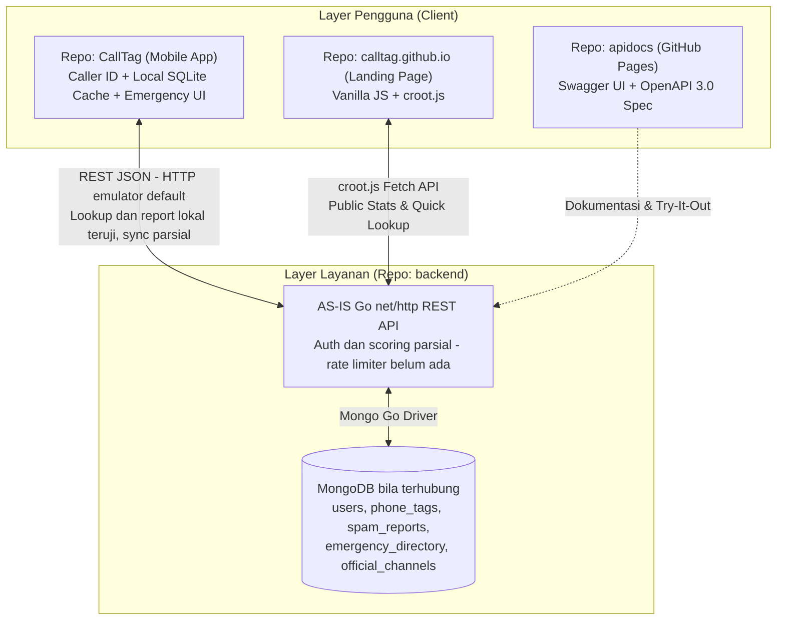
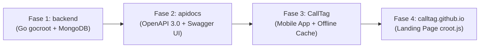
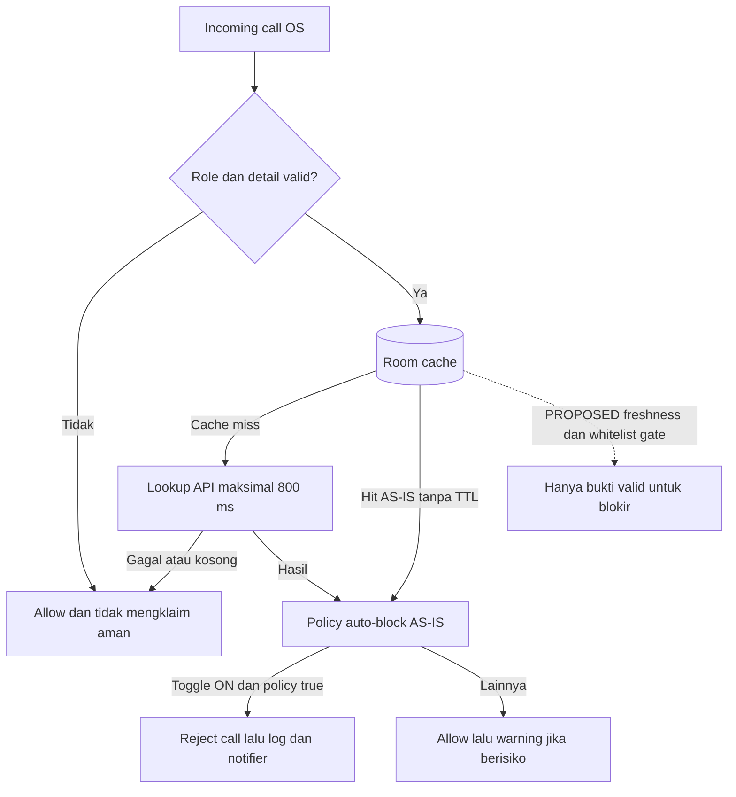
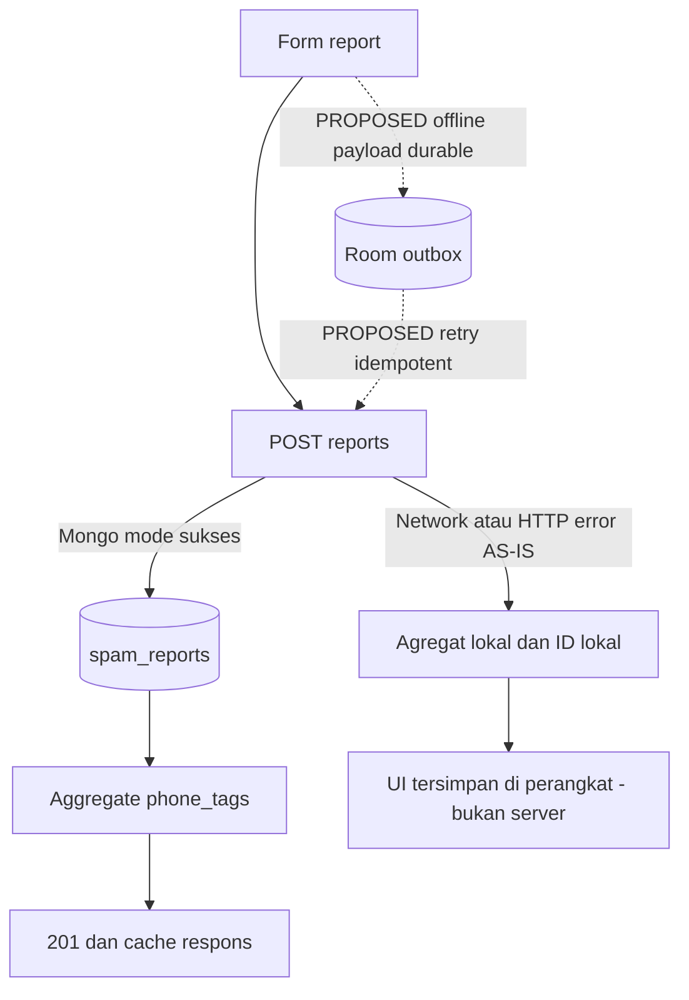

# Product Requirements Document (PRD): Ekosistem CallTag Indonesia

| Metadata Dokumen | Detail |
| :--- | :--- |
| **Nama Produk** | CallTag |
| **Versi Dokumen** | 1.1.0 (Audit integrasi dan penajaman MVP) |
| **Status** | Draft untuk review; PARTIALLY_VERIFIED di lingkungan lokal, belum release-ready |
| **Target Pasar** | Indonesia (Seluruh Provinsi & Kota/Kabupaten) |
| **Cakupan Repositori** | `CallTag` (Mobile App), `backend` (Go `net/http` bergaya `gocroot` + MongoDB), `apidocs` (OpenAPI Vanilla JS), `calltag.github.io` (Landing Page `croot.js`) |
| **Tanggal Pembaruan / Last Updated** | 10 November 2026 (Asia/Jakarta) |
| **Pemilik / reviewer** | Tim CallTag dua pengembang; review silang Android/QA dan Backend/API/Data; keputusan produk akhir oleh pemilik proyek |
| **Basis audit** | Android `42e9ceb`, backend `8676314`, apidocs `1ae8834`, website `c3e071b`; branch dan tanggal lengkap di [baseline audit](docs/AUDIT_REPORT.md) |

### Riwayat versi dan aturan membaca

| Versi | Tanggal | Perubahan dan alasan |
|---|---|---|
| 1.0.0 | 5 November 2026 | Visi, persona, taksonomi, rumus skor, desain data dan kontrak awal. |
| 1.1.0 | 10 November 2026 | Mempertahankan struktur dan visi; menambahkan bukti as-is, koreksi framework/nama koleksi/endpoint, status fitur, acceptance terukur, scope dua orang, model data dan diagram, serta backlog remediasi. |

**As-is** menyatakan hasil pemeriksaan kode/uji pada commit tersebut. **Target MVP / PROPOSED** menyatakan kebutuhan yang belum tentu diimplementasikan. **Post-MVP** ditunda. Persyaratan normatif dalam bagian 4–7 adalah target, bukan daftar fitur selesai. Label status baku dan batas `VERIFIED_E2E` ada pada [AUDIT_REPORT](docs/AUDIT_REPORT.md); [indeks docs](docs/README.md) memuat spesifikasi rinci.

---

## 1. EXECUTIVE SUMMARY & PRODUCT VISION

### 1.1 Latar Belakang Masalah di Indonesia
Masyarakat pengguna telepon seluler di Indonesia menghadapi dua masalah kritis dalam komunikasi harian dan keselamatan darurat:

1. **Eskalasi Kejahatan Siber & Teror Telepon Berpola Lokal:**
   Modus penipuan telepon dan pesan di Indonesia berkembang jauh melampaui telemarketing biasa. Masyarakat diteror oleh intimidasi penagih utang pinjaman online (Pinjol) ilegal, pengiriman file berbahaya berekstensi `.apk` yang menyamar sebagai kurir paket atau undangan pernikahan (APK Sniffing), penyamaran layanan pelanggan (CS) bank/pajak/bea cukai, promosi masif judi online (Judol), hingga rekayasa sosial (hipnotis telepon "keluarga kecelakaan").
2. **Fragmentasi Akses Nomor Darurat Daerah & Kebingungan Pelaporan Resmi:**
   Saat kondisi darurat terjadi (kebakaran, kecelakaan, evakuasi hewan berbisa, atau gangguan medis), banyak warga tidak hafal nomor darurat nasional (`112`, `110`, `113`, `119`). Lebih krusial lagi, di Indonesia, layanan seperti Pemadam Kebakaran (Damkar), Kepolisian Resor/Sektor (Polres/Polsek), dan ambulans RS daerah jauh lebih cepat merespons melalui **nomor telepon lokal atau WhatsApp posko Kota/Kabupaten** dibandingkan jalur sentral. Di sisi lain, korban penipuan siber sering tidak tahu harus melapor ke mana (antara AduanNomor Komdigi, CekRekening/IASC, Satgas PASTI OJK, atau Patroli Siber Polri).

### 1.2 Visi Produk (Product Vision)
Menjadi **perisai komunikasi dan asisten keselamatan darurat nomor satu bagi masyarakat Indonesia** melalui aplikasi seluler yang ringan, mampu mendeteksi ancaman telepon secara *real-time* (baik *online* maupun *offline*), menyediakan akses satu ketukan (*one-tap*) ke layanan darurat nasional maupun posko daerah terdekat, serta menghubungkan warga langsung ke kanal pelaporan resmi negara.

### 1.3 Arsitektur Ekosistem 4 Repositori
Ekosistem CallTag dibagi ke dalam empat repositori terpisah dengan tanggung jawab yang jelas:
1. **`CallTag` (Mobile App):** Aplikasi utama pengguna untuk identifikasi penelepon (*Caller ID*), pemblokiran otomatis (*Spam Guard*), direktori panggilan darurat nasional & lokal berbasis Kota/Kabupaten, pelaporan *crowdsourcing*, serta pusat panduan tindak lanjut resmi.
2. **`backend` (Go + MongoDB):** Satu proses REST API menggunakan `net/http`, router manual bergaya `gocroot`, dan MongoDB driver. `go.mod` baseline tidak memiliki dependency `gocroot`; tidak mengklaim microservice atau middleware framework tersedia. Mengelola reputasi, laporan, direktori dan sync dengan fallback memory saat startup Mongo gagal.
3. **`apidocs` (OpenAPI/Swagger UI):** Dokumentasi kontrak REST API interaktif berbasis Vanilla JS yang di-hosting di GitHub Pages sebagai rujukan tunggal (*Single Source of Truth*) integrasi antara `backend`, `CallTag`, dan `calltag.github.io`.
4. **`calltag.github.io` (Landing Page `croot.js`):** Situs web publik berbasis `croot.js` untuk edukasi produk, pengecekan reputasi nomor singkat via web, statistik ancaman publik, dan tautan unduhan aplikasi.

### 1.4 Current state dan batas rilis

**Verdict: PARTIALLY_VERIFIED.** Lookup Android dan submit laporan dari UI telah diuji melalui API sampai MongoDB lokal, lalu UI/Room dibaca ulang. Ini bukan bukti produksi atau screening telepon nyata. Backend, API docs dan website baru berada di feature branch; main ketiganya masih kerangka. Hasil perintah, fixture, PASS/FAIL/BLOCKED ada pada [rencana dan hasil QA](docs/QA_TEST_PLAN.md).

| Modul | As-is | Status |
|---|---|---|
| Compose empat tab, Room dan Retrofit | Cari, Darurat, Beri #Tag/kanal/koreksi, Proteksi; Nusantara Teal dan mode gelap tersedia | IMPLEMENTED_NOT_E2E_TESTED untuk keseluruhan UI; lookup/report lokal VERIFIED_E2E terbatas |
| Auth perangkat | Method, DTO, JWT dan save-token ada; tidak ada caller onboarding Android; guest atau ID statis dipakai report biasa | PARTIAL |
| Report | Mongo insert+aggregate lokal terbukti; tanpa idempotency/quota/moderasi; offline hanya menaikkan agregat cache, bukan raw outbox | PARTIAL |
| Dispute | Respons backend 201/UNDER_REVIEW tanpa write; Android fallback juga tidak punya antrean | PARTIAL; persistence MISSING |
| Screening/auto-block | Service dan notifier ada; cache-first dengan batas API 800 ms; policy lebih luas daripada DANGER-only, tanpa TTL | IMPLEMENTED_NOT_E2E_TESTED untuk panggilan nyata; safety PARTIAL |
| Offline sync | Manual satu batch 250, cursor MAX bercampur seed/lokal; server risk-sort dapat skip, CLEAN/delete tidak dikirim | PARTIAL |
| Direktori dan hub resmi | Seed+API, dialer/browser/WhatsApp handoff; sumber dan freshness per kontak belum dibuktikan | PARTIAL; seed MOCK_OR_LOCAL_ONLY |
| Moderator/whitelist workflow | Tidak ada route/panel admin atau lifecycle dispute persisten | MISSING |

### 1.5 Scope, asumsi, batasan dan non-goals

**MVP wajib:** satu pilot wilayah dengan kontak terkurasi, lookup dengan status sumber/freshness jujur, report/dispute persisten, auth dan anti-abuse minimum, sync lengkap dengan revocation, screening konservatif opt-in, panel moderator sederhana, serta bukti E2E lokal/staging. Tim dua orang mempertahankan arsitektur satu proses Go, bukan perluasan enterprise.

**Post-MVP:** cakupan seluruh kota, dataset 5.000 nomor otoritatif, pencarian terdekat berbasis GPS, deteksi pesan/APK, analisis anomali lanjutan dan integrasi tiket lembaga. Tidak menganggap target ini sudah tersedia. Tidak ada deadline akademik yang diberikan; milestone relatif pada bagian 7.

Asumsi: data uji sintetis, akses Mongo test sah, URL API ditentukan per environment, satu pemilik data direktori, dan perangkat/role OS tersedia untuk verifikasi telepon. Stakeholder: warga/pemohon, dua pengembang, reviewer akademik, operator moderator, kurator direktori. CallTag bukan penentu hukum pelaku penipuan atau pengganti layanan darurat.

---

## 2. GOALS & SUCCESS METRICS

### 2.1 Tujuan Bisnis & Produk (Product Goals)
1. **Proteksi Proaktif:** Mengidentifikasi dan memberi peringatan sebelum pengguna mengangkat telepon dari nomor yang terindikasi Pinjol ilegal, penipuan APK, CS palsu, atau judi online.
2. **Kecepatan Respons Darurat:** Memangkas waktu pencarian kontak darurat (terutama Damkar dan RS/Polres lokal) menjadi kurang dari 5 detik bahkan saat ponsel tidak memiliki koneksi internet.
3. **Literasi & Tindak Lanjut Hukum:** Mengarahkan korban penipuan ke instansi resmi yang tepat sesuai jenis kejahatan (Komdigi, OJK/IASC, Polri) dalam kurang dari 3 ketukan.
4. **Akurasi Komunitas (*Crowdsourcing*):** Membangun basis data reputasi nomor telepon Indonesia yang tahan terhadap manipulasi laporan palsu (*anti-brigading*).

### 2.2 Indikator Kinerja Utama (KPIs & Success Metrics)

| Kategori Metrik | Indikator (KPI) | Target MVP | Metode Pengukuran |
| :--- | :--- | :--- | :--- |
| **Performa Sistem** | Latensi *Lookup Caller ID* (API P95) | `< 150 ms` | Log metrik respons HTTP `backend` (`gocroot`) |
| **Performa Lokal** | Latensi *Lookup Offline Cache* di HP | `< 20 ms` | Benchmark kueri SQLite/Room lokal di `CallTag` |
| **Ketersediaan** | *Offline Emergency Directory Availability* | `100%` tanpa internet | Pengujian mode pesawat (*Airplane Mode*) |
| **Kualitas Data** | *False Positive Rate* (Nomor bersih dilabeli Scam) | `< 0.5%` | Rasio sanggahan (*dispute*) valid dibagi total nomor berlabel `SPAM`/`DANGER_SCAM` |
| **Keterlibatan Pengguna** | Rasio Konversi Laporan Pasca-Panggilan Asing | `>= 8%` | Jumlah laporan `SpamReports` dibagi total panggilan masuk dari nomor tidak dikenal |
| **Keandalan API** | *Uptime* Layanan `backend` | `>= 99.5%` | Pemantauan *health check* endpoint `/health` |

**Baseline seluruh KPI di atas: belum terukur.** Ini target desain awal, bukan hasil audit. API 150 ms dan cache 20 ms adalah sasaran optimasi yang memerlukan benchmark dataset/perangkat/ukuran beban jelas; latency field aplikasi saat ini hanya pembacaan Room, bukan waktu total API. Respons health 200 tidak membuktikan readiness Mongo. Uptime 99,5% dan konversi 8% menjadi metrik pilot setelah deployment; bukan gate demo akademik. Ukur FPR dengan dataset berlabel dan denominator evaluasi yang diketahui; rasio dispute-valid/flagged hanyalah proxy yang bias, bukan FPR statistik. Direktori 100% berarti kontak pilot yang dibundel tersedia offline, bukan seluruh wilayah Indonesia terlayani.

---

## 3. USER PERSONAS & CORE USER STORIES

### 3.1 User Personas

1. **Rina (28 Tahun, Karyawan Swasta & Pembeli Online Aktif di Jabodetabek)**
   - **Masalah:** Sering menerima telepon dari nomor tidak dikenal; khawatir tidak mengangkat telepon kurir paket asli, namun takut terjebak penipuan modus kurir APK atau telemarketing kartu kredit/pinjol.
   - **Kebutuhan:** Identifikasi layar otomatis (*Caller ID*) yang membedakan nomor kurir/bisnis asli dengan nomor penipu atau Pinjol ilegal.
2. **Pak Hendra (52 Tahun, Kepala Keluarga di Kota Semarang)**
   - **Masalah:** Kurang familier dengan modus penipuan digital terbaru (CS bank palsu, hipnotis telepon) dan bingung mencari nomor WhatsApp Damkar atau ambulans lokal ketika ada kejadian darurat di lingkungan rumah.
   - **Kebutuhan:** Peringatan layar merah yang tegas beserta pemblokiran otomatis untuk nomor berbahaya (`DANGER_SCAM`), serta tombol panggil darurat satu ketukan yang langsung menampilkan Damkar/RS Semarang.
3. **Dito (22 Tahun, Mahasiswa yang Menjadi Korban Penipuan Transfer)**
   - **Masalah:** Baru saja tertipu modus CS E-Wallet palsu; panik dan tidak tahu ke mana harus melapor agar nomor dan rekening pelaku segera dibekukan.
   - **Kebutuhan:** Fitur lapor cepat untuk menandai nomor pelaku di komunitas CallTag sekaligus panduan langkah demi langkah menuju CekRekening.id, IASC, dan AduanNomor.id.

### 3.2 Core User Stories (Prioritas MoSCoW)

Prioritas menggunakan metode **MoSCoW**:
- **M (Must Have):** Wajib ada pada rilis MVP.
- **S (Should Have):** Penting dan diupayakan masuk MVP setelah semua *Must Have* selesai.
- **C (Could Have):** Fitur tambahan bernilai tambah untuk iterasi pasca-MVP.
- **W (Won't Have for MVP):** Ditunda ke rilis fase berikutnya.

| ID | Modul | User Story | Prioritas (MoSCoW) | Repo Terkait |
| :--- | :--- | :--- | :---: | :--- |
| **US-01** | Caller ID & Spam Guard | Sebagai pengguna, saya ingin melihat label kategori dan tingkat bahaya nomor asing saat telepon berdering agar saya tahu apakah panggilan tersebut aman diangkat. | **M** | `CallTag`, `backend` |
| **US-02** | Caller ID & Spam Guard | Sebagai pengguna, saya ingin mengaktifkan blokir otomatis (*Auto-Block*) khusus untuk nomor berstatus `DANGER_SCAM` (Pinjol ilegal, APK Sniffing, Judol) agar saya tidak terganggu. | **M** | `CallTag` |
| **US-03** | Caller ID & Spam Guard | Sebagai pengguna, saya ingin melakukan pencarian manual nomor telepon di kolom pencarian aplikasi atau web untuk memeriksa rekam jejak nomor sebelum menghubungi balik. | **M** | `CallTag`, `backend`, `calltag.github.io` |
| **US-04** | Crowdsourcing Report | Sebagai pengguna, saya ingin melaporkan nomor mencurigakan ke dalam 6 kategori taksonomi khas Indonesia disertai komentar singkat agar pengguna lain terlindungi. | **M** | `CallTag`, `backend` |
| **US-05** | Crowdsourcing Report | Sebagai pemilik nomor yang salah dilaporkan, saya ingin mengajukan sanggahan (*dispute*) agar nomor saya ditinjau ulang dan tidak terblokir permanen secara keliru. | **M** (dinaikkan pada 1.1) | `CallTag`, `backend` |
| **US-06** | Panggilan Darurat | Sebagai warga dalam situasi darurat, saya ingin menekan satu tombol (*One-Tap Direct Dial*) ke nomor darurat nasional (`112`, `110`, `113`, `118`/`119`, `115`, `123`, `14080`) tanpa harus mengetik nomor di keypad. | **M** | `CallTag`, `backend` |
| **US-07** | Panggilan Darurat Lokal | Sebagai warga daerah, saya ingin mencari dan menghubungi nomor telepon atau WhatsApp Damkar, Polres/Polsek, dan RS terdekat berdasarkan Kota/Kabupaten saya, baik untuk kebakaran maupun evakuasi darurat non-kebakaran. | **M** | `CallTag`, `backend` |
| **US-08** | Mode Offline | Sebagai pengguna di area susah sinyal, saya ingin direktori darurat dan daftar *top scammer* tetap berfungsi penuh tanpa koneksi internet. | **M** | `CallTag`, `backend` |
| **US-09** | Official Reporting Hub | Sebagai korban penipuan, saya ingin mendapatkan panduan alur pelaporan dan pintasan langsung ke AduanNomor.id, CekRekening.id/IASC, Satgas PASTI OJK (WA `081157157157`), Patroli Siber Polri, dan LAPOR! sesuai kasus yang saya alami. | **M** | `CallTag`, `backend` |
| **US-10** | Dokumentasi & Web | Sebagai pengembang dan pengunjung publik, saya ingin mengakses dokumentasi OpenAPI interaktif di `apidocs` dan informasi produk serta statistik ancaman di `calltag.github.io`. | **M** | `apidocs`, `calltag.github.io` |
| **US-11** | Proteksi Pesan | Sebagai pengguna, saya ingin mendeteksi tautan berbahaya atau lampiran `.apk` pada notifikasi pesan masuk. | **W** | `CallTag` |

---

## 4. FUNCTIONAL REQUIREMENTS & ACCEPTANCE CRITERIA

### 4.1 Taksonomi Deteksi Spam & Scam Khas Indonesia
**Target MVP dan invariant lintas repo.** Bobot berikut ditemukan pada backend, tetapi deduplikasi 30 hari, batas trust, moderation dan decay berkala belum lengkap. Penilaian gap ada pada [audit kontrak](docs/API_CONTRACT_AUDIT.md).
Seluruh komponen ekosistem (`CallTag`, `backend`, `apidocs`, `calltag.github.io`) WAJIB menggunakan kode kategori terstandarisasi berikut:

| Kode Kategori (`category_code`) | Nama Tampilan (UI) | Bobot Keparahan Dasar ($W_{cat}$) | Contoh Modus di Indonesia |
| :--- | :--- | :---: | :--- |
| `PINJOL_DC` | Pinjol Ilegal & Debt Collector Meresahkan | `1.5` | Teror penagihan pinjol tidak berizin OJK, ancaman sebar data kontak darurat. |
| `APK_SNIFFING` | Penipuan Modus File APK | `2.0` | Kurir paket palsu ("cek foto resi.apk"), undangan nikah digital `.apk`, surat tilang ETLE `.apk`, tagihan PLN/BPJS `.apk`. |
| `IMPERSONATION` | Impersonasi / CS Palsu | `1.8` | Mengaku CS Bank (konfirmasi perubahan tarif transfer), CS E-Wallet, petugas Pajak/DJP (pemadanan NIK-NPWP), tertahan di Bea Cukai. |
| `JUDOL` | Promosi Judi Online (Judol) | `1.3` | Robocall atau pesan suara/WA menawarkan bonus deposit situs slot/judi online. |
| `SOCIAL_ENG` | Penipuan Sosial / Hipnotis Telepon | `1.8` | Modus "anak/keluarga kecelakaan di RS butuh biaya operasi segera", menang undian palsu. |
| `TELEMARKETING` | Telemarketing / Spam Promosi Agresif | `1.0` | Penawaran KTA, asuransi, atau properti berulang kali di luar jam wajar. |

---

### 4.2 Alur 1: Caller ID & Spam Guard

#### Persyaratan Fungsional:
1. Aplikasi `CallTag` menggunakan layanan penyaringan panggilan sistem operasi (misal Android `CallScreeningService`) untuk menangkap nomor panggilan masuk dalam format E.164 ternormalisasi (contoh: `0812...` menjadi `+62812...`).
2. Pemeriksaan dilakukan secara berjenjang:
   - **Langkah 1 (Kontak dan platform):** Hormati pengecualian kontak oleh Android Telecom. Baseline tidak meminta READ_CONTACTS dan tidak mengunggah buku telepon; tidak perlu menambah pengambilan kontak hanya untuk memenuhi langkah desain awal. Uji perilaku OS sesuai SDK/perangkat.
   - **Langkah 2 (Local Cache SQLite):** Periksa tabel `cached_phone_tags` di perangkat (sasaran baca cache `< 20 ms`, belum di-benchmark).
   - **Langkah 3 (Live API Lookup):** Jika perangkat *online* dan data lokal belum ada atau kedaluwarsa (`> 24 jam`), panggil `GET /api/v1/phones/{e164}` dengan batas *timeout* ketat `800 ms`.
3. Berdasarkan status reputasi (`reputation_level`), aplikasi menampilkan *overlay* informasi:
   - `CLEAN`: Tidak menampilkan peringatan bahaya.
   - `SUSPICIOUS` (Skor `15 - 39`): Banner kuning ("Dilaporkan Komunitas: Hati-hati").
   - `SPAM` (Skor `40 - 69`): Banner oranye ("Spam Terdeteksi: [Kategori Dominan]").
   - `DANGER_SCAM` (Skor `>= 70`): Layar peringatan merah penuh ("BAHAYA PENIPUAN: [Kategori Dominan]") + opsi tolak otomatis jika *Spam Guard Auto-Block* aktif.

#### Acceptance Criteria (Gherkin):

```gherkin
Feature: Real-time Caller ID dan Pemblokiran Spam Guard

  Scenario: Panggilan masuk dari nomor berstatus DANGER_SCAM saat perangkat online
    Given pengguna telah mengaktifkan izin Caller ID di aplikasi CallTag
    And pengaturan "Blokir Otomatis Nomor Bahaya (DANGER_SCAM)" berstatus "ON"
    When panggilan masuk diterima dari nomor "+6281299998888" yang tidak ada di kontak pengguna
    And endpoint "/api/v1/phones/+6281299998888" mengembalikan reputation_level "DANGER_SCAM" dengan kategori "APK_SNIFFING"
    Then aplikasi menjawab callback penyaringan dalam batas total kurang dari 5 detik dengan keputusan konservatif
    And saat cache/API/preferensi gagal atau data stale aplikasi mengizinkan panggilan tanpa mengklaim nomor aman
    And aplikasi mencatat riwayat panggilan diblokir dengan label "Penipuan Modus File APK"
    And pengguna menerima notifikasi senyap berisi ringkasan nomor yang diblokir

  Scenario: Panggilan masuk dari nomor scammer teratas saat perangkat offline (Tanpa Internet)
    Given perangkat pengguna berada dalam kondisi tanpa koneksi internet
    And database lokal perangkat menyimpan cache top scammer yang mencakup nomor "+6285711112222" dengan kategori "PINJOL_DC"
    When panggilan masuk diterima dari nomor "+6285711112222"
    Then aplikasi membaca cache lokal dalam waktu kurang dari 20 ms
    And layar menampilkan overlay peringatan merah "Pinjol Ilegal & Debt Collector Meresahkan"
```

---

### 4.3 Alur 2: Sistem Crowdsourcing Report & Algoritma Threshold/Scoring

#### Persyaratan Fungsional & Rumus Skor Bahaya (*Risk Score*):
Untuk mencegah satu laporan langsung menghancurkan reputasi nomor orang lain, `backend` menghitung **Risk Score ($S$)** pada rentang `0 - 100` setiap kali laporan baru masuk ke koleksi `SpamReports`:

$$S = \min\left(100, \sum_{i=1}^{N} \left( B \times W_{cat, i} \times T_{user, i} \times D(\Delta t_i) \right) \right)$$

Dimana:
- $N$: Jumlah laporan unik dari pelapor berbeda (1 akun pengguna hanya dihitung 1 kali per nomor target dalam periode 30 hari).
- $B = 8.0$: Poin dasar per laporan valid.
- $W_{cat, i}$: Bobot keparahan kategori laporan ke-$i$ (lihat Tabel 4.1, rentang `1.0` hingga `2.0`).
- $T_{user, i}$: *Trust Weight* akun pelapor ke-$i$ (rentang `0.2` untuk akun baru belum terverifikasi hingga `1.5` untuk akun terverifikasi dengan riwayat laporan akurat).
- $D(\Delta t_i) = 0.5^{(\Delta t_i / 90)}$: Faktor peluruhan waktu (*Exponential Time Decay*) dengan waktu paruh (*half-life*) **90 hari**, sehingga nomor yang sudah lama tidak aktif menipu atau telah didaur ulang operator seluler dapat pulih secara bertahap.

#### Aturan Ambang Batas (*Threshold*) Pelabelan Status:
1. **`CLEAN` ($S < 15$):** Belum memenuhi ambang reputasi berisiko; **bukan jaminan aman atau verifikasi kepemilikan**. `found=false`, offline cache-miss dan error harus punya availability/source terpisah dari enum reputasi.
2. **`SUSPICIOUS` ($15 \le S < 40$ dan minimal $N \ge 2$ pelapor unik):** Ditandai "Mencurigakan".
3. **`SPAM` ($40 \le S < 70$ dan minimal $N \ge 3$ pelapor unik):** Ditandai "Spam / Gangguan".
4. **`DANGER_SCAM` ($S \ge 70$ dan minimal $N \ge 5$ pelapor unik, ATAU terverifikasi daftar hitam instansi resmi):** Ditandai "Bahaya / Scam" dan masuk ke dalam paket sinkronisasi *Top Scammer Offline Cache*.

**Catatan as-is:** Target `SUSPICIOUS` di atas tetap mensyaratkan minimal 2 pelapor unik. Kode baseline memberi `SUSPICIOUS` mulai 1 pelapor dengan skor ≥ 15; perbedaan ini adalah gap implementasi, bukan perubahan target. Lihat [helper scoring pada baseline](https://github.com/CallTag/backend/blob/8676314/helper/scoring.go#L180).

#### Acceptance Criteria (Gherkin):

```gherkin
Feature: Pelaporan Nomor Crowdsourcing dan Perhitungan Skor Reputasi

  Scenario: Pengguna melaporkan nomor penipu modus CS Bank Palsu
    Given pengguna telah masuk (terautentikasi) di aplikasi CallTag dengan trust_weight 1.0
    When pengguna memasukkan nomor uji "+6281377776666" pada formulir laporan
    And memilih kategori "IMPERSONATION" (Impersonasi / CS Palsu)
    And mengisi catatan "Mengaku CS BCA meminta kode OTP pembatalan limit" lalu menekan tombol "Kirim Laporan"
    Then aplikasi mengirim request POST ke "/api/v1/reports"
    And backend menyimpan dokumen di koleksi "SpamReports" serta memperbarui agregasi di koleksi "PhoneTags"
    And pengguna melihat pesan sukses beserta rekomendasi pintasan menuju "AduanNomor.id" dan "CekRekening.id"

  Scenario: Kenaikan status nomor menjadi DANGER_SCAM setelah mencapai ambang batas
    Given nomor "+6281377776666" telah memiliki 4 laporan unik kategori "APK_SNIFFING" dengan total risk_score 64.0
    When pelapor unik ke-5 dengan trust_weight 1.0 mengirimkan laporan kategori "APK_SNIFFING" (bobot 2.0) untuk nomor tersebut
    Then backend menghitung ulang risk_score menjadi 80.0 dengan unique_reporters sebanyak 5
    And backend mengubah reputation_level nomor "+6281377776666" dari "SPAM" menjadi "DANGER_SCAM"
    And nomor tersebut disertakan dalam endpoint sinkronisasi offline "/api/v1/sync/offline-bundle"
```

---

### 4.4 Alur 3: Panggilan Darurat Nasional & Lokal serta Pusat Panduan Lapor Resmi

**Catatan as-is:** intent aplikasi menggunakan ACTION_DIAL, sehingga membuka dialer dan menunggu pengguna; tidak membuktikan panggilan tersambung. WhatsApp hanya membuka handoff/prefill. Daftar berikut baseline produk yang memerlukan validasi sumber per kontak sebelum pilot; audit tidak menelepon nomor atau memastikan layanan aktif. Lokasi GPS adalah Post-MVP, bukan fitur baseline.

#### A. Spesifikasi Modul Panggilan Darurat Indonesia
1. **Nomor Darurat Nasional (*One-Tap Direct Dial*):**
   Ditampilkan di bagian teratas tab **Darurat** dengan tombol panggil instan yang langsung memicu *intent* telepon (`tel:`):
   - **`112`** : Panggilan Darurat Terpadu Nasional
   - **`110`** : Kepolisian RI
   - **`113`** : Pemadam Kebakaran (Damkar)
   - **`118` / `119`** : Ambulans & Gawat Darurat Kemenkes
   - **`115`** : BASARNAS / Pencarian dan Pertolongan (SAR)
   - **`123`** : PLN (Gangguan Kelistrikan)
   - **`14080`** : Jasa Marga (Darurat Jalan Tol)
2. **Direktori Darurat Lokal Berbasis Lokasi/Kota:**
   - Pengguna dapat memilih **Provinsi** dan **Kota/Kabupaten** (atau menggunakan deteksi lokasi GPS otomatis yang dicocokkan ke poligon/daftar kota lokal).
   - Menampilkan daftar instansi lokal: **Damkar Daerah**, **Polres/Polsek**, dan **Rumah Sakit / IGD Terdekat**.
   - Setiap entri lokal menyediakan:
     * Tombol **Telepon PSTN/Seluler** (`tel:+62...`)
     * Tombol **Chat/Panggilan WhatsApp** (`https://wa.me/62...`) khusus instansi yang mendukung laporan via WA (sangat umum pada posko Damkar Kota/Kabupaten di Indonesia).
     * Tag layanan khusus pada posko Damkar: `Kebakaran`, `Evakuasi Hewan Berbisa/Sarang Tawon`, `Penyelamatan Non-Kebakaran (Cincin/Kunci/Pohon Tumbang)`.

#### B. Spesifikasi Pusat Lapor & Panduan Tindak Lanjut Resmi (*Official Reporting Hub*)
Menyediakan direktori terkurasi beserta panduan persiapan bukti (tangkapan layar bukti chat, mutasi rekening, log panggilan, nomor pelaku) sebelum pengguna diarahkan ke kanal resmi:

| Jenis Kasus yang Dialami Korban | Instansi & Kanal Resmi | Aksi Pintasan di Aplikasi |
| :--- | :--- | :--- |
| **Lapor Nomor Seluler Penipu / Pemblokiran MSISDN** | **AduanNomor.id** (Kementerian Komunikasi dan Digital / Komdigi) | Buka Webview/Browser ke `https://aduannomor.id` + tombol salin nomor pelaku otomatis. |
| **Cek & Lapor Rekening Bank / E-Wallet Penipu** | **CekRekening.id** (Komdigi) & **IASC** (*Indonesia Anti-Scam Centre* - OJK) | Buka `https://cekrekening.id` atau `https://iasc.ojk.go.id` + checklist dokumen bukti mutasi. |
| **Lapor Pinjol Ilegal & Investasi Bodong** | **Satgas PASTI / Kontak OJK 157** | *Deep link* langsung ke WhatsApp Resmi OJK (`https://wa.me/6281157157157`), telepon `157`, atau portal `https://sipasti.ojk.go.id`. |
| **Lapor Tindak Pidana Siber (Penipuan / Pemerasan / Phishing)** | **Patroli Siber Polri** | Buka informasi pelaporan `https://patrolisiber.id` + panduan pembuatan Laporan Polisi (LP) di SPKT Polres terdekat. |
| **Lapor Layanan Publik Umum** | **LAPOR!** (SP4N - Kementerian PANRB) | Buka `https://www.lapor.go.id` untuk pengaduan layanan instansi pemerintah. |

#### Acceptance Criteria (Gherkin):

```gherkin
Feature: Direktori Darurat Nasional, Lokal Kota/Kabupaten, dan Pusat Lapor Resmi

  Scenario: Menghubungi WhatsApp Damkar Kota/Kabupaten untuk evakuasi darurat
    Given pengguna membuka menu "Darurat" di aplikasi CallTag
    When pengguna memilih lokasi "Jawa Barat - Kota Bandung"
    And pengguna memilih filter instansi "Damkar Daerah"
    Then aplikasi menampilkan kartu "Dinas Kebakaran dan Penanggulangan Bencana (Diskar PB) Kota Bandung"
    And kartu tersebut menampilkan nomor darurat lokal, nomor WhatsApp resmi, serta tag layanan "Kebakaran & Evakuasi Non-Kebakaran"
    When pengguna menekan tombol "Hubungi via WhatsApp"
    Then aplikasi membuka WhatsApp menuju nomor resmi posko dengan teks template "Halo Petugas Damkar, saya membutuhkan bantuan darurat di lokasi: ..."

  Scenario: Mengakses nomor darurat nasional dan lokal saat tidak ada sinyal internet
    Given ponsel pengguna tidak terhubung ke internet (Offline)
    When pengguna membuka menu "Darurat"
    Then seluruh 7 nomor darurat nasional (112, 110, 113, 118/119, 115, 123, 14080) tampil seketika dari cache lokal
    And direktori darurat Kota/Kabupaten terakhir yang dipilih pengguna tetap dapat dicari dan dihubungi via panggilan telepon seluler

  Scenario: Panduan tindak lanjut korban Pinjol Ilegal menuju Satgas PASTI / Kontak OJK 157
    Given pengguna membuka menu "Pusat Lapor Resmi"
    When pengguna memilih bantuan "Saya Diteror Pinjol Ilegal / Investasi Bodong"
    Then aplikasi menampilkan daftar bukti yang perlu disiapkan (Nama aplikasi pinjol, nomor telepon penagih, tangkapan layar ancaman)
    And menampilkan tombol pintasan "Chat WhatsApp OJK (081157157157)" serta "Hubungi Kontak OJK 157"
```

---

## 5. CROSS-REPO TECHNICAL ARCHITECTURE & MONGODB DATA MODEL

### 5.1 Diagram Arsitektur Lintas 4 Repositori



Diagram ini overview as-is feature audit. Startup gagal Mongo memilih memory fallback yang tidak durable; dispute tidak ditulis ke Mongo. HTTPS produksi, autentikasi ketat, moderasi dan sync lengkap adalah target. Component/container, DFD0/1 dan deployment yang memisahkan kondisi aktual/usulan ada pada [SYSTEM_ARCHITECTURE](docs/SYSTEM_ARCHITECTURE.md).

---

### 5.2 Skema Koleksi MongoDB di `backend`

Target penyimpanan daring adalah MongoDB; pengujian lokal telah membuktikan operasi lookup/report. Nama logis awal `Users`/`PhoneTags`/`SpamReports`/`EmergencyDirectory`/`OfficialChannels` pada contoh dipetakan ke nama koleksi aktual **`users`/`phone_tags`/`spam_reports`/`emergency_directory`/`official_channels`**. Contoh JSON lama berikut dipertahankan sebagai ilustrasi produk sintetis, bukan dump database atau bukti kelengkapan schema. `ObjectId('...')` di dalam string adalah notasi penjelasan, bukan Extended JSON untuk langsung diimpor. Field aktual, JSON-vs-BSON, required/null, indeks aktual/usulan, ERD logis, Room dan migrasi dijelaskan pada [DATABASE_DESIGN](docs/DATABASE_DESIGN.md). Mongo tidak menegakkan foreign key relasional otomatis.

#### 1. Koleksi `Users`
Menyimpan profil pelapor, reputasi kepercayaan akun (*trust weight*), dan kuota laporan harian untuk pencegahan *spam report*.

```json
{
  "_id": "ObjectId('672a10000000000000000001')",
  "phone_hash": "sha256_9f86d081884c7d659a2feaa0c55ad015a3bf4f1b2b0b822cd15d6c15b0f00a08",
  "device_id_hash": "sha256_device_fingerprint_hash",
  "display_name": "Warga Terverifikasi #4821",
  "role": "USER",
  "trust_weight": 1.0,
  "accuracy_stats": {
    "total_reports": 14,
    "confirmed_reports": 12,
    "disputed_reports": 0
  },
  "daily_report_count": 2,
  "last_report_at": "2026-11-05T11:30:00Z",
  "status": "ACTIVE",
  "created_at": "2026-10-01T08:00:00Z",
  "updated_at": "2026-11-05T11:30:00Z"
}
```
- **Indexes:**
  - `idx_users_phone_hash`: `{ "phone_hash": 1 }` (Unique)
  - `idx_users_device_hash`: `{ "device_id_hash": 1 }`

#### 2. Koleksi `PhoneTags`
Menyimpan hasil agregasi reputasi setiap nomor telepon yang pernah dilaporkan atau diverifikasi. Menjadi target utama kueri *Caller ID* berlatensi rendah.

```json
{
  "_id": "ObjectId('672a20000000000000000002')",
  "phone_e164": "+6281299998888",
  "country_code": "ID",
  "carrier": "Telkomsel",
  "reputation_level": "DANGER_SCAM",
  "risk_score": 84.5,
  "primary_category": "APK_SNIFFING",
  "category_breakdown": {
    "PINJOL_DC": 0,
    "APK_SNIFFING": 9,
    "IMPERSONATION": 2,
    "JUDOL": 0,
    "SOCIAL_ENG": 0,
    "TELEMARKETING": 0
  },
  "top_community_label": "Penipu Kurir Paket File APK",
  "unique_reporters": 11,
  "is_official_blacklisted": false,
  "is_whitelisted_verified": false,
  "sync_version": 1042,
  "first_reported_at": "2026-10-15T04:12:00Z",
  "last_reported_at": "2026-11-05T10:05:00Z",
  "updated_at": "2026-11-05T10:05:00Z"
}
```
- **Indexes:**
  - `idx_phonetags_e164`: `{ "phone_e164": 1 }` (Unique - Kunci utama *Caller ID lookup*)
  - `idx_phonetags_sync`: `{ "reputation_level": 1, "sync_version": 1, "risk_score": -1 }` (Digunakan untuk *offline delta sync*)

#### 3. Koleksi `SpamReports`
Menyimpan log laporan individual dari pengguna serta status peninjauan/sanggahan.

```json
{
  "_id": "ObjectId('672a30000000000000000003')",
  "phone_e164": "+6281299998888",
  "reporter_user_id": "ObjectId('672a10000000000000000001')",
  "category_code": "APK_SNIFFING",
  "custom_tag": "Mengirim WA file Lihat_Foto_Paket.apk",
  "comment": "Mengaku kurir ekspedisi meminta buka file APK karena alamat tidak jelas.",
  "call_type": "WHATSAPP_OR_CELLULAR",
  "reporter_trust_snapshot": 1.0,
  "applied_weight": 2.0,
  "status": "VALIDATED",
  "created_at": "2026-11-05T10:05:00Z"
}
```
- **Indexes:**
  - `idx_reports_dedup`: `{ "phone_e164": 1, "reporter_user_id": 1 }` (**as-is nonunique**, tidak mencegah penyisipan duplikat; gate skor per reporter hanya ada di helper)
  - `idx_reports_phone_created`: `{ "phone_e164": 1, "created_at": -1 }`

#### 4. Koleksi `EmergencyDirectory`
Menyimpan nomor darurat tingkat Nasional (`scope: "NATIONAL"`) maupun tingkat Kota/Kabupaten (`scope: "LOCAL"`).

```json
{
  "_id": "ObjectId('672a40000000000000000004')",
  "code": "ID-JB-BDG-DAMKAR-01",
  "scope": "LOCAL",
  "agency_type": "DAMKAR",
  "name": "Dinas Kebakaran dan Penanggulangan Bencana (Diskar PB) Kota Bandung",
  "province": "Jawa Barat",
  "city_regency": "Kota Bandung",
  "contacts": {
    "short_code": "113",
    "phone_numbers": ["+6222113", "+62227207113"],
    "whatsapp_number": "+62811207113",
    "whatsapp_template": "Halo Petugas Damkar Kota Bandung, saya membutuhkan bantuan darurat di lokasi: "
  },
  "capabilities": [
    "Pemadaman Kebakaran",
    "Evakuasi Hewan Berbisa & Sarang Tawon",
    "Penyelamatan Darurat Non-Kebakaran (Cincin, Pohon Tumbang, Banjir)"
  ],
  "address": "Jl. Sukabumi No.17, Kacapiring, Kec. Batununggal, Kota Bandung",
  "location": {
    "type": "Point",
    "coordinates": [107.6365, -6.9175]
  },
  "is_24_hours": true,
  "verified_at": "2026-11-01T00:00:00Z",
  "sync_version": 12
}
```
- **Indexes:**
  - `idx_emergency_scope_region`: `{ "scope": 1, "province": 1, "city_regency": 1, "agency_type": 1 }`
  - `idx_emergency_geo`: `{ "location": "2dsphere" }` (Untuk pencarian posko terdekat via GPS)

#### 5. Koleksi `OfficialChannels`
Menyimpan daftar kanal pelaporan resmi pemerintah/otoritas beserta panduan persiapan bukti dan tautan langsung.

```json
{
  "_id": "ObjectId('672a50000000000000000005')",
  "channel_slug": "satgas-pasti-ojk",
  "title": "Satgas PASTI & Kontak OJK 157",
  "authority_name": "Otoritas Jasa Keuangan (OJK)",
  "related_categories": ["PINJOL_DC", "IMPERSONATION"],
  "description": "Kanal pengaduan resmi untuk teror Pinjol Ilegal, penyalahgunaan data pribadi oleh penagih utang, dan penipuan investasi bodong.",
  "action_links": {
    "website_url": "https://sipasti.ojk.go.id",
    "phone_dial": "157",
    "whatsapp_url": "https://wa.me/6281157157157",
    "email": "konsumen@ojk.go.id"
  },
  "required_evidence_checklist": [
    "Nama aplikasi atau entitas Pinjol Ilegal",
    "Nomor telepon dan WhatsApp penagih utang (Debt Collector)",
    "Tangkapan layar ancaman atau bukti transfer"
  ],
  "step_by_step_guide": [
    "Simpan bukti tangkapan layar percakapan atau log panggilan dari pelaku.",
    "Hubungi WhatsApp resmi Kontak OJK di 0811-5715-7157 atau telepon 157.",
    "Lampirkan kronologi singkat beserta bukti untuk pemblokiran entitas oleh Satgas PASTI."
  ],
  "display_order": 3,
  "is_active": true,
  "updated_at": "2026-11-01T00:00:00Z"
}
```
- **Indexes:**
  - `idx_official_slug`: `{ "channel_slug": 1 }` (Unique)
  - `idx_official_categories`: `{ "related_categories": 1, "display_order": 1 }`

---

### 5.3 Kontrak Endpoint REST API (`backend`) untuk `apidocs`

Sebelas endpoint berikut ditemukan pada router feature backend dengan `net/http`, bukan middleware framework `gocroot`. Tabel ini **kebijakan target MVP**: kolom auth menyatakan target; as-is report menerima guest atau JWT tidak valid, dispute tanpa auth, sync publik, dan reports lookup publik. Android memiliki 10 metode tanpa health. Skema OpenAPI belum lengkap dan lookup envelope keliru. Lihat [INTEGRATION_MATRIX](docs/INTEGRATION_MATRIX.md) untuk tiap request/response/status/DB dan [API_CONTRACT_AUDIT](docs/API_CONTRACT_AUDIT.md) untuk langkah perbaikan kompatibel.

| Method | Path Endpoint | Auth | Deskripsi Fungsional | Target Pemanggil |
| :---: | :--- | :---: | :--- | :--- |
| `GET` | `/health` | Public | Pemeriksaan status server API dan koneksi MongoDB. | Semua |
| `POST` | `/api/v1/auth/device` | Public | Registrasi perangkat anonim/terverifikasi & penerbitan token JWT. | `CallTag` |
| `GET` | `/api/v1/phones/{e164}` | Bearer / Public Rate-Limited | *Lookup* reputasi nomor telepon (`reputation_level`, `risk_score`, `primary_category`, `top_community_label`). | `CallTag`, `calltag.github.io` |
| `GET` | `/api/v1/phones/{e164}/reports` | Bearer | Mengambil daftar ringkasan komentar laporan komunitas terbaru untuk suatu nomor. | `CallTag` |
| `POST` | `/api/v1/reports` | Bearer | Mengirimkan laporan nomor spam/scam baru (memicu kalkulasi ulang `PhoneTags`). | `CallTag` |
| `POST` | `/api/v1/disputes` | Bearer | Mengajukan sanggahan (*dispute*) apabila nomor milik pengguna salah dilabeli sebagai spam/scam. | `CallTag` |
| `GET` | `/api/v1/emergency/national` | Public | Mengambil daftar 7 nomor darurat nasional Indonesia (`112`, `110`, `113`, `118`/`119`, `115`, `123`, `14080`). | `CallTag`, `calltag.github.io` |
| `GET` | `/api/v1/emergency/local` | Public | Filter `?province=...&city=...&type=...`; lat/lng dan pencarian terdekat Post-MVP, belum didukung. | `CallTag`, `calltag.github.io` |
| `GET` | `/api/v1/official-channels` | Public | Mengambil daftar kanal pelaporan resmi pemerintah (AduanNomor, CekRekening/IASC, OJK 157, Patroli Siber, LAPOR!). | `CallTag`, `calltag.github.io` |
| `GET` | `/api/v1/sync/offline-bundle` | Bearer | Mengunduh *delta sync* nomor darurat dan daftar *Top Scammers* (`DANGER_SCAM`) berdasarkan parameter `?since_version=...` untuk disimpan di cache HP. | `CallTag` |
| `GET` | `/api/v1/stats/public` | Public | Mengambil statistik agregat publik (jumlah nomor scam terdeteksi per kategori) untuk ditampilkan di landing page. | `calltag.github.io` |

---

## 6. EDGE CASES & NON-FUNCTIONAL REQUIREMENTS (NFR)

Bagian 6 adalah **target**, bukan klaim hasil implementasi. Requirement ID, kriteria terukur, dependensi dan status audit ada di bagian 8. Sebagian target awal dipersempit cakupannya secara eksplisit agar layak untuk dua orang.

### 6.1 Mode Offline Wajib (*Offline-First Architecture*)
Mengingat kondisi geografis dan kualitas jaringan seluler yang tidak merata di Indonesia, serta potensi darurat saat listrik/internet padam:
1. **Pre-Packaged Seed Data saat Instalasi:**
   File instalasi aplikasi `CallTag` WAJIB menyertakan database awal (*bundled seed*) yang berisi:
   - Seluruh 7 Nomor Darurat Nasional (`112`, `110`, `113`, `118`/`119`, `115`, `123`, `14080`).
   - Direktori Damkar, Polres dan RS wilayah pilot yang dipilih serta divalidasi kurator. Ekspansi seluruh ibu kota/provinsi Post-MVP.
   - Seed nomor sintetis khusus demo, dipisahkan dari data pengguna dan auto-block. Target awal 5.000 nomor berisiko aktif menjadi Post-MVP setelah ada sumber, hak pemrosesan, provenance dan mekanisme koreksi; APK baseline hanya 6 fixture reputasi, bukan 5.000 nomor otoritatif.
2. **Background Delta Synchronization:**
   Saat perangkat terhubung ke internet (diutamakan Wi-Fi atau paket data hemat), aplikasi memanggil `/api/v1/sync/offline-bundle?since_version={last_version}` maksimal 1 kali sehari. Ukuran payload kompresi Gzip untuk pembaruan harian dibatasi `< 500 KB`.
3. **Zero-Network Graceful Fallback:**
   Apabila panggilan masuk terjadi saat perangkat tidak memiliki sinyal data (atau API tidak merespons dalam `800 ms`), *Caller ID* langsung memutuskan status berdasarkan tabel SQLite lokal tanpa menampilkan pesan *error* yang mengganggu layar panggilan.

### 6.2 Sistem Anti-Abuse & Pencegahan Laporan Palsu (*Anti-Brigading*)
Untuk mencegah persaingan bisnis tidak sehat atau perundungan siber (melaporkan nomor pribadi orang lain secara massal agar diblokir):
1. **Deduplikasi Pelapor & Perangkat:** Satu akun dan satu `device_id_hash` hanya dihitung maksimal **1 kali** untuk nomor target yang sama dalam rentang 30 hari.
2. **Kuota Harian (*Rate Limiting*):** Setiap pengguna biasa dibatasi maksimal **10 laporan per 24 jam** dan maksimal **3 laporan per 5 menit** di tingkat *middleware* `gocroot`.
3. **Syarat Minimum Pelapor Unik (*Multi-Reporter Gate*):** Satu pengguna dengan `trust_weight` tinggi sekalipun tidak pernah bisa mengubah status nomor menjadi `SPAM` atau `DANGER_SCAM` sendirian. Status `DANGER_SCAM` wajib memenuhi dua syarat sekaligus: $S \ge 70$ **DAN** minimal $N \ge 5$ pelapor unik.
4. **Deteksi Anomali Lonjakan (*Velocity Check*):** Jika sebuah nomor yang sebelumnya berstatus `CLEAN` menerima `>= 10` laporan dalam waktu `< 15 menit` dari akun-akun yang baru dibuat (`umur akun < 24 jam`), sistem menahan perubahan status pada level `SUSPICIOUS` dan menandai nomor tersebut dengan flag `UNDER_REVIEW` untuk mencegah serangan *brigading* bot.
5. **Perlindungan Nomor Resmi (*Whitelist Shield*):** Nomor darurat nasional, nomor resmi instansi pemerintah, dan call center resmi perbankan/operator yang ada dalam daftar `is_whitelisted_verified: true` dikunci agar tidak pernah bisa diturunkan statusnya melalui laporan komunitas.
6. **Mekanisme Sanggah (*Dispute Resolution*):** Pemilik nomor dapat membuktikan kepemilikan nomor (melalui verifikasi OTP/WhatsApp Auth) dan mengajukan sanggahan via `POST /api/v1/disputes` untuk membekukan penalti skor sambil ditinjau.

### 6.3 Privasi Data & Kepatuhan Regulasi (UU PDP No. 27 Tahun 2022)
**As-is:** aturan ini target. Endpoint reports masih membalas raw `SpamReport` dengan `reporter_user_id`, snapshot trust dan komentar tanpa filter; jangan mengklaim sanitasi/anonimisasi publik sudah diterapkan. Lihat R11 pada laporan audit. Tidak ditemukan upload buku kontak, tetapi hal itu saja belum membuktikan seluruh tata kelola privasi terpenuhi.
1. **Tanpa Pencurian Buku Telepon (*No Contact Book Harvesting*):** Aplikasi `CallTag` DILARANG mengunggah daftar kontak pribadi dari buku telepon pengguna ke server `backend`. Pemeriksaan apakah penelepon ada di kontak pengguna dilakukan 100% di dalam memori lokal perangkat.
2. **Hashing Identitas Pelapor:** Nomor telepon pelapor disimpan dalam bentuk *salted SHA-256 hash* (`phone_hash`) di koleksi `Users` dan tidak pernah ditampilkan secara publik pada respons API `/api/v1/phones/{e164}/reports`.
3. **Sanitasi Komentar:** Komentar laporan di `SpamReports` difilter secara otomatis untuk menyensor kata kasar ekstrem dan mencegah penyebaran NIK/data pribadi warga di kolom komentar publik.

---

## 7. MVP RELEASE ROADMAP

**Roadmap 1.1 menggantikan asumsi bahwa setiap repo sudah siap setelah dibuat.** Milestone relatif: M0 baseline → M1 autentikasi/persistensi/safety P0 → M2 sync/outbox → M3 moderasi/data akurat → M4 staging/E2E/release → M5 peningkatan fitur. Dua orang bekerja paralel: A backend/API/data, B Android/QA/docs, dengan review silang. Backlog B01–B16 beserta evidence, deliverable, prasyarat, effort S/M/L, acceptance, metode pengujian dan owner ada pada [IMPLEMENTATION_ROADMAP](docs/IMPLEMENTATION_ROADMAP.md). Tidak ada deadline akademik yang diasumsikan.

Diagram dan fase awal berikut dipertahankan sebagai **kelompok pekerjaan target** lintas repository, bukan klaim implementasi selesai atau kewajiban waterfall. Kontrak harus direview bersama sebelum patch konsumen:



### Fase 1: Repositori `backend` (Fondasi API & Database)
- **Fokus:** Menyelesaikan hardening REST API `net/http` bergaya `gocroot` dan MongoDB; migrasi framework bukan syarat MVP.
- **Deliverables:**
  1. Konfigurasi koneksi MongoDB dan pembuatan indeks untuk 5 koleksi (`Users`, `PhoneTags`, `SpamReports`, `EmergencyDirectory`, `OfficialChannels`).
  2. *Seeder* data awal Indonesia: 7 nomor darurat nasional, direktori Damkar/Polres/RS kota-kota utama Indonesia, dan 5 kanal resmi (`OfficialChannels`: AduanNomor.id, CekRekening.id/IASC, Satgas PASTI OJK 157, Patroli Siber Polri, LAPOR!).
  3. Implementasi mesin kalkulasi *Risk Score* ($S$), *time decay*, *rate limiter*, dan perlindungan *anti-brigading*.
  4. Implementasi seluruh 11 endpoint REST API beserta pengujian unit/integrasi.

### Fase 2: Repositori `apidocs` (Standarisasi Kontrak OpenAPI)
- **Fokus:** Mendokumentasikan seluruh endpoint `backend` secara interaktif di GitHub Pages.
- **Deliverables:**
  1. Penyusunan file spesifikasi `openapi.yaml` / `swagger.json` yang mencakup skema request, response, kode error HTTP, dan contoh data khas Indonesia.
  2. Integrasi halaman Swagger UI berbasis Vanilla JS yang ringan dan responsif untuk di-hosting di GitHub Pages.
  3. Validasi kesesuaian 100% antara respons aktual `backend` dan spesifikasi di `apidocs`.

### Fase 3: Repositori `CallTag` (Aplikasi Mobile Inti)
- **Fokus:** Membangun pengalaman pengguna di perangkat seluler dengan dukungan *Offline-First*.
- **Deliverables:**
  1. Modul *Caller ID & Spam Guard* yang terintegrasi dengan layanan penyaringan panggilan sistem operasi.
  2. Penyimpanan lokal (SQLite) yang memuat *seed data* darurat dan sinkronisasi berkala dengan endpoint `/api/v1/sync/offline-bundle`.
  3. Modul **Darurat Indonesia**: *One-Tap Direct Dial* 7 nomor nasional + pencarian direktori Damkar/Polres/RS Kota/Kabupaten (termasuk pintasan WhatsApp posko lokal).
  4. Modul **Lapor Komunitas** (6 taksonomi modus Indonesia) dan **Pusat Panduan Lapor Resmi** (*Official Reporting Hub*).

### Fase 4: Repositori `calltag.github.io` (Landing Page Publik)
- **Fokus:** Membangun portal publik dan alat cek nomor cepat berbasis web menggunakan `croot.js`.
- **Deliverables:**
  1. Halaman utama (*Landing Page*) modular dengan `croot.js` yang menampilkan proposisi nilai CallTag untuk masyarakat Indonesia.
  2. Fitur **Cek Nomor Cepat** dan **Direktori Darurat Web** yang memanggil endpoint publik `backend` (`/api/v1/phones/{e164}`, `/api/v1/emergency/national`, `/api/v1/stats/public`).
  3. Halaman edukasi singkat mengenali 6 modus penipuan telepon di Indonesia serta tautan menuju kanal pelaporan resmi dan unduhan aplikasi `CallTag`.

## 8. REQUIREMENT REGISTER DAN ACCEPTANCE MVP

Bagian 4 mempertahankan cerita dan skenario produk; register ini memberi ID stabil, status, prioritas dan dependensi bagi setiap kelompok kebutuhan tersebut. Detail journey lintas UI/VM/Repository/API/DB ada di [FEATURE_GAP_ANALYSIS](docs/FEATURE_GAP_ANALYSIS.md). P0/P1 adalah Must kecuali dinyatakan lain; P2 Should/Could, P3 Won't untuk MVP. Status as-is tidak menyatakan kebutuhan target telah terpenuhi.

| ID / user story / prioritas | Acceptance terukur target (Given/When/Then) | Dependensi / status as-is |
|---|---|---|
| FR-001 US01 M/P1 onboarding | Given instalasi baru, when role/permission ditolak/dicabut, then UI menyatakan nonaktif dan direktori tetap dapat dipakai tanpa crash; flow grant overlay terpisah | FR-003; PARTIAL |
| FR-002 US03 M/P0 lookup | Given format 08/+62 yang valid, when API/Room tersedia, then nomor identik, sumber dan fetchedAt tampil; input tidak valid ditolak; cache miss atau error tidak menghasilkan klaim aman | NFR-003/FR-008; happy path lokal VERIFIED_E2E, keseluruhan PARTIAL |
| FR-003 US01/02 M/P0 screening | Given role aktif dan opt-in, when fresh authoritative DANGER diterima, then policy dievaluasi dan callback < 5 detik; unknown/stale/whitelist mengizinkan panggilan dan memberi peringatan yang tepat; SPAM saja tidak auto-block | FR-002/008/011; IMPLEMENTED_NOT_E2E_TESTED, policy PARTIAL |
| FR-004 US04 M/P0 report | Given principal sah, when payload valid dikirim, then 201 hanya sesudah persist, ID opaque dapat ditelusuri, retry idempoten; JWT tidak valid menghasilkan 401 dan body tidak valid menghasilkan 400 | FR-007/NFR-001; mobile→Mongo lokal happy path VERIFIED_E2E, safety PARTIAL |
| FR-005 US04/08 M/P1 penulisan offline | Given offline, when submit, then draft mentah/payload persisten bertanda pending; tetap ada setelah restart; reconnect tidak double-post atau menaikkan skor lokal otoritatif | FR-004/008, migrasi Room; MISSING outbox, fallback MOCK_OR_LOCAL_ONLY |
| FR-006 US05 M/P0 dispute | Given pemohon sah, when mengajukan koreksi, then ID record unik persisten dan status dapat dibaca pemilik sesudah restart; error DB tidak mengaku dicatat | FR-007/010; PARTIAL handler, persistence MISSING |
| FR-007 US04 M/P0 identitas | Given instalasi perangkat, when memperoleh credential, then principal server-issued stabil dan tak dapat diganti header; nomor tidak disebut terverifikasi tanpa bukti kepemilikan | NFR-001; PARTIAL, pemanggil Android MISSING |
| FR-008 US08 M/P0 sync | Given dataset > limit dan update/deletion, when semua halaman diproses, then tidak ada versi tertinggal dan cursor transaksional terpisah seed; retry/restart/revocation lulus | FR-004, change log dan migrasi Room; PARTIAL |
| FR-009 US06/07/09 M/P1 direktori+hub | Given instalasi baru dalam kondisi offline, when memilih wilayah pilot, then kontak terkurasi dapat ditemukan ≤ 5 detik pada uji tugas; dialer/WA/browser terbuka atau error yang jelas, bukan klaim sambungan | Kurator sumber/NFR-007; PARTIAL, panggilan nyata BLOCKED |
| FR-010 US05 M/P1 moderator | Given staf berwenang, when meninjau report/dispute, then keputusan, alasan, aktor dan timestamp diaudit dan koreksi menghasilkan sync; pengguna biasa menerima 403 | FR-006/007/008; MISSING |
| FR-011 US01/05 M/P1 whitelist | Given bukti resmi dan masa berlaku yang valid, when whitelist aktif, then tidak diblokir dan override berasal dari server, berlaku sesudah sync; expiry/revocation diaudit | FR-010/008; field server tersedia, workflow MISSING |
| FR-012 US04 M/P0 scoring | Given pelapor valid yang berbeda, when agregasi, then formula B = 8, bobot tabel dan half-life 90 hari konsisten, satu principal tidak memperbanyak kategori/tag/score; uji threshold 14.99/15/40/70 dan N = 1/2/3/5 | FR-004/007/010; PARTIAL |
| FR-013 US10 M/P1 web+docs | Given API live, when lookup/report/stat, then sumber akurat termasuk nilai 0; respons OpenAPI sesuai format wire 11 endpoint; demo tidak mengaku hasil produksi | FR-002/004/008, skema kontrak; PARTIAL |
| FR-014 US01 M/P1 settings/history | Given toggle notifikasi OFF, when panggilan berisiko, then notifier mengikuti preference dan permission; seed/simulation tidak dihitung sebagai panggilan nyata | FR-003/NFR-006; PARTIAL |
| FR-015 US11 W/P3 pesan/APK | Given spesifikasi baru disepakati, when desain fitur pesan dimulai, then review permission/privacy tersendiri; tidak disertakan pada gate MVP saat ini | M1–M4 selesai; SPEC_ONLY |
| FR-016 US07 C/P3 pencarian terdekat berbasis GPS | Given data geo tervalidasi dan consent, when lookup terdekat dibangun, then kontrak lat/lng/indeks geo diuji; tidak diiklankan di MVP | FR-009, dataset geo; SPEC_ONLY |
| FR-017 privasi M/P1 rights | Given pemilik principal sah, when meminta hapus/koreksi data, then akses dibatasi, hasil ditelusuri dan retensi backup dijelaskan; tidak menghapus bukti tanpa kebijakan | FR-007/010/NFR-002; MISSING |

Perbaikan salah label dan persistensi dispute menaikkan prioritas US05 dari Should menjadi Must karena auto-block berdampak pada panggilan penting. Registrasi anonim bukan verifikasi kepemilikan; opsi verifikasi bisnis/OTP lengkap ditunda kecuali diperlukan pilot. Target deduplikasi 30 hari pada bagian 4.3/6.2 harus disepakati sebagai rolling window atau satu kontribusi aktif; keputusan final ada di ADR/backlog sebelum implementasi. Backend as-is hanya melakukan deduplikasi kontribusi skor pertama per identitas tanpa window, memberi SUSPICIOUS untuk 1 pelapor dengan skor ≥ 15, dan menerapkan decay hanya saat penulisan data.

### 8.1 Role, permission dan moderasi

| Aktor | Hak target MVP | Pembatasan |
|---|---|---|
| Publik | Lookup ringkas, direktori, kanal, statistik agregat | Rate limit; tidak melihat identitas pelapor/kontak dispute atau komentar PII mentah |
| Pengguna/principal | Submit report, baca pengajuan sendiri, ajukan dispute | Principal tervalidasi; quota, idempotency dan ownership akses; tidak dapat mengatur trust/role |
| Moderator | Antrean report/dispute, keputusan dengan alasan, koreksi false positive | RBAC internal; least privilege; tindakan diaudit |
| Admin/kurator | Kelola akses staf, sumber kontak, whitelist dengan expiry, tampilan audit | Akses sensitif dibatasi; bukan CRUD semua data tanpa log |

As-is hanya field role USER dan token claims, tanpa enforcement admin/panel. Minimum MVP berupa endpoint internal dan panel sederhana **wajib P1**; login aman dan keamanan dispute mendahului panel. Superadmin, grafik besar dan analitik kompleks P2/P3. Detail keputusan/effort/alternatif [FEATURE_GAP_ANALYSIS](docs/FEATURE_GAP_ANALYSIS.md).

### 8.2 NFR, threat model dan batas privasi

| ID / prioritas | Acceptance terukur target | Dependensi / status |
|---|---|---|
| NFR-001 M/P0 security | Secret produksi kosong → startup gagal; JWT tidak valid menghasilkan 401, hak akses tidak mencukupi menghasilkan 403, kuota terlampaui menghasilkan 429; replay idempoten; ukuran body/field dibatasi; origin CORS terdaftar; tidak ada token/nomor utuh di log | B01/B05/B07; PARTIAL |
| NFR-002 M/P1 privacy | PII tidak direspons publik; tujuan persetujuan dan retensi terbit; delete/export diuji principal; enkripsi HTTPS dan akses penyimpanan minimum; buku kontak tidak diunggah | FR-017; PARTIAL, deletion MISSING |
| NFR-003 M/P0 resilience | Callback Telecom total < 5 detik atau allow; API 800 ms bukan deadline total; timeout/cache miss/stale tidak menghasilkan klaim aman palsu; cancellation tidak menghilangkan respons | FR-003; PARTIAL |
| NFR-004 M/P1 durability | Report/dispute yang diterima tetap ada setelah restart; insert/aggregate/journal recovery konsisten; upgrade Room mempertahankan data pending; uji restore DB berhasil | B03/B05/B10/B14; PARTIAL |
| NFR-005 S/P2 performance | Laporkan p50/p95 pada device/dataset/beban bernama; cache 20 ms/API 150 ms target awal, bukan hasil; jangan pakai latensi pembacaan lokal sebagai waktu API keseluruhan | Fixture benchmark; belum terukur |
| NFR-006 M/P1 accessibility | Target sentuh utama 56 dp/darurat 64 dp sesuai DESIGN; TalkBack memberi label; font 130%/mode terang-gelap/izin ditolak tidak menutup aksi utama | FR-001/009/014; PARTIAL |
| NFR-007 M/P1 provenance | Seluruh kontak pilot mempunyai source URL/reviewer/verifiedAt nyata; fixture terisolasi dan setiap render menampilkan sumber/freshness yang benar | FR-009/011; PARTIAL |
| NFR-008 M/P1 maintainability | Pemeriksaan Go/kontrak, kompilasi Android dan jalur kegagalan UI di CI; correlation ID dan kelas error tanpa PII; migrasi berversi; operator dapat mendeteksi kegagalan sync | B08/B14; PARTIAL |
| NFR-009 M/P1 release | BASE_API_URL HTTPS eksplisit, signing release benar, tidak otomatis memublikasikan perubahan dokumentasi saja tanpa keputusan; target SDK sesuai kanal distribusi dan kebijakan saat rilis | Staging/keystore sah; BLOCKED produksi |

Ancaman utama: penyerang Sybil mengganti identitas, pelapor memfitnah melalui label/komentar, pencurian credential, server tidak tersedia atau data kedaluwarsa, dan staf yang menyalahgunakan hak. Aset: reputasi nomor, kontak darurat, identitas pseudonim, token, log panggilan dan bukti pemohon. Owner A menangani auth/data/rate-limit/audit; owner B menangani kejujuran tampilan/cache/policy/permission. Risiko tersisa, mitigasi minimum dan mitigasi jangka panjang terdaftar di [register risiko](docs/AUDIT_REPORT.md#register-risiko-dan-penanganan).

UU 27/2022 dirujuk sebagai konteks hak dan pemrosesan pada [JDIH BPK](https://peraturan.bpk.go.id/Details/229798/uu-no-27-tahun-2022); tidak menyatakan identitas yang di-hash otomatis anonim atau aplikasi sudah patuh. Angka retensi definitif perlu disepakati pemilik proyek; contoh log lokal bergulir 30 hari pada desain database adalah usulan, bukan kewajiban hukum atau konfigurasi aktif. Durasi penyimpanan laporan, sengketa, jurnal dan backup masih menjadi keputusan produk yang harus selaras dengan kebutuhan koreksi dan penghapusan.

### 8.3 Diagram inti tambahan



AS-IS policy masih dapat memblokir SPAM/kategori berisiko dan cache tidak TTL; diagram menunjukkan lokasi perbaikan, bukan klaim target konservatif sudah aktif. Panggilan nyata belum diuji. Batas total callback Android 5 detik mengikuti [referensi Android](https://developer.android.com/reference/android/telecom/CallScreeningService).



Outbox dan replay adalah target belum ada. Insert dan agregasi Mongo belum atomik; 500 dapat terjadi setelah insert. UI sudah membedakan ID laporan lokal, tetapi record komentar offline belum persisten. Sequence, ERD, use case, moderation/state, onboarding, lookup, sync, directory, DFD dan deployment lengkap pada [FLOWS_AND_DIAGRAMS](docs/FLOWS_AND_DIAGRAMS.md), [DATABASE_DESIGN](docs/DATABASE_DESIGN.md), [SYSTEM_ARCHITECTURE](docs/SYSTEM_ARCHITECTURE.md).

### 8.4 Test, traceability dan release gate

FR-002/004 happy path lokal memiliki bukti runtime, bukan semua acceptance. Seluruh ID FR/NFR dipetakan ke endpoint/test case dan PASS/FAIL/BLOCKED di [QA_TEST_PLAN](docs/QA_TEST_PLAN.md). Gate MVP: P0 tertutup, Must P1 diterima, kontrak wire sinkron, outage/offline/restart/retry/revocation diuji, moderasi false positive berfungsi, data fixture terisolasi, sumber kontak diverifikasi, konfigurasi release dan backup/restore ditinjau. Dokumen lengkap bukan aplikasi selesai.

## 9. KEPUTUSAN TERBUKA DAN REFERENSI

1. Principal anonymous-server-issued vs nomor terverifikasi untuk pilot; mekanisme bukti dan trust.
2. Wilayah pilot dan kurator sumber kontak, kebijakan publikasi nomor/komentar, retensi/penghapusan.
3. Deduplikasi rolling 30 hari vs kontribusi aktif, moderation gate dan default auto-block opt-in.
4. Kanal distribusi sideload akademik vs Google Play, URL staging/release dan signing. Target SDK 34 as-is belum memenuhi submission Play umum per [kebijakan resmi diakses 10 November 2026](https://support.google.com/googleplay/android-developer/answer/11926878?hl=en), yang mensyaratkan API 36 untuk aplikasi/update baru sejak 31 Agustus 2026.
5. Mongo production/backup dan perangkat uji/operator belum tersedia untuk verifikasi penuh. Domain API pada OpenAPI belum dapat di-resolve dari host audit; bukan bukti tidak akan ada deployment.

Keputusan/konsekuensi dan alternatif tercatat di [ARCHITECTURE_DECISIONS](docs/ARCHITECTURE_DECISIONS.md). [DESIGN.md](DESIGN.md) tetap sumber visual Nusantara Teal, warna semantik dan ukuran target sentuh; palet CLEAN/verified yang sama tidak membuktikan verifikasi. [AGENTS.md](AGENTS.md) tetap pedoman engineering: tidak menambahkan test Android khayalan, tidak mengubah enum/warna ad hoc atau menghapus fallback diam-diam. Audit mengusulkan koreksi semantik/policy melalui patch terpisah, bukan menimpa panduan tersebut.
