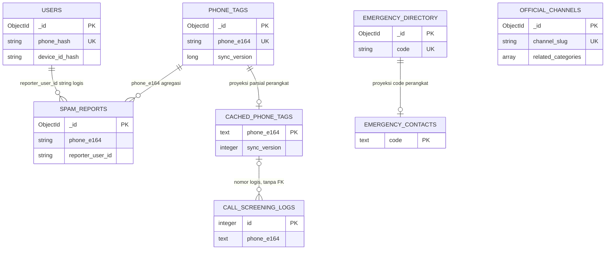

# Desain basis data CallTag

Dokumen ini memisahkan **aktual** dari **usulan yang belum diimplementasikan**. Baseline audit 10 November 2026: Android `42e9ceb`, backend `8676314`. Tautan backend dipatok ke commit `8676314` pada repositori GitHub terpisah; tautan Android tetap relatif terhadap repositori ini. Dokumen tidak membuat collection, index, migrasi, atau perubahan runtime.

## Bukti dan batas verifikasi

Sumber aktual: [model Go](https://github.com/CallTag/backend/blob/8676314/model/model.go), [akses Mongo dan index](https://github.com/CallTag/backend/blob/8676314/config/db.go), [konfigurasi collection](https://github.com/CallTag/backend/blob/8676314/config/config.go), [Room](../app/src/main/java/id/calltag/app/data/local/CallTagDatabase.kt), dan tiga entity Android. Koordinator memverifikasi `go test ./...` dan `go vet ./...` lulus serta MongoDB 8.3.9 disposable di port lokal 28018, database `calltag_audit`: seed 23 emergency, 5 official channel, 6 phone tags. Dua submit dari pelapor sama menghasilkan dua laporan persisten/readback, satu reporter unik dan skor 16/SUSPICIOUS; index dedup terbukti nonunique. POST dispute tidak membuat collection/dokumen sengketa. Keberhasilan suite endpoint belum membuktikan invariant persistence, auth, sync atau concurrency.

Data Mongo adalah sumber laporan/agregat daring saat koneksi aktif. Room adalah cache perangkat dan riwayat screening lokal. DataStore menyimpan preferensi/kredensial aplikasi; bukan tabel Room. Belum ada outbox laporan/sengketa, tabel kanal resmi, atau metadata checkpoint sync khusus di Room.

## Model logis aktual



Garis adalah hubungan logis lintas dokumen/perangkat, bukan FK atau jaminan satu perangkat. Banyak perangkat dapat menyimpan proyeksi nomor yang sama. `reporter_user_id` adalah string, dapat berupa hex `_id` user, guest atau seed; tidak ada referential constraint Mongo. `phone_tags` dapat ada tanpa laporan karena seed. Nomor laporan juga bisa ada tanpa agregat jika tahap write agregat gagal.

## Aturan tipe, hadir, dan null

Mongo saat ini tidak dipasangi `$jsonSchema` validator oleh aplikasi. Tabel berikut mendeskripsikan serialization Go, **bukan validasi database**. Field tanpa `omitempty` ditulis walau zero value; struct nonpointer tidak menyatakan input wajib. Go string/int/bool default `""`/0/false; field absen pada decode dapat menjadi zero value. BSON array/map nil dapat menjadi `null`; JSON nil slice juga dapat menjadi `null`. `omitempty` dapat menghilangkan field zero; timestamp Go zero bukan tanggal bisnis yang valid. Tidak ada kebijakan null global yang ditegakkan Mongo. Ukuran `int` BSON mengikuti representasi driver/nilai; `int64` dipakai eksplisit untuk sync. API JSON timestamp `time.Time` berbentuk RFC3339, sedangkan BSON menyimpan Date, bukan string.

Enum logis kategori: `PINJOL_DC`, `APK_SNIFFING`, `IMPERSONATION`, `JUDOL`, `SOCIAL_ENG`, `TELEMARKETING`. Enum reputasi: `CLEAN`, `SUSPICIOUS`, `SPAM`, `DANGER_SCAM`. Keduanya string pada storage; Mongo belum menolak nilai di luar enum. `UNKNOWN` bukan anggota enum reputasi; ketiadaan hasil/ketidaktersediaan harus diwakili state terpisah (lihat [ADR](ARCHITECTURE_DECISIONS.md)).

## Lima collection Mongo aktual

### `users`

Sumber: [User](https://github.com/CallTag/backend/blob/8676314/model/model.go#L41), [FindOrCreateUser](https://github.com/CallTag/backend/blob/8676314/config/db.go#L219).

| Field BSON | Tipe Go / BSON | Kehadiran writer dan makna |
|---|---|---|
| `_id` | ObjectID / ObjectId | `omitempty`; service membuat ID saat user baru |
| `phone_hash`, `device_id_hash` | string / string | Selalu ditulis; pseudonim deterministik, bukan verifikasi kepemilikan |
| `display_name`, `role`, `status` | string / string | Selalu; user baru role USER, status ACTIVE |
| `trust_weight` | float64 / double | Selalu; default bisnis 1,0 |
| `accuracy_stats` | struct / object | Embedded `total_reports`, `confirmed_reports`, `disputed_reports`: int |
| `daily_report_count` | int / integer | Selalu, tetapi submit belum memperbaruinya |
| `last_report_at` | time.Time / date | `omitempty`, zero dapat absen; submit belum memperbaruinya |
| `created_at`, `updated_at` | time.Time / date | Selalu ditulis |

`phone_e164` pada struct hanya JSON (`bson:"-"`); model pengguna tidak menyimpan nomor raw. Auth response menambahkannya setelah read. `phone_hash` dan `device_id_hash` masih dikirim dalam JSON user. Salt hash dan JWT key memiliki fallback literal di source; nilainya sengaja tidak disalin. Runtime produksi harus mensyaratkan konfigurasi rahasia kuat; perubahan hash key memerlukan migrasi.

### `phone_tags`

Sumber: [PhoneTag](https://github.com/CallTag/backend/blob/8676314/model/model.go#L71), [CreateReportAndAggregate](https://github.com/CallTag/backend/blob/8676314/config/db.go#L344).

| Field BSON | Tipe / semantik aktual |
|---|---|
| `_id` | ObjectId, `omitempty`; Mongo upsert membuat ID namun nilai itu belum diambil untuk respons nomor baru |
| `phone_e164`, `country_code`, `carrier` | string, selalu; normalizer belum memvalidasi E.164 ketat |
| `reputation_level` | string; empat level logis |
| `risk_score` | double; materialized score, dihitung saat submit |
| `primary_category`, `primary_category_label`, `top_community_label` | string, selalu |
| `is_danger`, `is_official_blacklisted`, `is_whitelisted_verified` | bool, selalu |
| `tags` | array `{tag:string,count:int}` atau null bila nil |
| `category_breakdown` | object kategori → int, atau null bila nil |
| `unique_reporters`, `total_reports` | int; dedup hanya kontribusi skor, bukan seluruh vote |
| `sync_version` | int64; Mongo memakai Unix seconds, memory memakai counter proses |
| `first_reported_at`, `last_reported_at` | date, `omitempty` |
| `updated_at` | date, selalu |

`spam_score` adalah alias JSON (`bson:"-"`), bukan kolom BSON kedua. Agregat adalah proyeksi denormalisasi untuk lookup cepat; authoritative reports belum konsisten dengan angka baseline seed. Mongo seed hanya membuat phone_tags, sedangkan memory membuat satu laporan sintetis per tag. Reagregasi pertama dapat menghilangkan baseline count/skor yang tidak mempunyai history. Score decay 90 hari dihitung saat write; belum ada job periodik untuk menurunkan angka tanpa laporan baru.

### `spam_reports`

Sumber: [SpamReport](https://github.com/CallTag/backend/blob/8676314/model/model.go#L96), [SubmitReport](https://github.com/CallTag/backend/blob/8676314/controller/report.go#L15).

| Field BSON | Tipe / semantik aktual |
|---|---|
| `_id` | ObjectId dibuat service, `omitempty` |
| `phone_e164`, `reporter_user_id` | string, selalu; reporter bukan ObjectId typed |
| `category_code`, `custom_tag`, `comment`, `call_type` | string, selalu; panjang/enum call_type belum dibatasi |
| `reporter_trust_snapshot`, `applied_weight` | double; agregator memakai taxonomy terkini alih-alih applied_weight |
| `status` | string, service langsung menetapkan VALIDATED |
| `created_at` | date, service menetapkan waktu UTC |

`tag_name` adalah alias JSON (`bson:"-"`). `report_id` respons saat ini adalah gabungan nomor/uid, **bukan** `_id` Mongo dan tidak disimpan sebagai field. Laporan dikirim by value sehingga ID baru dalam config tidak dikembalikan ke controller. Dua laporan user/nomor sama memiliki `_id` berbeda tetapi `report_id` respons sama. Insert laporan dan update agregat bukan transaction; retry setelah 500 dapat menggandakan laporan.

### `emergency_directory`

Sumber: [EmergencyDirectory](https://github.com/CallTag/backend/blob/8676314/model/model.go#L126).

| Field BSON | Tipe / kehadiran writer |
|---|---|
| `_id` | ObjectId, `omitempty` |
| `code`, `scope`, `agency_type`, `name` | string, selalu; scope NATIONAL/LOCAL logis |
| `province`, `city_regency`, `address` | string, `omitempty`; absen atau string, tidak dibutuhkan null |
| `contacts` | Embedded object; `phone_numbers:[]string`, optional `short_code`, `whatsapp_number`, `whatsapp_template` dengan `omitempty` |
| `capabilities` | array string; nil bisa null |
| `location` | pointer GeoPoint, `omitempty`; object `{type:string,coordinates:[]float64}` bila ada, koordinat [longitude,latitude] |
| `is_24_hours` | bool, selalu |
| `verified_at` | date; seed kosong diganti waktu load, belum bukti verifikasi kontak |
| `sync_version` | int64 |

Kontak/keterangan/lokasi di-embed karena dibaca bersama satu instansi dan ukurannya kecil. Tidak ada query nearest/2dsphere index saat ini; filter direktori Mongo mengambil seluruh dokumen lalu memfilter di Go.

### `official_channels`

Sumber: [OfficialChannel](https://github.com/CallTag/backend/blob/8676314/model/model.go#L152).

| Field BSON | Tipe / kehadiran writer |
|---|---|
| `_id` | ObjectId, `omitempty` |
| `channel_slug`, `title`, `authority_name`, `description` | string, selalu |
| `related_categories` | array category string; nil bisa null |
| `action_links` | Embedded object: `website_url:string`; `phone_dial`, `whatsapp_url`, `email` optional `omitempty` |
| `required_evidence_checklist`, `step_by_step_guide` | array string, nil bisa null |
| `display_order` | int |
| `is_active` | bool |
| `updated_at` | date; loader seed mengisinya saat load |

Panduan dan link di-embed karena satu kanal dikelola/dibaca bersama. Kategori menjadi kode bersama, bukan collection lookup terpisah. Relationship kanal ke laporan tidak disimpan; rekomendasi dihitung berdasarkan kategori.

## Index aktual dan usulan

Index `_id_` bawaan Mongo tidak diulang pada tabel. [EnsureIndexesAndSeed](https://github.com/CallTag/backend/blob/8676314/config/db.go#L118) mengabaikan error CreateMany/InsertOne dan selalu return nil; daftar ini menyatakan **yang dicoba source**, bukan jaminan semua deployment memilikinya. Pemeriksaan Mongo disposable mengonfirmasi dedup nonunique.

| Collection | Nama | Keys berurutan | Unique aktual |
|---|---|---|---|
| users | idx_users_phone_hash | phone_hash:1 | ya |
| users | idx_users_device_hash | device_id_hash:1 | tidak |
| phone_tags | idx_phonetags_e164 | phone_e164:1 | ya |
| phone_tags | idx_phonetags_sync | reputation_level:1,sync_version:1,risk_score:-1 | tidak |
| spam_reports | idx_reports_dedup | phone_e164:1,reporter_user_id:1 | **tidak** |
| spam_reports | idx_reports_phone_created | phone_e164:1,created_at:-1 | tidak |
| emergency_directory | idx_emergency_code | code:1 | ya |
| emergency_directory | idx_emergency_scope_region | scope:1,province:1,city_regency:1,agency_type:1 | tidak |
| official_channels | idx_official_slug | channel_slug:1 | ya |

**Usulan, belum diterapkan:** dedup policy satu kontribusi aktif per `(phone_e164,reporter_user_id)` dengan unique/partial unique sesuai status, dan idempotency key unik per principal/request. Riwayat koreksi tetap dicatat. Jangan mengubah index existing menjadi unique sebelum menangani duplikat lama. Tambahkan tie-break `_id:-1` pada pagination laporan. Kanal dapat memakai `(is_active,display_order,_id)`; index lokasi hanya jika nearest query dibangun. Query sync perlu berubah dulu; index yang ada tidak memperbaiki cursor tidak aman.

## Room aktual: SQLite `calltag_offline.db`, version 1

[CallTagDatabase](../app/src/main/java/id/calltag/app/data/local/CallTagDatabase.kt) memakai `version=1`, `exportSchema=false`, `fallbackToDestructiveMigration()`. Ketiga entity tidak memiliki nullable Kotlin property: semua kolom `NOT NULL`. String → SQLite TEXT; Double → REAL; Long/Int/Boolean → INTEGER (Boolean 0/1). Default Kotlin bukan deklarasi DEFAULT SQL. Tidak ada FK Room.

### `cached_phone_tags`

Sumber: [CachedPhoneTag](../app/src/main/java/id/calltag/app/data/local/entity/CachedPhoneTag.kt).

| Kolom | Kotlin → SQLite | Constraint/default aplikasi |
|---|---|---|
| phone_e164 | String → TEXT | PK |
| carrier, reputation_level | String → TEXT | tanpa default |
| spam_score | Double → REAL | alias risk_score DTO |
| is_danger | Boolean → INTEGER | tanpa default |
| primary_category, primary_category_label, top_community_label, tags_summary | String → TEXT | ringkasan lossy, bukan history server |
| unique_reporters | Int → INTEGER | sync mapper saat ini mengisi konstanta 5 |
| sync_version | Long → INTEGER | versi item, bukan checkpoint tersendiri |
| cached_at_epoch_ms | Long → INTEGER | default waktu perangkat saat entity dibuat |

Index nonunique `(reputation_level,spam_score)` dan `(sync_version)`, plus PK. DAO REPLACE upsert; versi sync dihitung `MAX(sync_version)` seluruh cache, sehingga lookup satu nomor baru dapat memajukan cursor global tanpa membuktikan halaman delta lengkap. Cache tidak memiliki expiry/source/verified_at per item.

### `emergency_contacts`

Sumber: [EmergencyContact](../app/src/main/java/id/calltag/app/data/local/entity/EmergencyContact.kt).

| Kolom | Kotlin → SQLite | Constraint/default aplikasi |
|---|---|---|
| code | String → TEXT | PK |
| scope, agency_type, name | String → TEXT | tanpa default |
| province, city_regency, short_code | String → TEXT | default `""` |
| primary_phone | String → TEXT | tanpa default |
| secondary_phone, whatsapp_number, whatsapp_template | String → TEXT | default `""` |
| capabilities_summary, address | String → TEXT | default `""` |
| is_24_hours | Boolean → INTEGER | default true |

Index nonunique `(scope,province,city_regency)` dan `(agency_type)`, plus PK. Proyeksi hanya dua nomor, ringkasan capabilities; tidak menyimpan GeoJSON, verified_at atau sync_version direktori. Filter LIKE substring/case folding tidak dijamin mendapat semua manfaat index region.

### `call_screening_logs`

Sumber: [CallScreeningLog](../app/src/main/java/id/calltag/app/data/local/entity/CallScreeningLog.kt).

| Kolom | Kotlin → SQLite | Constraint/default aplikasi |
|---|---|---|
| id | Long → INTEGER | PK autoGenerate, default Kotlin 0 meminta ID baru |
| phone_e164, tag_label, category_code, reputation_level | String → TEXT | tanpa default |
| spam_score | Double → REAL | snapshot hasil screening |
| was_blocked | Boolean → INTEGER | keputusan saat kejadian |
| detection_source | String → TEXT | LOCAL_CACHE/LIVE_API logis |
| screened_at_epoch_ms | Long → INTEGER | waktu perangkat saat entity dibuat |

Hanya PK; belum ada index waktu untuk `ORDER BY screened_at_epoch_ms DESC LIMIT`. Log adalah snapshot independen agar riwayat tetap bermakna ketika cache diganti/dihapus. Seed juga mengisi log contoh jika kosong; jangan menganggap seluruh log sebagai aktivitas nyata pengguna tanpa provenance.

## Usulan persistence sengketa dan moderasi minimal

Seluruh bagian ini **belum diimplementasikan**. POST `/api/v1/disputes` sekarang hanya respons 201/UNDER_REVIEW tanpa write, reason/contact tidak dipersist, ID turunan nomor berulang. Tidak ada collection admin, endpoint review, atau audit log aktual.

| Collection usulan | Field inti dan tipe | Index/aturan usulan |
|---|---|---|
| disputes | `_id:ObjectId`, `phone_e164:string`, `submitted_by:string`, `owner_name:string`, `reason:string`, `contact_ref:string?` privat, `ownership_status:string`, `status:string`, `created_at/updated_at:date`, `reviewed_by:string?`, `resolution:string?`, `resolved_at:date?`, `report_ids:[ObjectId]` opsional | `(phone_e164,created_at:-1)`, `(status,created_at:1)`; idempotency key unik terpisah; partial unique satu open per pengaju/nomor hanya bila policy disetujui |
| moderation_audit_logs | `_id:ObjectId`, `actor_id:string`, `action:string`, `target_type:string`, `target_id:string`, `reason:string`, `before/after:object` teredaksi, `created_at:date`, `request_id:string` | `(target_type,target_id,created_at)`, `(actor_id,created_at)`; append-only di izin aplikasi |

Referensi ke user/report dipilih karena lifecycle dan volume independen. Review event bertambah tanpa batas sehingga tidak di-embed sebagai array tak terbatas dalam phone_tags. Tidak perlu collection admin khusus untuk dua operator awal: identitas admin terverifikasi + role/allowlist server-side dapat merujuk users; akses harus menolak guest dan memeriksa status, bukan hanya klaim JWT. Role change/override dicatat; policy empat mata dipakai untuk whitelist/blacklist dan keputusan berisiko. See [ADR admin](ARCHITECTURE_DECISIONS.md#adr-009--moderasi-minimal-untuk-dua-operator-usulan).

Usulan validator mewajibkan ID/nomor/principal/status/timestamps sesuai collection, tipe BSON, enum, ASCII E.164 maksimal 15 digit untuk nomor biasa, allowlist short code terpisah, panjang text, trust bounded dan risk 0–100. Optional field absen punya arti jelas; null hanya jika schema memang membolehkannya. Nilai default Go tidak dianggap memenuhi validasi bisnis. Enforcement harus konsisten di handler dan validator; aturan ownership/moderasi tidak dapat digantikan validator.

## Contoh dokumen sintetis

Contoh berikut adalah Extended JSON Mongo untuk **skema aktual laporan**; nomor test sengaja tidak ditujukan untuk dihubungi, bukan data pengguna. Tidak memuat token, salt, connection string atau kontak pribadi.

```json
{
  "_id": {"$oid": "000000000000000000000101"},
  "phone_e164": "+6200000000101",
  "reporter_user_id": "000000000000000000000001",
  "category_code": "APK_SNIFFING",
  "custom_tag": "Contoh uji internal",
  "comment": "Data sintetis, bukan tuduhan atas nomor nyata.",
  "call_type": "CELLULAR_CALL",
  "reporter_trust_snapshot": 1.0,
  "applied_weight": 2.0,
  "status": "VALIDATED",
  "created_at": {"$date": "2026-11-10T00:00:00Z"}
}
```

Contoh **usulan** sengketa, tidak menandakan endpoint sekarang menyimpannya:

```json
{
  "_id": {"$oid": "000000000000000000000201"},
  "phone_e164": "+6200000000101",
  "submitted_by": "000000000000000000000001",
  "owner_name": "Organisasi Uji",
  "reason": "Permohonan pemeriksaan data sintetis",
  "contact_ref": "audit@example.invalid",
  "ownership_status": "UNVERIFIED",
  "status": "UNDER_REVIEW",
  "created_at": {"$date": "2026-11-10T00:00:00Z"},
  "updated_at": {"$date": "2026-11-10T00:00:00Z"},
  "report_ids": [{"$oid": "000000000000000000000101"}]
}
```

## Konsistensi, sync, retensi dan migrasi yang diusulkan

**Belum diimplementasikan.** Accepted report, quota/dedup, agregat dan jurnal sync harus memiliki atomicity/idempotency yang jelas: transaction dengan retry pada replica set, atau event log + worker per nomor/revision CAS + reconciliation. Saat ini read-all/recompute/update dapat ditimpa writer stale dan insert berhasil dapat diikuti 500.

Untuk delta, usulkan `sync_changes` dengan sequence global durable unik, generation, operation UPSERT/DELETE, phone, revision/payload dan created_at; `sync_counters` atau mekanisme urutan setara. Sort sequence ascending, cursor halaman eksplisit, `has_more`, dan commit checkpoint Room dalam transaction sesudah halaman diterapkan. Sertakan CLEAN/whitelist/deletion sebagai event, bukan hanya nomor berbahaya. Journal + aggregate harus konsisten. Metadata sync perangkat harus terpisah dari MAX versi item/cache. Cursor kedaluwarsa memerlukan full resync; durasi retensi jurnal harus cocok dengan kontrak offline. Jangan sekadar mengganti detik dengan nanodetik.

Retensi **usulan kebijakan produk**, bukan hukum/kondisi aktual: screening log lokal bergulir 30 hari dengan opsi hapus; outbox (jika dibuat) sampai acknowledged atau dibatalkan; laporan/sengketa selama investigasi dan masa banding yang disepakati, lalu hapus/pseudonimkan kontak privat; audit minimal cukup untuk pertanggungjawaban dengan akses terbatas. Tetapkan durasi final, proses penghapusan, redaksi respons publik, penghapusan backup dan batas offline sebelum menambahkan TTL. Tidak ada TTL/cleanup saat ini. Hash dan stable reporter ID tetap data yang dapat ditautkan; jangan menyebutnya anonim mutlak.

Urutan migrasi aman: inventaris tipe/duplikat/index aktual dan data demo → backup terenkripsi serta uji restore → dry-run normalisasi/cleanup terlapor → tambah field/version/validator bertahap → dedup dengan pemilihan kontribusi deterministik/audit → unique index → deploy pembaca kompatibel lalu penulis → rebuild agregat/journal → full resync generation baru → cek count/score/sample dan rollback. Backup tidak menyalin secret ke repo; audit dijalankan pada DB disposable. Production harus fail-closed untuk write bila Mongo diwajibkan; fallback memory hanya mode development eksplisit.

Room perlu mengaktifkan exportSchema dan menulis migration eksplisit sebelum perubahan versi; uji migrasi dari v1 dan pertahankan screening history sesuai kebijakan. `fallbackToDestructiveMigration()` saat ini dapat menghapus ketiga tabel ketika versi naik tanpa jalur migrasi, lalu seed ulang; re-seed cache tidak memulihkan riwayat nyata. Migrasi checkpoint, source/expiry dan outbox memerlukan tabel/version baru yang belum dibuat dokumen ini.
