# Alur dan diagram

Baseline Android `42e9ceb`, backend `8676314`. **AS-IS** adalah alur source yang ditemukan; panah tidak berarti E2E telah diuji. **PROPOSED** adalah target implementasi. Bukti runtime dan batasnya ada di [AUDIT_REPORT](AUDIT_REPORT.md). Inventaris dan prioritas ada di [FEATURE_GAP_ANALYSIS](FEATURE_GAP_ANALYSIS.md).

## 1. AS-IS — onboarding dan izin

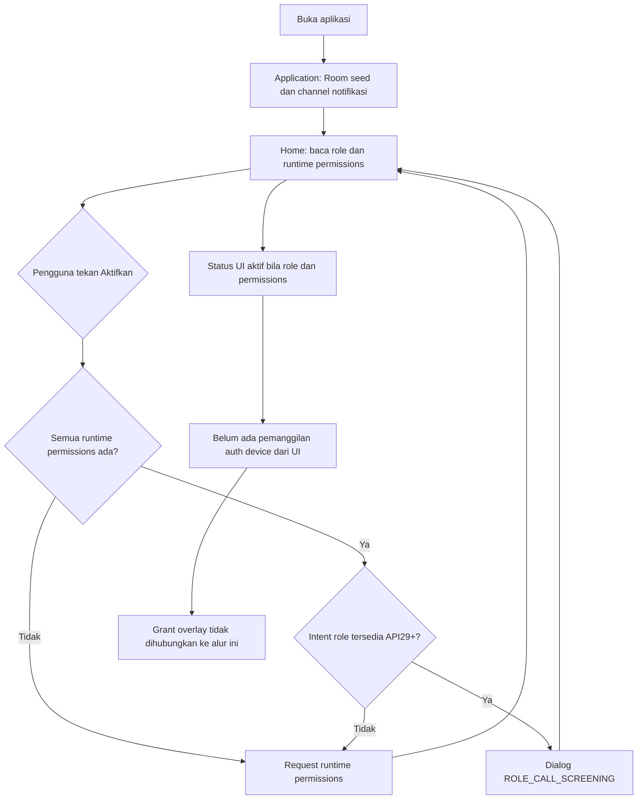

Bukti: [Application:31](../app/src/main/java/id/calltag/app/CallTagApplication.kt#L31), [Home:134](../app/src/main/java/id/calltag/app/ui/screens/HomeScreen.kt#L134), [RolePermissionManager:24](../app/src/main/java/id/calltag/app/util/RolePermissionManager.kt#L24). Status aktif bukan pengujian Telecom/OEM. API26–28 mengandalkan cek permission, tanpa role intent modern.

## 2. AS-IS — pencarian nomor

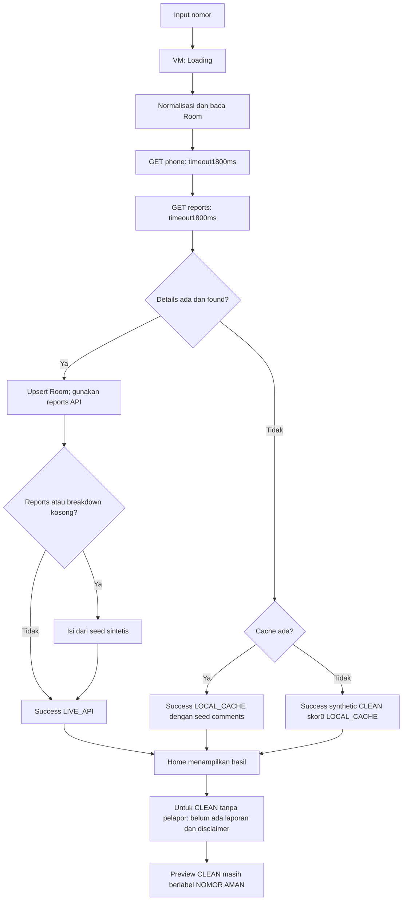

Bukti: [repo:106](../app/src/main/java/id/calltag/app/data/repository/CallTagRepository.kt#L106), [Home:513](../app/src/main/java/id/calltag/app/ui/screens/HomeScreen.kt#L513), [preview:75](../app/src/main/java/id/calltag/app/ui/components/CallerIdOverlayCard.kt#L75). Tidak ada state UNKNOWN/OFFLINE_MISS terpisah; dua API saat ini sekuensial.

## 3. AS-IS — screening cache, API dan error

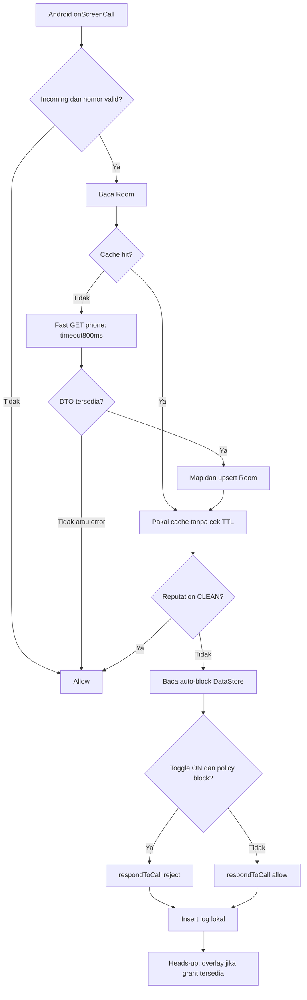

Bukti: [service:34](../app/src/main/java/id/calltag/app/service/CallTagScreeningService.kt#L34), [repo:68](../app/src/main/java/id/calltag/app/data/repository/CallTagRepository.kt#L68), [policy:56](../app/src/main/java/id/calltag/app/util/PhoneNormalizer.kt#L56). Timeout800ms mencakup request remote, bukan Room/DataStore/seluruh callback. Kegagalan DataStore setelah lookup belum dijaga fallback keseluruhan. Tidak ada lookup kontak aplikasi; cakupan callback untuk kontak tersimpan harus diuji menurut OS/perizinan. Toggle heads-up belum dibaca notifier.

## 4. AS-IS — report online, offline dan penolakan server

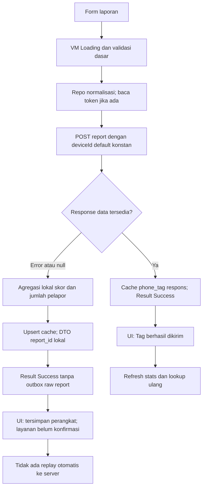

Bukti: [repo:188](../app/src/main/java/id/calltag/app/data/repository/CallTagRepository.kt#L188), [VM:215](../app/src/main/java/id/calltag/app/ui/viewmodel/CallTagMainViewModel.kt#L215), [UI:486](../app/src/main/java/id/calltag/app/ui/screens/ReportAndHubScreen.kt#L486). “Offline” di fallback juga dapat berarti400/401/500 atau respons null; penyebab error hilang. Backend [report:63](https://github.com/CallTag/backend/blob/8676314/controller/report.go#L63) tidak menolak invalid JWT; source dan runtime lokal mendukung batas ini.

## 5. AS-IS — sync offline bundle

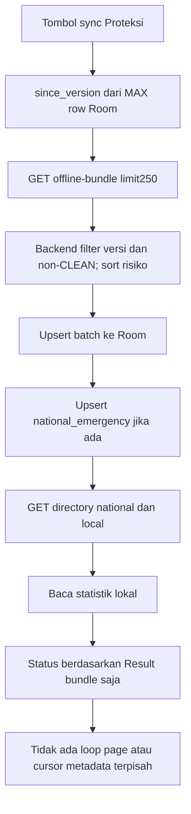

Bukti: [repo:338](../app/src/main/java/id/calltag/app/data/repository/CallTagRepository.kt#L338), [VM:309](../app/src/main/java/id/calltag/app/ui/viewmodel/CallTagMainViewModel.kt#L309), [backend:521](https://github.com/CallTag/backend/blob/8676314/config/db.go#L521). Seed dan report lokal ikut memengaruhi MAX; latest_sync_version DTO tidak digunakan. Perubahan menjadi CLEAN tidak masuk feed ini; hasil directory di VM tidak menentukan pesan sukses sync.

## 6. AS-IS — direktori dan kanal resmi

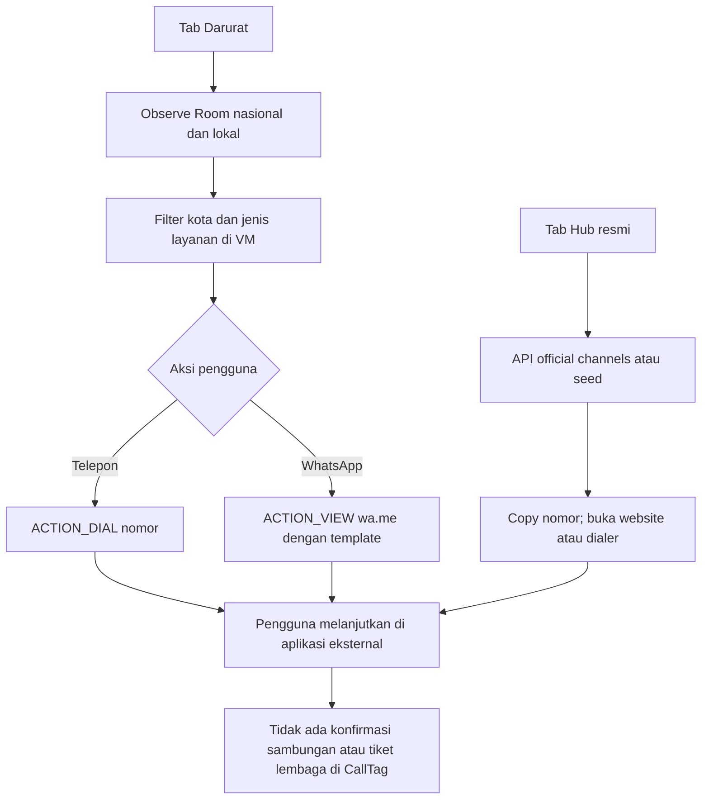

Bukti: [EmergencyScreen:524](../app/src/main/java/id/calltag/app/ui/screens/EmergencyScreen.kt#L524), [hub external:925](../app/src/main/java/id/calltag/app/ui/screens/ReportAndHubScreen.kt#L925). Pilihan kota hardcoded; tidak ada klaim pencarian lokasi terdekat berdasarkan GPS.

## 7. PROPOSED — moderasi minimum

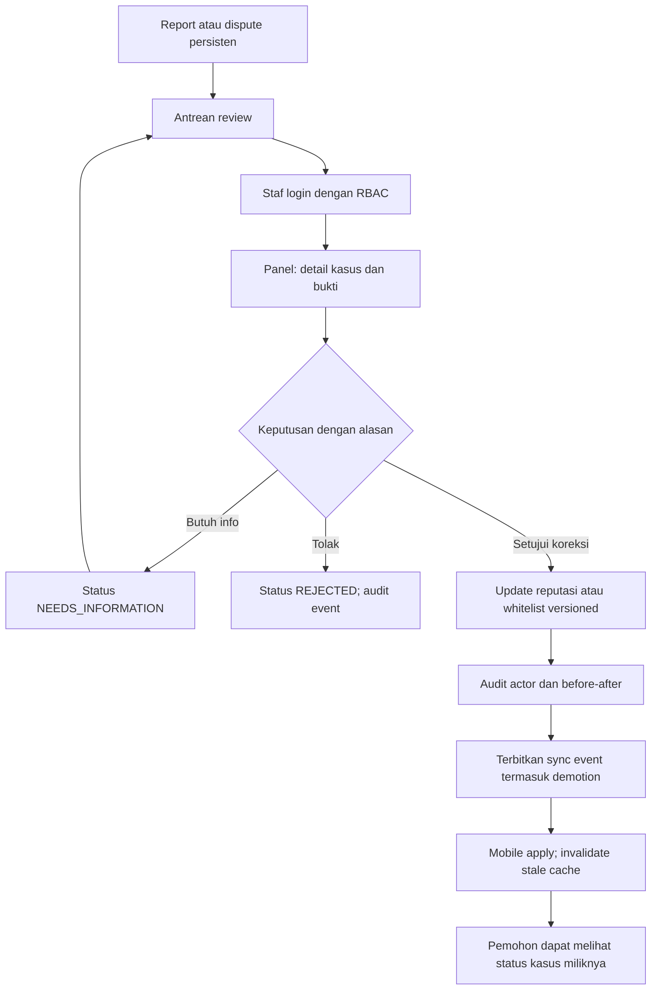

Panel dan endpoint admin **MISSING** pada baseline [router:23](https://github.com/CallTag/backend/blob/8676314/route/route.go#L23). Persistensi dispute/koreksi false positive adalah P0; panel + endpoint operasi minimum P1.

## 8. AS-IS — sequence lookup

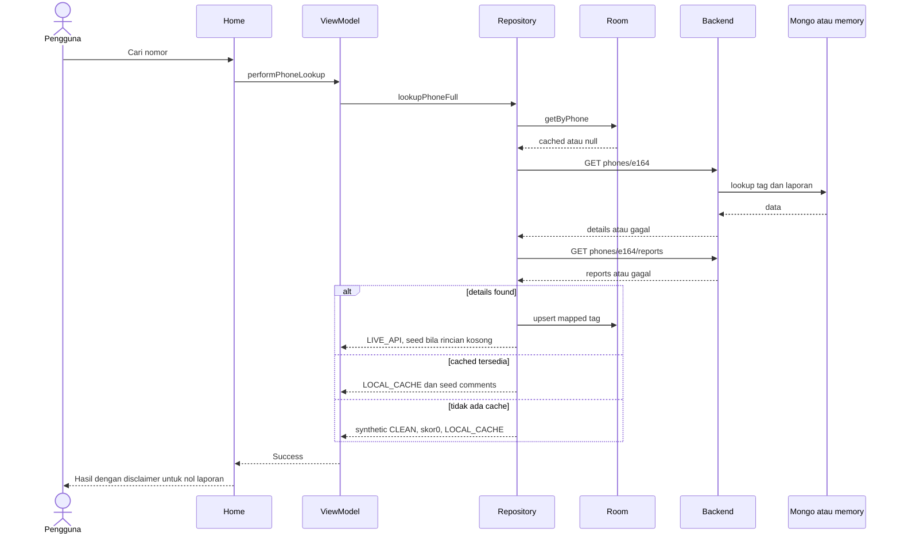

Sumber: [lookupPhoneFull:106](../app/src/main/java/id/calltag/app/data/repository/CallTagRepository.kt#L106). Rantai lookup emulator API34 → API lokal → MongoDB → UI/Room telah diuji memakai fixture sintetis non-seed (label AUDIT_SYNTHETIC, SUSPICIOUS, skor16, satu pelapor). Status VERIFIED_E2E terbatas pada jalur lokal ini; diagram tidak membuktikan seluruh cabang gagal maupun panggilan Telecom nyata.

## 9. AS-IS — sequence report dan sync

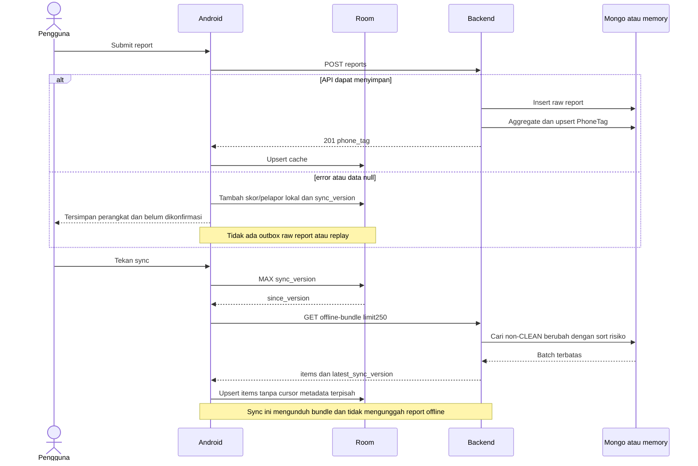

Sumber: [report:188](../app/src/main/java/id/calltag/app/data/repository/CallTagRepository.kt#L188), [sync:338](../app/src/main/java/id/calltag/app/data/repository/CallTagRepository.kt#L338), [DB:344](https://github.com/CallTag/backend/blob/8676314/config/db.go#L344). Insert report dan agregasi adalah operasi yang berbeda, bukan diagram transaksi atomik.

Satu submission form Android pada emulator lokal telah diverifikasi: tag AUDIT_MOBILE_E2E menampilkan “#Tag berhasil dikirim”, MongoDB menyimpan satu SpamReport dan Room memuat tag yang sama dengan status CLEAN, skor12.8. Bukti ini mencakup report online guest pada fixture lokal; bukan bukti autentikasi mobile, seluruh cabang report/offline/retry, atau pemblokiran telepon nyata.

## 10. AS-IS dan PROPOSED — state dispute

**AS-IS:** state berikut merupakan state UI/DTO; belum ada state machine kasus persisten di server.

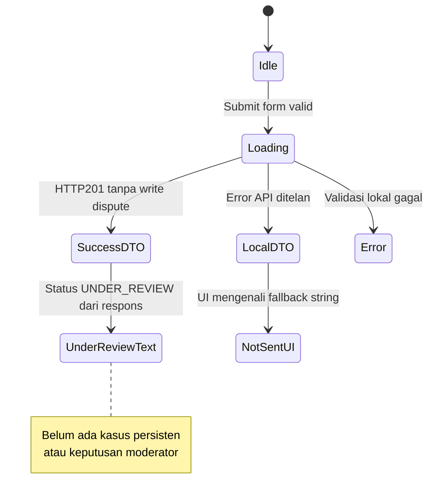

**PROPOSED P0/P1:** status hanya maju setelah write DB; pemohon hanya dapat mengakses kasusnya sendiri.

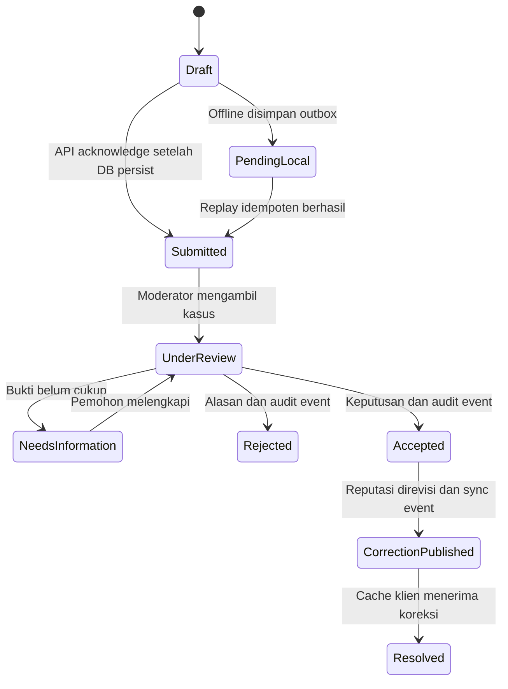

Sumber kondisi saat ini: [backend:98](https://github.com/CallTag/backend/blob/8676314/controller/report.go#L98), [UI:847](../app/src/main/java/id/calltag/app/ui/screens/ReportAndHubScreen.kt#L847).

## 11. AS-IS dan PROPOSED — state proteksi

**AS-IS:** status UI di Home hanya `role && permissions`; preferensi di Proteksi bukan pemeriksaan kapabilitas sistem.

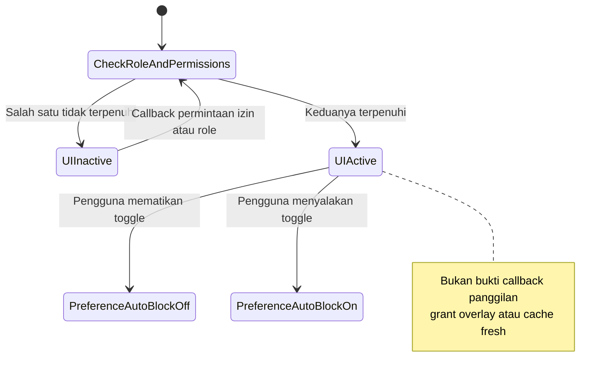

**PROPOSED P0/P1:** bedakan kemampuan sistem, preferensi tindakan dan mutu data.

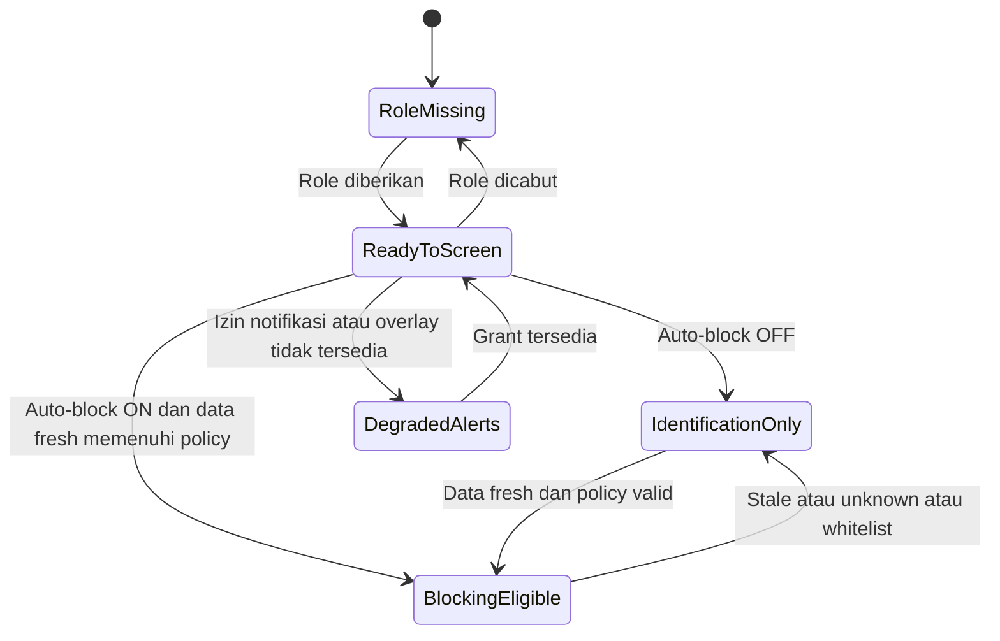

Sumber kondisi saat ini: [Home:414](../app/src/main/java/id/calltag/app/ui/screens/HomeScreen.kt#L414), [prefs:32](../app/src/main/java/id/calltag/app/data/preferences/CallTagPreferences.kt#L32), [notifier:62](../app/src/main/java/id/calltag/app/service/CallerIdNotifier.kt#L62). Target detail fail-open dan kelayakan blokir memerlukan keputusan policy serta pengujian OEM; diagram target tidak mengklaim kemampuan OS di luar callback screening.

## 12. AS-IS dan PROPOSED — use case

Mermaid tidak memiliki sintaks use-case UML native yang dipakai di sini; flowchart berikut menunjukkan aktor, batas sistem dan use case secara eksplisit.

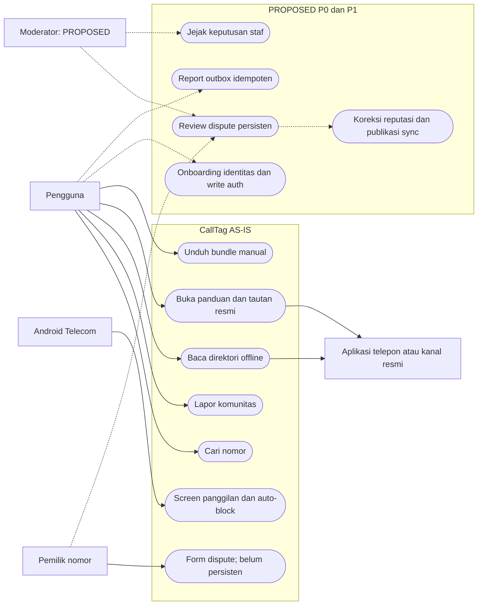

AS-IS ditelusuri dari [MainScaffold:204](../app/src/main/java/id/calltag/app/ui/MainScaffold.kt#L204), [ApiService](../app/src/main/java/id/calltag/app/data/remote/ApiService.kt#L37) dan [router backend](https://github.com/CallTag/backend/blob/8676314/route/route.go#L23). Use case yang putus-putus adalah backlog, bukan fitur tersedia.
