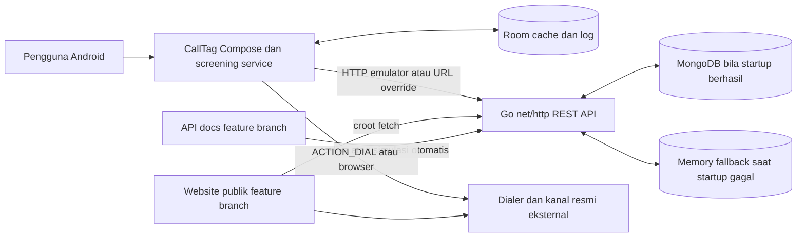
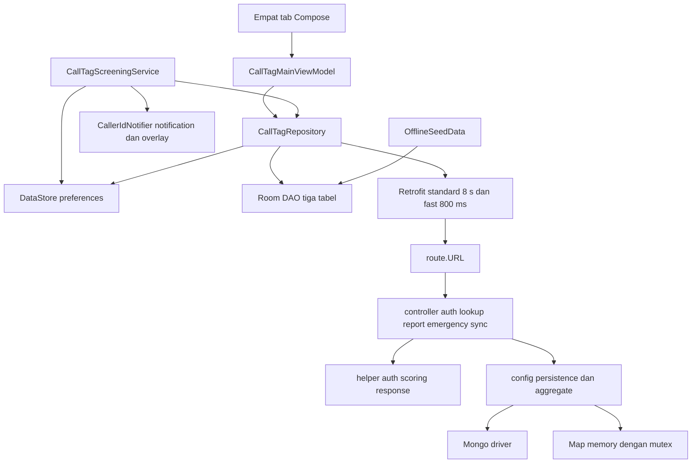
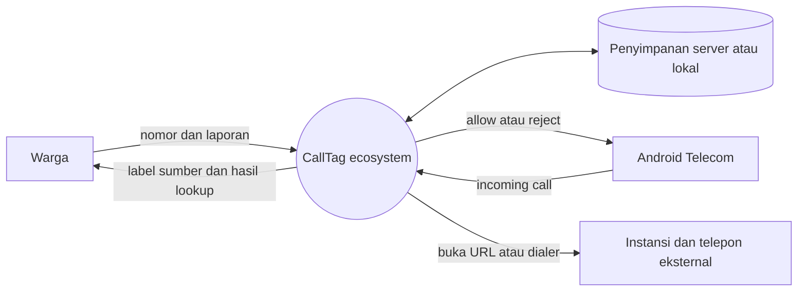
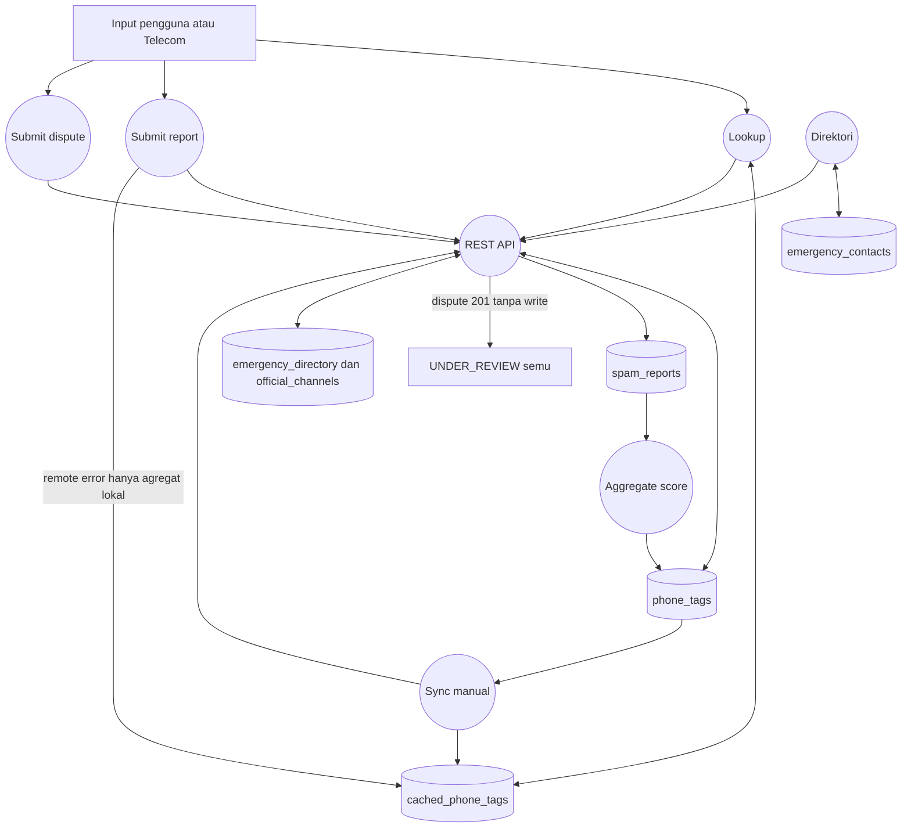
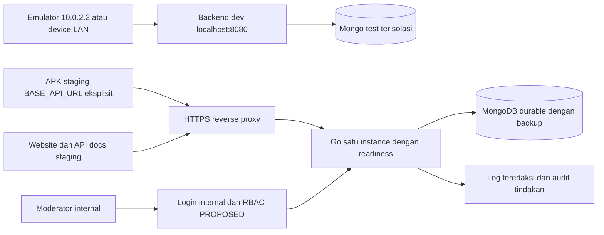

# Arsitektur sistem CallTag

Basis dan status mengikuti [AUDIT_REPORT](AUDIT_REPORT.md). Diagram AS-IS menggambarkan kode pada feature audit, bukan deployment publik. **PROPOSED** adalah target dan belum diimplementasikan.

## Context dan container AS-IS

Android tidak langsung mengakses MongoDB. Go adalah satu proses HTTP, bukan kumpulan microservice; gocroot hanya pendekatan penamaan router pada baseline. Outbound dialer/browser bukan integrasi laporan ke instansi. Runtime lokal memilih Mongo; fallback hanya pilihan startup, bukan failover durable.

## Komponen internal AS-IS

Wiring ada pada `CallTagApplication.kt:20–35`; dua client `NetworkModule.kt:16–56`; backend router `route/route.go:23–69`, controller memanggil fungsi `config/db.go` langsung. Tidak ada dependency injection framework atau service layer terpisah yang wajib ditambah untuk tim dua orang. Mutex melindungi memory; itu tidak membuktikan atomisitas Mongo.

## DFD level 0 AS-IS

Boundary data sensitif meliputi nomor target, identitas pseudonim, komentar dan log panggilan. Diagram tidak menampilkan unggah buku kontak karena tidak ditemukan implementasinya; OS menyediakan screening sesuai perizinan.

## DFD level 1 AS-IS

Laporan offline tidak melewati outbox; komentar asli tidak ditulis sebagai raw report lokal. Dispute berhenti pada acknowledgment semu. DFD menjelaskan letak putus alur agar keberadaan endpoint tidak disamakan dengan penyimpanan.

## Deployment PROPOSED — minimum MVP

Staging harus memakai DB tersendiri dan secret environment, bukan fallback publik. Satu proses + Mongo cukup untuk MVP; transaction lintas laporan/agregat membutuhkan replica set atau alternatif CAS/reconciliation yang terdokumentasi. Website statis boleh GitHub Pages; URL API wajib dikonfigurasi dan akses CORS dibatasi sesuai origin yang dipakai.

## Dependency, lifecycle dan failure boundary

| Area | AS-IS dan bukti | Target PROPOSED |
|---|---|---|
| Transport | `app/build.gradle.kts:60–63` default HTTP emulator; manifest:23 cleartext global | Build dev/staging/release eksplisit; production HTTPS, cleartext hanya dev. |
| Persistence | `config/db.go:35–67` fallback saat startup; health `controller/sync.go:83` flag saja | Production startup strict, liveness/readiness terpisah, bounded ping. |
| Screening | `CallTagScreeningService.kt:57–114` coroutine + network 800 ms | Deadline total <5 detik dan fail-open pada finally, lalu observability tanpa nomor lengkap. |
| Cache | repository:77 langsung return cache, seeding async `CallTagDatabase.kt:53` | Source/freshness/version terpisah, initial readiness, revocation event. |
| Background | VM:315 sync manual | WorkManager unik dengan constraint/retry; UI dapat sync manual dan melihat last-success. |
| Recovery | Room version 1 destructive; belum ada kode migration/backup Mongo | Export schema, non-destructive migration, index migration idempoten, uji restore di staging. |

## Rekomendasi urutan merge dan release

1. Review feature backend/apidocs, pisahkan patch auth/persistence/kontrak dari dokumen.
2. Jalankan test unit/contract/integration pada DB test; perbaiki P0.
3. Buat PR per repo, merge setelah review manusia; audit ini tidak melakukan merge.
4. Deploy staging dan konfigurasi URL APK/website/OpenAPI seragam, lalu jalankan E2E/perangkat.
5. Rilis hanya setelah gate keselamatan, sumber direktori, signing dan backup terpenuhi.

**Catatan CI:** `.github/workflows/release-android.yml:3–7` memicu release pada push main, termasuk merge docs. Reviewer harus menata filter path/approval release sebelum merge audit bila tidak ingin rilis APK dipicu perubahan dokumentasi. Audit tidak mengubah workflow tersebut.
