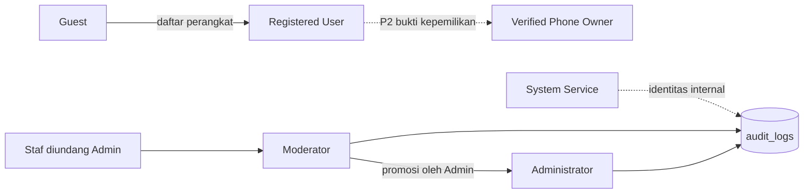
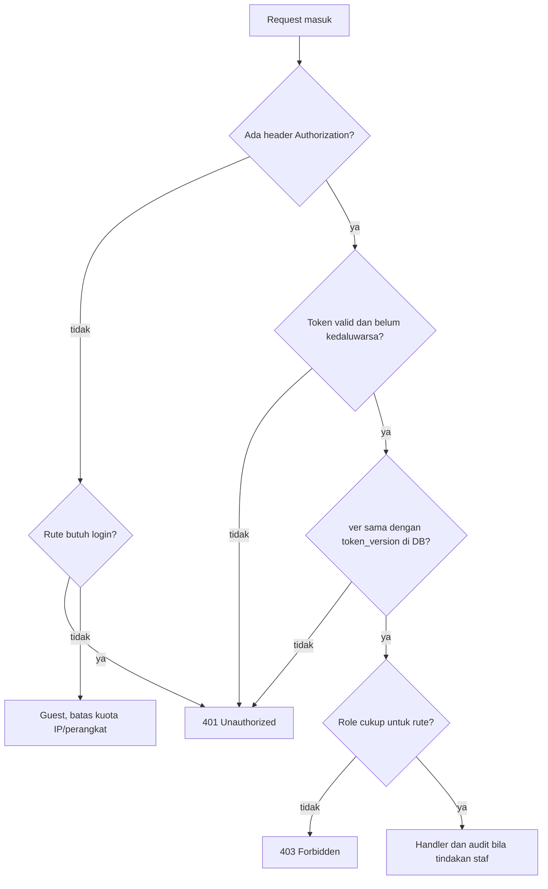

# 02. Role, hak akses, dan autentikasi

Status: **PROPOSED**. Kondisi as-is: `users.role` ada di model tetapi tidak ada RBAC, token tidak valid menjadi guest, `AuthLogin` menerima nomor tanpa bukti ([AUDIT_REPORT](../AUDIT_REPORT.md) A01, A02).

## 1. Keputusan role

| Role | Putusan | Alasan |
|---|---|---|
| Guest | **Wajib (MVP)** | Lookup dan direktori darurat harus bisa dipakai tanpa akun. Batasan: rate limit per IP/perangkat, **tidak boleh membuat laporan**. |
| Registered User | **Wajib (MVP)**, berbasis *akun perangkat* | Laporan harus punya principal yang diterbitkan server agar kuota dan anti-abuse berfungsi. Tidak memerlukan nomor telepon. |
| Verified Phone Owner | **Ditunda (P2)** | Perlu bukti kepemilikan nomor (OTP/WhatsApp) berbiaya dan perlu alur hukum. Sementara itu pemilik nomor memakai dispute biasa dengan bukti. |
| Moderator | **Wajib (P1, sebelum pilot publik)** | Tanpa moderasi, A02/A03 tidak tertutup. |
| Administrator | **Wajib (P1)**, digabung dengan Moderator sebagai satu model staf berlapis | Dua operator; pemisahan lengkap berlebihan. Tindakan sensitif (kelola staf, direktori, konfigurasi) hanya `ADMIN`. |
| System Service | **Wajib (P1)** | Tugas terjadwal (decay skor, kedaluwarsa, retensi) berjalan dengan identitas internal tercatat di audit log. Bukan akun login. |

Prinsip: **nomor yang diketik pengguna bukan bukti kepemilikan**. Tidak ada status "terverifikasi" tanpa bukti server.

## 2. Matriks izin

Legenda: ✔ boleh, ✖ tidak, `own` hanya data milik sendiri, `Q` dengan kuota, `R` hanya baca.

| Kemampuan | Guest | User | Moderator | Admin | System |
|---|---|---|---|---|---|
| Lookup nomor (`GET /phones/{e164}`) | ✔ Q ketat | ✔ Q | ✔ | ✔ | ✔ |
| Lihat laporan teredaksi nomor | ✔ Q | ✔ Q | ✔ | ✔ | ✔ |
| Direktori darurat, kanal resmi, statistik publik | ✔ | ✔ | ✔ | ✔ | ✔ |
| Kirim laporan | ✖ | ✔ Q | ✔ Q | ✔ Q | ✖ |
| Riwayat laporan sendiri | ✖ | ✔ own | ✔ own | ✔ own | ✖ |
| Ajukan dispute | ✖ (P1: ✔ dengan kontak balik, Q ketat) | ✔ Q | ✔ | ✔ | ✖ |
| Lacak status dispute sendiri | token tiket | ✔ own | ✔ | ✔ | ✖ |
| Lihat laporan mentah (komentar, reporter pseudonim) | ✖ | ✖ | ✔ | ✔ | R |
| Moderasi laporan/tag | ✖ | ✖ | ✔ | ✔ | ✖ |
| Putuskan dispute, koreksi reputasi | ✖ | ✖ | ✔ (alasan wajib) | ✔ | ✖ |
| Kelola whitelist/nomor bisnis | ✖ | ✖ | usul | ✔ | ✖ |
| Kelola direktori darurat/kanal resmi | ✖ | ✖ | ✖ | ✔ | ✖ |
| Kelola staf, konfigurasi | ✖ | ✖ | ✖ | ✔ | ✖ |
| Baca audit log | ✖ | ✖ | own | ✔ | ✖ |
| Hapus/ekspor data akun sendiri | ✖ | ✔ | ✔ | ✔ | ✖ |
| Whitelist pribadi lokal (Tahap 5B `T-311`) | ✖ | ✔ own | ✔ own | ✔ own | ✖ |
| Jalankan job terjadwal | ✖ | ✖ | ✖ | picu manual | ✔ |

## 3. Rancangan RBAC

- Klaim JWT: `sub` (id server), `role` (`USER|MOD|ADMIN`), `ver` (versi token), `exp`, `iat`. Tidak memuat nomor telepon.
- Middleware berlapis: `RequestID → Recover → CORS(origin terdaftar) → RateLimit → Authn → RequireRole(...) → Handler`.
- Aturan kunci: token **hilang** pada rute publik berarti guest; token **ada tetapi tidak valid/kedaluwarsa** berarti `401`, tidak pernah diturunkan jadi guest (menutup A02).
- Role disimpan di server (`users.role`); mengubah role menaikkan `token_version` sehingga token lama ditolak.
- Setiap tindakan staf menulis `audit_logs` sebelum respons sukses.

Keterangan: panah putus-putus menandai role yang belum dibangun (P2) atau identitas non-login.

## 4. Alur autentikasi

### 4.1 Pengguna aplikasi (akun perangkat)

1. Aplikasi membuat `install_id` acak (UUID) pada instalasi pertama dan menyimpannya di DataStore.
2. `POST /api/v1/auth/device {install_id, display_name?}` → server membuat/mencari `users` + `devices`, mengembalikan `access_token` (15 menit) dan `refresh_token` (30 hari, disimpan hash di server, dirotasi).
3. Opsional (P1, meningkatkan kepercayaan): token **Play Integrity** diverifikasi server; tanpa itu `trust_weight` mulai rendah (0,5).
4. Pada `401`, aplikasi memakai `POST /api/v1/auth/refresh` satu kali; gagal berarti daftar ulang sebagai akun baru (riwayat tidak terbawa, ini batas yang dijelaskan).

Perubahan dari as-is: field `phone` pada `AuthDeviceRequest` **opsional** (tidak pernah diwajibkan untuk menggunakan fitur dasar pencarian & darurat). Pada **Tahap 5B (`T-308`)**, antarmuka Android membedakan **Mode Tamu (*Guest*)** dan **Masuk Akun Opsional** (*nama tampilan + nomor HP opsional* via `POST /api/v1/auth/device`): tamu tetap dapat mencari nomor, mengakses direktori darurat, dan melacak sanggahan, sementara fitur kontribusi & personalisasi (*kirim laporan `#Tag`, lihat riwayat panggilan/outbox, whitelist pribadi `T-311`, dan halaman kuota `/me`*) terbuka setelah masuk akun. Nomor pengguna tetap hanya disimpan server dalam bentuk hash/mask.

### 4.2 Staf

`POST /api/v1/admin/login {username, password, totp_code}` mengembalikan cookie sesi 8 jam dengan `HttpOnly`, `SameSite=Strict`, dan `Secure` di produksi. Kata sandi memakai bcrypt dan TOTP wajib untuk `MOD` serta `ADMIN`. Operator membuat akun di `staff_accounts` melalui `backend/cmd/seedstaff`.

## 5. Siklus hidup akun

| Status | Arti | Transisi |
|---|---|---|
| `ACTIVE` | Normal | → `RESTRICTED` (kuota dikurangi/laporan tertahan moderasi) oleh moderator atau aturan anomali |
| `RESTRICTED` | Laporan masuk antrean tinjau, tidak menambah skor | → `ACTIVE` setelah ditinjau; → `BANNED` |
| `BANNED` | Tidak dapat melapor | Hanya Admin; wajib alasan |
| `DELETION_REQUESTED` | Pengguna meminta hapus | Job menghapus/anonimkan dalam 30 hari (kebijakan retensi), laporan agregat dipertahankan tanpa pseudonim |
| `DELETED` | Selesai | Terminal |

## 6. Verifikasi kepemilikan nomor (P2, rancangan)

Tidak dibangun pada MVP. Bila disetujui:

| Opsi | Cara | Biaya/dependensi | Catatan |
|---|---|---|---|
| WhatsApp inbound (pengguna mengirim kode ke nomor CallTag) | Bukti kontrol nomor tanpa SMS keluar | Nomor WhatsApp Business + API resmi Meta, biaya per percakapan | Tidak ada gateway tidak resmi |
| SMS OTP | Server kirim kode | Penyedia SMS (mis. Twilio/Vonage/penyedia lokal berizin), biaya per SMS, risiko pompa SMS | Wajib rate limit dan kuota biaya |
| Firebase Phone Auth | OTP lewat Firebase | Ada kuota gratis terbatas, dependensi Google | Perlu Google Play Services |
| Manual berbukti | Dispute dengan dokumen + peninjauan staf | Tanpa biaya, lambat | Cukup untuk pilot akademik |

Rekomendasi: manual berbukti untuk pilot; WhatsApp inbound bila perlu otomatis. Angka biaya aktual **belum diverifikasi** dan harus dicek ke penyedia pada saat keputusan.

Hasil verifikasi hanya memberi hak **mengajukan koreksi/sanggahan berprioritas** dan lencana "pemilik terverifikasi pada dispute". Tidak otomatis menghapus laporan.

