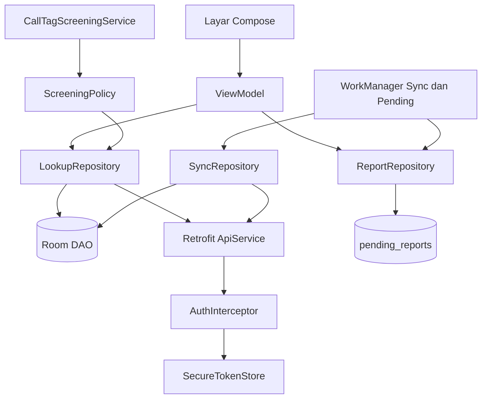
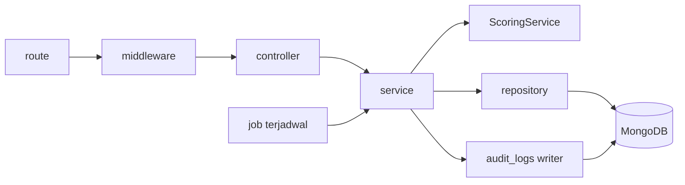

# 05. Arsitektur sistem final

Status: **PROPOSED**. Baseline as-is: [SYSTEM_ARCHITECTURE](../SYSTEM_ARCHITECTURE.md). Prinsip: **tidak rewrite**; perbaiki bertahap pada struktur yang ada.

## 1. Android

| Komponen | Putusan | Alasan |
|---|---|---|
| Kotlin + Compose + MVVM + Repository | **Pertahankan** | Sudah berjalan (AGENTS.md). |
| Retrofit + OkHttp | Pertahankan; tambah `AuthInterceptor` (token, refresh satu kali) dan `Authenticator` | Menggantikan pengiriman header manual di repository. |
| Room | Pertahankan; **naik ke versi 2** dengan `exportSchema=true` dan migrasi tertulis; hapus `fallbackToDestructiveMigration` | NFR-004; menjaga `pending_reports`. |
| DataStore | Pertahankan untuk preferensi; token ke `EncryptedSharedPreferences`/Keystore | Token tidak berada di preferensi biasa. |
| WorkManager | **Tambah** (unik, constraint jaringan, backoff) untuk sync dan kirim pending | Diperlukan untuk alur 8 dan 9. |
| Dependency Injection | **Tidak wajib**; tetap manual lewat `CallTagApplication` | Skala kecil; Hilt tidak membawa manfaat sepadan. Evaluasi ulang bila > 6 repository. |
| Offline-first | Pertahankan, dengan aturan baru: cache punya `expires_at`, `source`, `fetched_at`; hasil seed berlabel | Menutup A07, A10. |
| Error handling | Hasil bertipe `LookupResult` = `Found / NotFound / Unavailable(cause)` menggantikan `null`→CLEAN | ADR-004. |

Struktur package yang direkomendasikan (evolusi, bukan pemindahan massal):

```text
id.calltag.app
├── data
│   ├── local        (Room: entity, dao, migration, OfflineSeedData -> dipindah ke debug/fixture)
│   ├── remote       (ApiService, dto, AuthInterceptor, NetworkModule)
│   ├── repository   (LookupRepository, ReportRepository, SyncRepository, AuthRepository)
│   └── preferences  (CallTagPreferences, SecureTokenStore)
├── domain           (model murni: LookupResult, ReputationLevel, ScreeningPolicy)
├── work             (SyncWorker, PendingReportWorker)
├── service          (CallTagScreeningService, CallerIdNotifier)
├── ui               (theme, components, screens, viewmodel)
└── util             (PhoneNormalizer, RolePermissionManager)
```

`CallTagRepository` (510 baris) dipecah per tanggung jawab saat disentuh, bukan sekaligus.



## 2. Backend (modular monolith)

| Lapisan | Peran | Perubahan dari as-is |
|---|---|---|
| `route` | Router `net/http` (Go 1.22+ pola `ServeMux` per metode) | Ganti `switch` path manual; tetap tanpa framework baru (ADR-001) |
| `middleware` (baru) | request id, recover, CORS terdaftar, rate limit, authn, RBAC, batas body, logging teredaksi | Menutup A01/A02, R11 |
| `controller` | Decode/validasi/encode saja | Logika dipindah ke `service` |
| `service` (baru) | `ReportService`, `LookupService`, `DisputeService`, `ModerationService`, `SyncService`, `ScoringService` | Atomisitas dan aturan bisnis di satu tempat |
| `repository` (rename dari `config/db.go` bertahap) | Akses Mongo; interface sehingga memory fallback hanya untuk `APP_ENV=dev` | Production strict (A09) |
| `model` | Struct domain + BSON/JSON terpisah (DTO publik tidak memuat field internal) | R11 |
| `job` (baru) | decay, kedaluwarsa, retensi; dipicu `System Service` (cron proses sama) | Pengganti decay saat tulis |
| `observability` | `/healthz` (liveness), `/readyz` (ping Mongo berbatas waktu), log JSON tanpa PII | T20 |

Atomisitas laporan: transaksi Mongo membutuhkan replica set. Keputusan: staging/produksi memakai **replica set satu node** agar `session.WithTransaction` tersedia; bila tidak memungkinkan, fallback ke pola "insert dengan unique key lalu agregasi idempoten yang dapat dihitung ulang dari `spam_reports`" (rekonsiliasi). Keduanya dijelaskan di [06](06-DESAIN-DATABASE.md).



## 3. Website

| Fungsi | Putusan |
|---|---|
| Landing, cara kerja, privasi, FAQ khusus produk, unduhan | Ya (statis GitHub Pages) |
| Pencarian nomor publik | Ya, memakai `GET /phones/{e164}` dengan status jujur; kuota guest |
| Pelaporan dari web | **Tidak pada MVP** (tidak ada principal terpercaya; mengurangi permukaan abuse). Form "lapor cepat" saat ini dinonaktifkan atau diarahkan ke aplikasi/kanal resmi |
| Statistik | Hanya dari `GET /stats/public` nyata; nol ditampilkan sebagai nol; tanpa seed |
| Direktori darurat dan kanal resmi | Ya |
| Unduhan | Tautan GitHub Releases dengan versi hasil verifikasi nyata (perilaku test existing dipertahankan) |

## 4. Admin panel

| Opsi | Kelebihan | Kekurangan | Putusan |
|---|---|---|---|
| A. Halaman terlindungi di website | Tanpa repo baru | GitHub Pages statis; kredensial dan data sensitif berdampingan dengan situs publik | Tidak |
| B. Frontend terpisah (repo baru) | Pemisahan bersih | Repo kelima, CI, hosting tambahan; berlebihan untuk 2 orang | Tidak |
| **C. Halaman internal yang disajikan backend** (`embed` HTML + JS kecil di `/admin`) | Satu deploy, satu CORS (same-origin), cookie sesi aman, tanpa repo baru | Backend menyajikan UI minimal | **Dipilih** |

Pembatasan akses jaringan (allowlist IP/VPN/reverse proxy basic auth tambahan) direkomendasikan untuk staging dan pilot.

## 5. Integrasi

| Arah | Protokol dan aturan |
|---|---|
| Android → Backend | HTTPS (produksi), JSON envelope `{success,code,message,data,timestamp}`, token Bearer, `Idempotency-Key` pada POST |
| Website → Backend | HTTPS, CORS hanya origin terdaftar, endpoint publik |
| Admin → Backend | Same-origin, cookie `HttpOnly`, CSRF token, RBAC `MOD/ADMIN` |
| Backend → MongoDB | Driver resmi, URI dari environment, TLS pada staging/produksi, pengguna DB hak minimum |
| Backend → autentikasi | JWT HS256 dengan secret wajib dari environment (startup gagal bila kosong/lemah); rotasi `kid` direncanakan P2 |
| Backend → sumber eksternal | **Tidak ada pada MVP**. Bila Opsi B/C disetujui, lewat `provider` interface dengan izin tertulis dan cache terbatas |
| Sinkronisasi | `GET /sync/changes?cursor=` (journal), lihat [06](06-DESAIN-DATABASE.md) |
| Android → Room | DAO transaksi; cursor dan data diterapkan atomik |

## 6. Environment

| Environment | Backend | Mongo | Android `BASE_API_URL` | Rahasia | Data |
|---|---|---|---|---|---|
| dev | lokal `:8080`, memory fallback boleh (`APP_ENV=dev`) | lokal | `http://10.0.2.2:8080/` (cleartext hanya build debug) | `.env` lokal tidak di-commit | seed sintetis berlabel |
| staging | satu instance di balik HTTPS | replica set satu node, terpisah dari produksi | URL HTTPS staging eksplisit, build `staging` | variabel environment/secret manager | sintetis + sebagian kurasi |
| production | strict: Mongo gagal berarti proses keluar | replica set + backup terjadwal | HTTPS eksplisit, `usesCleartextTraffic=false` | secret manager, rotasi | hanya data nyata dan kurasi |

Build type Android baru: `debug` (cleartext izin), `staging`, `release` (HTTPS saja, signing dari environment). `AndroidManifest` cleartext global dihapus dan diganti `network_security_config` per build.
