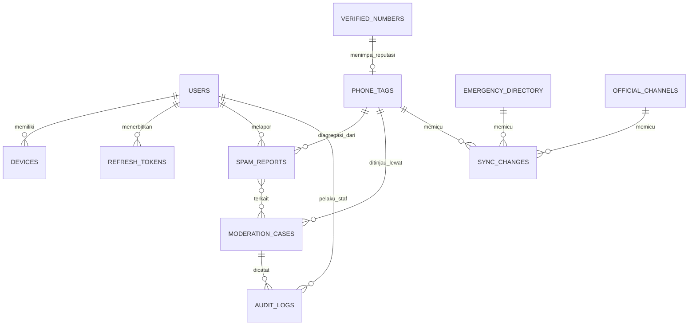

# 06. Desain database (MongoDB dan Room)

Status: **PROPOSED**. Skema aktual 5 koleksi dan 3 tabel Room ada di [DATABASE_DESIGN](../DATABASE_DESIGN.md); dokumen ini hanya mendefinisikan **perubahan target** agar tidak menduplikasi.

## 1. Keputusan entitas

| Entitas | Koleksi/tabel | Putusan |
|---|---|---|
| Users | `users` | Ada; ubah: hapus ketergantungan `phone_hash` wajib, tambah `status`, `token_version`, `role` ditegakkan |
| Devices | `devices` | **Baru**, terpisah dari users (satu user banyak install; menyimpan `install_id_hash`, `attestation`) |
| Phone Profiles | `phone_tags` (nama dipertahankan) | Ada; tambah `availability` turunan tidak disimpan, `last_activity_at`, `expires_at`, `version` |
| Phone Tags | embedded `phone_tags.tags[]` | Bukan koleksi terpisah |
| Spam Reports | `spam_reports` | Ada; tambah `idempotency_key`, `status` (`PENDING_MOD|VALIDATED|REJECTED`), `source` |
| Reputation Records | embedded pada `phone_tags` + `reputation_history[]` ringkas | Riwayat perubahan level di `audit_logs`, bukan koleksi baru |
| Disputes dan Moderation Cases | `moderation_cases` (satu koleksi, `type: DISPUTE|REPORT_REVIEW|TAG_REVIEW`) | **Baru** |
| Verified Businesses / whitelist | `verified_numbers` | **Baru** (kecil, dikurasi staf) |
| Emergency Directory | `emergency_directory` | Ada; tambah `source_url`, `verified_by`, `verified_at` wajib, `version` |
| Official Channels | `official_channels` | Ada |
| Audit Logs | `audit_logs` | **Baru**, append-only |
| Sync Events | `sync_changes` | **Baru** (journal) |
| System Configuration | `system_config` | **Ditunda**; cukup environment variables untuk MVP |
| Refresh tokens | `refresh_tokens` | **Baru** (hash, `expires_at`, TTL index) |

Total koleksi target MVP: 11 (5 existing + 6 baru).

## 2. Rincian entitas baru atau berubah

### 2.1 `devices`

| Field | Tipe | Validasi |
|---|---|---|
| `_id` | ObjectId | |
| `user_id` | ObjectId | wajib, ref `users` |
| `install_id_hash` | string | wajib, SHA-256 dengan salt dari environment |
| `attestation` | object? | `{provider:"PLAY_INTEGRITY", verdict, checked_at}` |
| `created_at`, `last_seen_at` | date | |

Indeks: unik `install_id_hash`; `user_id`. Retensi: dihapus bersama user. Akses: hanya service auth.

### 2.2 `spam_reports` (perubahan)

Tambahan: `idempotency_key` string (wajib, ≤ 64), `status`, `source` (`APP|FIXTURE|EXTERNAL_OPEN_LIST`), `pii_flags` []. Indeks: **unik** `{reporter_user_id, idempotency_key}`; **unik parsial** `{phone_e164, reporter_user_id, window_key}` dengan `window_key = floor(created_at / 30 hari)` untuk dedup 30 hari; `{phone_e164, created_at:-1}`; `{status, created_at}` untuk antrean. Retensi: raw 24 bulan lalu anonimkan reporter; komentar hapus 12 bulan setelah `REJECTED`. *(Catatan `T-209`: entri impor dataset terbuka berlisensi jelas wajib memakai `source=EXTERNAL_OPEN_LIST` beserta metadata sumber agar tidak tercampur dengan laporan komunitas warga).*

```json
{
  "_id": "665f00000000000000000001",
  "phone_e164": "+6281200000005",
  "reporter_user_id": "665f0000000000000000aa01",
  "category_code": "APK_SNIFFING",
  "custom_tag": "kurir paket mencurigakan",
  "comment": "Fixture lokal; bukan laporan warga",
  "call_type": "CELLULAR_CALL",
  "idempotency_key": "2f9c1d0e-0000-4000-8000-000000000001",
  "status": "VALIDATED",
  "reporter_trust_snapshot": 0.5,
  "applied_weight": 8.0,
  "source": "FIXTURE",
  "created_at": "2026-11-13T08:00:00Z"
}
```

### 2.3 `moderation_cases`

| Field | Tipe | Catatan |
|---|---|---|
| `type` | enum | `DISPUTE`, `REPORT_REVIEW`, `TAG_REVIEW` |
| `phone_e164` | string | indeks |
| `status` | enum | `OPEN`, `NEEDS_INFO`, `ACCEPTED`, `REJECTED`, `CLOSED` |
| `submitter` | object | `{user_id?, contact_ref_enc, owner_verified:false}` kontak terenkripsi |
| `reason`, `evidence_refs[]` | string, [] | evidence berupa tautan/teks, bukan unggah berkas pada MVP |
| `related_report_ids[]` | ObjectId[] | |
| `decision` | object? | `{by, at, outcome, reason}` |
| `tracking_token_hash` | string | untuk pelacak guest |
| `version` | int | optimistic lock |
| `created_at`, `updated_at` | date | |

Indeks: `{status, created_at}`; `{phone_e164}`; unik parsial `{phone_e164, submitter.user_id}` untuk `status ∈ {OPEN,NEEDS_INFO}` (cegah dispute ganda). Retensi: 36 bulan setelah `CLOSED`.

```json
{
  "type": "DISPUTE",
  "phone_e164": "+6281200000005",
  "status": "OPEN",
  "submitter": {"user_id": "665f0000000000000000aa02", "owner_verified": false},
  "reason": "Nomor ini milik toko kami, bukan penipuan (contoh sintetis).",
  "version": 1,
  "created_at": "2026-11-13T08:10:00Z"
}
```

### 2.4 `verified_numbers`

`phone_e164` (unik), `kind` (`OFFICIAL|BUSINESS|PUBLIC_SERVICE`), `display_label`, `source_url`, `verified_by`, `verified_at`, `expires_at`, `status`. Whitelist aktif bila `status=ACTIVE` dan `expires_at` di masa depan. Mulai **Tahap 4B (`T-207`, `T-209`)**, koleksi ini diisi seed awal terverifikasi instansi/bank/ekspedisi resmi Indonesia serta dapat ditambah melalui CLI importer/Admin (`T-403`) dengan kewajiban provenance `source_url` & audit.

### 2.5 `audit_logs` (append-only)

`actor` (`{id, role}`), `action`, `target` (`{type,id}`), `before_hash`, `after_hash`, `reason`, `request_id`, `at`. Indeks `{at:-1}`, `{target.id}`. Tanpa operasi update/delete dari aplikasi; peran DB aplikasi tidak memiliki `delete` pada koleksi ini. Retensi 24 bulan.

### 2.6 `sync_changes`

| Field | Tipe | Catatan |
|---|---|---|
| `seq` | int64 | urutan global monoton (counter terpisah dengan `findOneAndUpdate $inc`) |
| `generation` | int | naik saat full resync dipaksa |
| `op` | enum | `UPSERT`, `DELETE` |
| `kind` | enum | `PHONE_TAG`, `EMERGENCY`, `OFFICIAL_CHANNEL` |
| `key` | string | `phone_e164` atau `code` |
| `payload` | object? | proyeksi aman untuk klien (tanpa PII) |
| `at` | date | |

Indeks unik `seq`. Klien menyimpan `cursor = "generation:seq"` opak. Halaman diurutkan `seq` naik dengan `limit` dan `has_more`; tidak diurutkan risiko. Retensi 90 hari; klien dengan cursor lebih tua menerima `FULL_RESYNC_REQUIRED`.

### 2.7 Perubahan `phone_tags`

Tambah: `last_activity_at`, `expires_at` (12 bulan sejak aktivitas), `version`, `dispute_state` (`NONE|OPEN|CORRECTED`). `sync_version` lama dipertahankan untuk kompatibilitas selama transisi, kemudian dihapus dari kontrak setelah klien baru terdistribusi (perubahan aditif dahulu).

## 3. Diagram hubungan data



## 4. Konsistensi dan atomisitas

1. Penyimpanan laporan: dalam satu transaksi (replica set): insert `spam_reports` → hitung ulang `phone_tags` dari laporan aktif → tulis `sync_changes`. Jika transaksi tidak tersedia: insert (unik), lalu agregasi **idempoten** yang menghitung dari `spam_reports` (bukan `$inc`), dan job rekonsiliasi harian membandingkan hitungan.
2. Migrasi aman (urutan): inventaris duplikat → backup → dry-run → tambah field baru (aditif) → bersihkan duplikat (tandai `REJECTED`, jangan hapus) → buat unique index → deploy pembaca lalu penulis → hitung ulang agregat → uji restore di staging → full resync klien (`generation++`).
3. Validasi: `$jsonSchema` validator pada `spam_reports`, `moderation_cases`, `verified_numbers` (level `moderate` saat migrasi).

## 5. Room (Android) versi 2

| Tabel | Perubahan |
|---|---|
| `cached_phone_tags` | Tambah `availability`, `source` (`SERVER|FIXTURE|LOCAL`), `fetched_at_epoch_ms`, `expires_at_epoch_ms`, `server_version`; **hapus** konstanta `unique_reporters=5`; kolom skor hanya dari server |
| `pending_reports` (baru) | `local_id` (PK), `idempotency_key`, payload, `status` (`PENDING|SENDING|SENT|FAILED`), `attempts`, `last_error`, `created_at`; **tidak** memengaruhi `cached_phone_tags` |
| `pending_disputes` (baru) | struktur serupa |
| `sync_state` (baru) | satu baris: `cursor`, `generation`, `last_success_at`, `last_error` (cursor terpisah dari data) |
| `emergency_contacts` | Tambah `source_url`, `verified_at`, `server_version` |
| `call_screening_logs` | Simpan nomor ter-mask (`+62812****0005`) |
| `local_whitelist` *(Tahap 5B `T-311`)* | Daftar pengecualian pribadi (di DataStore/Room v3) untuk melewati auto-block secara lokal |

Kedaluwarsa cache: nomor reputasi 14 hari untuk keputusan blokir, 90 hari hanya untuk tampilan berlabel "data lama". Seed APK dipindah ke fixture debug dan **tidak** dipakai di build release untuk reputasi (direktori darurat tetap di-bundle dengan `verified_at`).

Migrasi: `exportSchema=true`, `Migration(1,2)` tertulis menambah tabel/kolom, uji `MigrationTestHelper`. Retry pending: backoff eksponensial 30 detik × 2^n maksimum 6 jam, batas 8 percobaan lalu `FAILED` terlihat pengguna. Setelah restart, `SENDING` dikembalikan ke `PENDING` saat Worker berikutnya.

## 6. Keselarasan model

Satu tabel pemetaan nama lintas lapisan disimpan di [07](07-KONTRAK-API.md) bagian 4. Aturan: OpenAPI adalah sumber kontrak; DTO Kotlin dan struct Go dihasilkan/diperiksa dengan contract test, bukan disalin manual.

