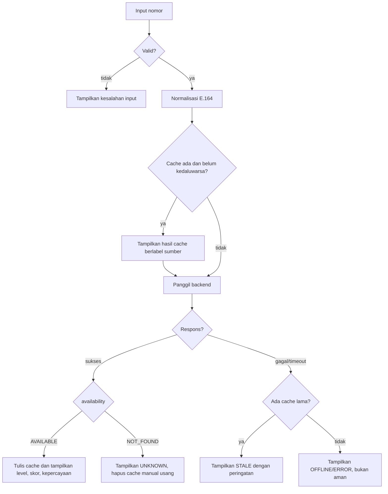
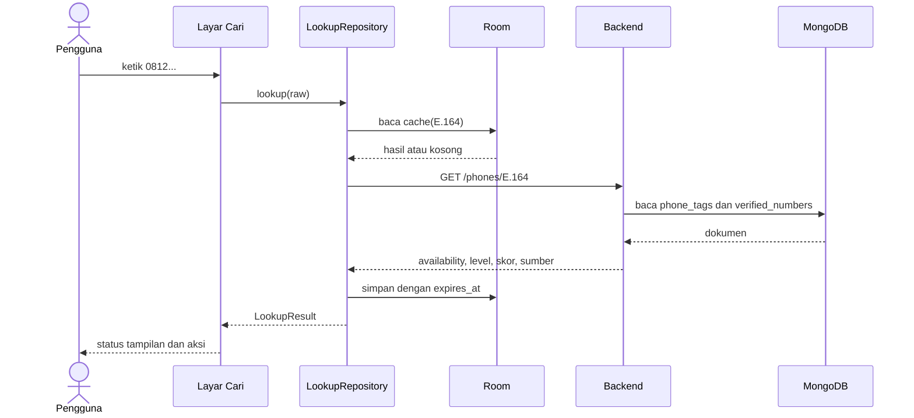

# 08. Strategi pencarian nomor

Status: **PROPOSED**. Kondisi as-is: [FLOWS_AND_DIAGRAMS](../FLOWS_AND_DIAGRAMS.md) bagian 2 dan 3 (lookup menghasilkan CLEAN sintetis saat tidak ada data, cache tanpa TTL).

## 1. Status hasil (dua dimensi)

| Dimensi | Nilai | Sumber |
|---|---|---|
| `availability` | `AVAILABLE`, `NOT_FOUND`, `UNAVAILABLE` (timeout/offline/error) | Klien + server |
| `reputation_level` | `CLEAN`, `SUSPICIOUS`, `SPAM`, `DANGER_SCAM`, atau `null` | Server |
| `verified_label` | `null`, `OFFICIAL`, `BUSINESS`, `PUBLIC_SERVICE` | `verified_numbers` |

Status tampilan yang diturunkan UI (tidak disimpan sebagai enum backend):

| Tampilan | Aturan penurunan | Warna/teks (DESIGN.md) |
|---|---|---|
| UNKNOWN | `NOT_FOUND`, atau level `CLEAN` tanpa whitelist | Netral: "Belum ada data. Ini bukan jaminan aman." |
| CLEAN (dalam pengamatan) | tidak ditampilkan sebagai aman | - |
| SUSPICIOUS / SPAM / DANGER_SCAM | level server | amber / oranye / merah |
| VERIFIED BUSINESS/OFFICIAL | `verified_label` ≠ null | teal + sumber dan tanggal |
| ERROR / OFFLINE | `UNAVAILABLE` tanpa cache valid | Netral: "Tidak dapat memeriksa. Bukan berarti aman." |
| STALE | cache lewat `expires_at` | Label "data lama" + waktu |

Perubahan penting: `CLEAN` pada Room tidak lagi dibuat dari cache miss (A07). Teks "NOMOR AMAN" dihapus dari seluruh UI.

## 2. Alur pencarian

1. Validasi: kosong/alfabet ditolak; kode pendek ≤ 6 digit dikenali sebagai nomor layanan.
2. Normalisasi E.164 (`PhoneNormalizer`): `08…` → `+62…`; `62…` → `+62…`; `+` dipertahankan. Aturan seragam Android, Go, dan website, diuji dengan tabel kasus yang sama.
3. Cache lokal: jika ada dan belum kedaluwarsa, tampilkan segera lalu segarkan di latar belakang.
4. Permintaan ke backend (timeout 1,8 detik untuk UI; 800 ms hanya jalur panggilan masuk).
5. Server: `LookupService` membaca `phone_tags`, `verified_numbers`, dispute aktif.
6. Pengambilan tag dan ringkasan laporan teredaksi (`/reports`, dimuat saat rincian dibuka).
7. Penentuan `availability` + tingkat kepercayaan (`confidence`: `RENDAH` N<2, `SEDANG` N 2–4, `TINGGI` N≥5 dan tinjauan moderator).
8. Tampilkan: nomor, status, kategori, skor (sebagai indikator, bukan vonis), tag, jumlah laporan, **jumlah pelapor unik**, waktu pembaruan, sumber (`SERVER`/`CACHE`/`FIXTURE`), status verifikasi, aksi (laporkan, ajukan sanggahan, buka kanal resmi, salin).

## 3. Sumber data

| Lapisan | Isi | Catatan |
|---|---|---|
| Laporan komunitas | `spam_reports` terverifikasi alur moderasi | Inti |
| Kurasi staf | `verified_numbers`, direktori darurat, kanal resmi | Bukti dan tanggal wajib |
| Dataset publik resmi (mis. daftar yang dirilis lembaga) | Hanya bila lisensi jelas, diimpor staf dengan provenance | Opsional, P2 |
| Penyedia eksternal | Tidak pada MVP | Lihat [09](09-ANALISIS-GETCONTACT-CLI.md) |

Seed dan fixture berlabel `FIXTURE`, tidak boleh tampil di build release sebagai laporan warga.

## 4. Yang tidak dilakukan

Tidak ada nama pemilik, tidak ada identitas dari tag komunitas, tidak ada unggah buku kontak, tidak ada pengayaan dari layanan tidak resmi.
