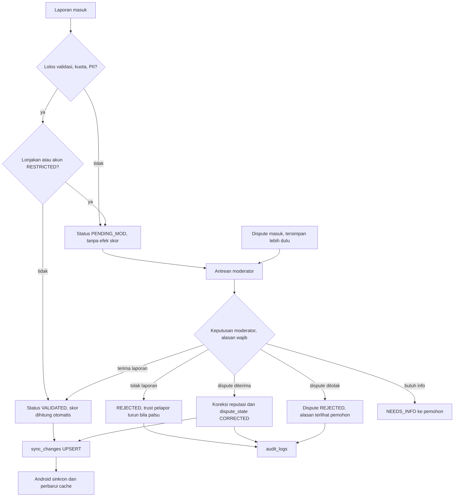
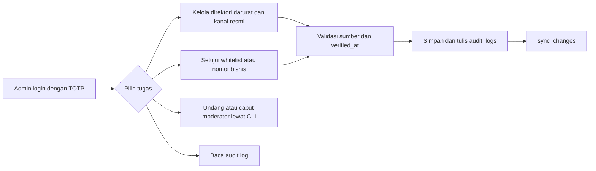

# 11. Admin dan moderasi

Status: **PROPOSED**. Saat ini `MISSING` ([FEATURE_GAP_ANALYSIS](../FEATURE_GAP_ANALYSIS.md), ADR-009). Pendekatan: halaman internal yang disajikan backend ([05](05-ARSITEKTUR-SISTEM.md) bagian 4).

## 1. MVP panel (dua pengguna: Moderator dan Admin)

| # | Fitur | Putusan | Halaman | Role | Endpoint | Koleksi |
|---|---|---|---|---|---|---|
| 1 | Login admin | MVP | `/admin/login` | staf | N7 | `users` |
| 2 | Dashboard ringkas | MVP kecil (hitungan antrean, kasus lewat SLA, laporan 24 jam) | `/admin` | MOD+ | N8 (agregat) | cases, reports |
| 3 | Daftar laporan masuk | MVP (hanya yang `PENDING_MOD`) | `/admin/reports` | MOD+ | N8 (`type=REPORT_REVIEW`) | `moderation_cases`, `spam_reports` |
| 4 | Moderasi laporan | MVP | detail kasus | MOD+ | N9, N10 | beberapa |
| 5 | Daftar nomor dan reputasi | MVP (cari satu nomor) | `/admin/numbers` | MOD+ | N11 | `phone_tags` |
| 6 | Peninjauan sanggahan | MVP | `/admin/disputes` | MOD+ | N8, N10 | `moderation_cases` |
| 7 | Whitelist | MVP | `/admin/verified` | MOD usul, ADMIN setuju | N12 | `verified_numbers` |
| 8 | Nomor bisnis terverifikasi | Digabung dengan #7 (`kind=BUSINESS`) | sama | ADMIN | N12 | sama |
| 9 | Nomor darurat | MVP | `/admin/emergency` | ADMIN | N13 | `emergency_directory` |
| 10 | Kanal resmi | MVP | `/admin/channels` | ADMIN | N13 | `official_channels` |
| 11 | Audit log | MVP (baca) | `/admin/audit` | ADMIN | N14 | `audit_logs` |
| 12 | Pengaturan sistem | **Ditunda**; konfigurasi lewat environment | - | - | - | - |

Analitik besar, manajemen staf lewat UI, dan peran super-admin ditunda.

## 2. Keputusan otomatis vs keputusan manusia

| Keputusan | Pelaku | Catatan |
|---|---|---|
| Hitung skor dan level SUSPICIOUS/SPAM | **Otomatis** | Berdasar [03](03-SPESIFIKASI-FITUR.md) |
| Naik ke DANGER_SCAM | Otomatis menghasilkan *kandidat*; menjadi aktif setelah gerbang konfirmasi (OD-03) | Mengurangi risiko brigading |
| Tahan laporan (`PENDING_MOD`) | Otomatis (lonjakan, PII, akun RESTRICTED) | Tidak menambah skor sampai ditinjau |
| Terima/tolak laporan, tag | Manusia | Alasan wajib |
| Putuskan dispute | Manusia | Alasan wajib; hasil `ACCEPTED` memicu koreksi dan `sync_changes` |
| Whitelist/blacklist | Manusia (ADMIN) | Kedaluwarsa dan sumber wajib |
| Banned/restricted akun | Moderator mengusulkan, Admin untuk `BANNED` | |
| Decay/kedaluwarsa | System Service | Tercatat sebagai aktor `SYSTEM` |

Setiap perubahan level penting menulis `audit_logs` dengan `before_hash`/`after_hash`, aktor, dan alasan; tidak ada edit langsung skor di database.

## 3. Alur moderasi

## 4. Alur admin

## 5. SLA dan batas

SLA tinjauan target **7 hari** untuk dispute dan **3 hari** untuk laporan tertahan (nilai awal usulan, perlu persetujuan; pada proyek akademik 2 orang dicatat sebagai target, bukan janji produk). Dashboard menampilkan kasus yang melewati SLA.

## 6. Acceptance ringkas

AC-11 dan AC-14 di [04](04-ALUR-PENGGUNA.md); tambahan: pengguna non-staf menerima `403` pada seluruh `/admin/*`; konflik versi menghasilkan `409`; setiap keputusan memiliki entri audit yang dapat dicari berdasarkan nomor.

