# 13. Katalog Lengkap Diagram Sistem CallTag (17 Diagram Arsitektur & Alur)

| Metadata | Nilai |
|---|---|
| Status | **DISETUJUI (14 November 2026)** sesuai keputusan [17-KEPUTUSAN-ARSITEKTUR](17-KEPUTUSAN-ARSITEKTUR.md) |
| Cakupan | 17 diagram sistem target (Mermaid) mencakup konteks, arsitektur, komponen, RBAC, autentikasi, lookup, screening, pelaporan, moderasi, database, sinkronisasi, admin, website, deployment, dan CI/CD |
| Baseline AS-IS | Diagram kondisi awal kode sebelum perubahan tetap tersimpan di [SYSTEM_ARCHITECTURE](../SYSTEM_ARCHITECTURE.md) dan [FLOWS_AND_DIAGRAMS](../FLOWS_AND_DIAGRAMS.md) |

---

## Daftar Isi 17 Diagram Sistem

1. [Diagram Konteks Sistem (System Context Diagram)](#1-diagram-konteks-sistem-system-context-diagram)
2. [Arsitektur Sistem Tingkat Tinggi (High-Level System Architecture)](#2-arsitektur-sistem-tingkat-tinggi-high-level-system-architecture)
3. [Diagram Komponen Android (Android Component Diagram)](#3-diagram-komponen-android-android-component-diagram)
4. [Diagram Komponen Backend (Backend Component Diagram)](#4-diagram-komponen-backend-backend-component-diagram)
5. [Diagram Peran dan Hak Akses (Role and Permission Diagram)](#5-diagram-peran-dan-hak-akses-role-and-permission-diagram)
6. [Diagram Alir Autentikasi (Authentication Flowchart)](#6-diagram-alir-autentikasi-authentication-flowchart)
7. [Diagram Alir Pencarian Nomor (Phone Lookup Flowchart)](#7-diagram-alir-pencarian-nomor-phone-lookup-flowchart)
8. [Diagram Urutan Pencarian Nomor (Phone Lookup Sequence Diagram)](#8-diagram-urutan-pencarian-nomor-phone-lookup-sequence-diagram)
9. [Diagram Alir Penyaringan Panggilan Masuk (Incoming Call Screening Flowchart)](#9-diagram-alir-penyaringan-panggilan-masuk-incoming-call-screening-flowchart)
10. [Diagram Alir Pelaporan Komunitas (Community Reporting Flowchart)](#10-diagram-alir-pelaporan-komunitas-community-reporting-flowchart)
11. [Diagram Alir Sanggahan dan Moderasi (Dispute and Moderation Flowchart)](#11-diagram-alir-sanggahan-dan-moderasi-dispute-and-moderation-flowchart)
12. [Diagram Hubungan Entitas Basis Data (Database ER Diagram)](#12-diagram-hubungan-entitas-basis-data-database-er-diagram)
13. [Diagram Sinkronisasi Offline (Offline Synchronisation Diagram)](#13-diagram-sinkronisasi-offline-offline-synchronisation-diagram)
14. [Diagram Alur Kerja Admin (Admin Workflow Diagram)](#14-diagram-alur-kerja-admin-admin-workflow-diagram)
15. [Diagram Integrasi Website (Website Integration Diagram)](#15-diagram-integrasi-website-website-integration-diagram)
16. [Arsitektur Deployment (Deployment Architecture)](#16-arsitektur-deployment-deployment-architecture)
17. [Diagram Alur CI/CD (CI/CD Diagram)](#17-diagram-alur-cicd-cicd-diagram)

---

## 1. Diagram Konteks Sistem (System Context Diagram)

Menggambarkan batas ekosistem CallTag, aktor eksternal (Pengguna Android, Pengunjung Web, Pemilik Nomor, Moderator/Admin), sistem operasi Android Telecom, serta layanan instansi/darurat eksternal.

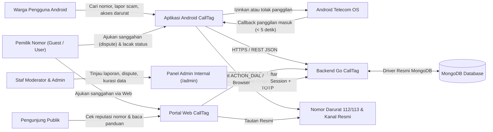

**Penjelasan:** Aplikasi Android dan Portal Web berkomunikasi dengan Backend Go melalui REST API. Panggilan ke nomor darurat dan kanal pelaporan pemerintah dilakukan melalui *Intent* telepon/peramban perangkat, tanpa mengunggah buku kontak pengguna.

---

## 2. Arsitektur Sistem Tingkat Tinggi (High-Level System Architecture)

Menunjukkan hubungan antarkontainer pada empat repositori (`CallTag`, `backend`, `calltag.github.io`, `apidocs`) dan penyimpanan data lokal maupun server.

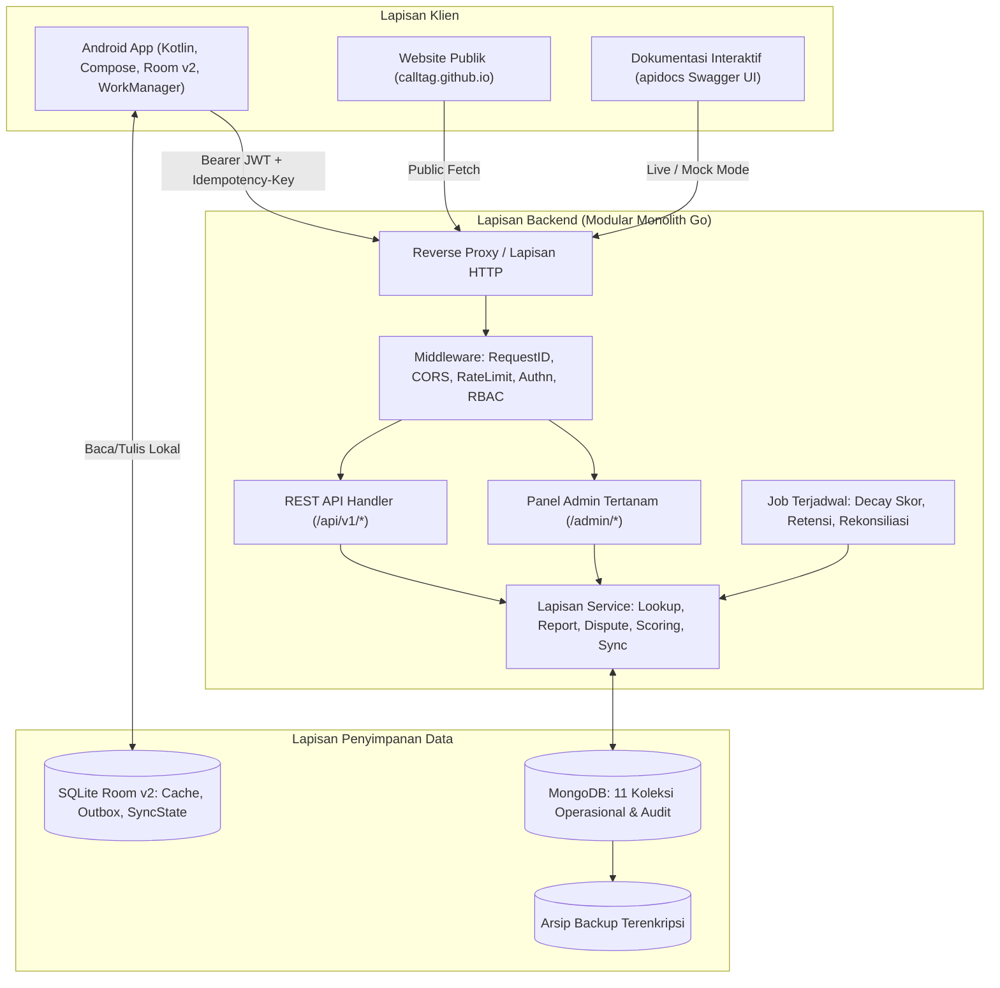

**Penjelasan:** Arsitektur mempertahankan pendekatan *modular monolith* pada satu proses Go untuk kemudahan operasional tim 2 orang, dilengkapi *Room v2* di sisi Android sebagai penyangga *offline-first*.

---

## 3. Diagram Komponen Android (Android Component Diagram)

Merinci arsitektur internal aplikasi Android di repositori `CallTag/CallTag` dengan pemisahan *UI Layer*, *Domain/Policy*, *Repository*, *WorkManager*, dan *Local/Remote Data Sources*.

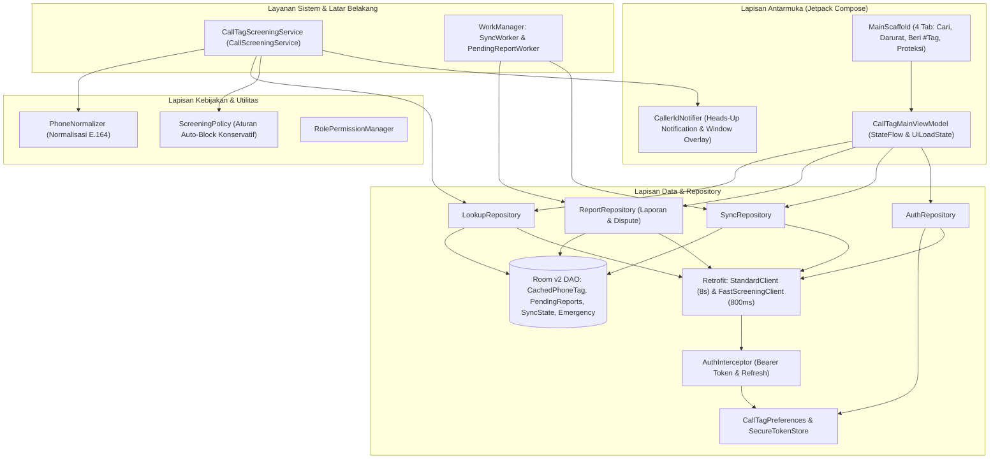

**Penjelasan:** Jalur panggilan masuk (`CallTagScreeningService`) wajib melewati `FastScreeningClient` (batas waktu 800 ms) dan `ScreeningPolicy` agar keputusan kembali ke sistem operasi dalam waktu di bawah 5 detik.

---

## 4. Diagram Komponen Backend (Backend Component Diagram)

Menggambarkan lapisan internal server Go di repositori `CallTag/backend` sesuai keputusan ADR-021.

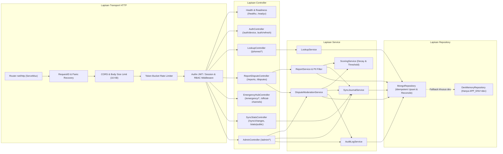

**Penjelasan:** Semua aksi penulisan reputasi dan moderasi terpusat di lapisan `Service` yang secara konsisten memperbarui agregat `phone_tags`, menulis jurnal `sync_changes`, dan mencatat `audit_logs`.

---

## 5. Diagram Peran dan Hak Akses (Role and Permission Diagram)

Memvisualisasikan 4 role aktif pada MVP (`Guest`, `Registered User`, `Staf Moderator/Admin`, `System Service`) dan 1 role yang ditunda ke P2 (`Verified Phone Owner`) sesuai OD-01.

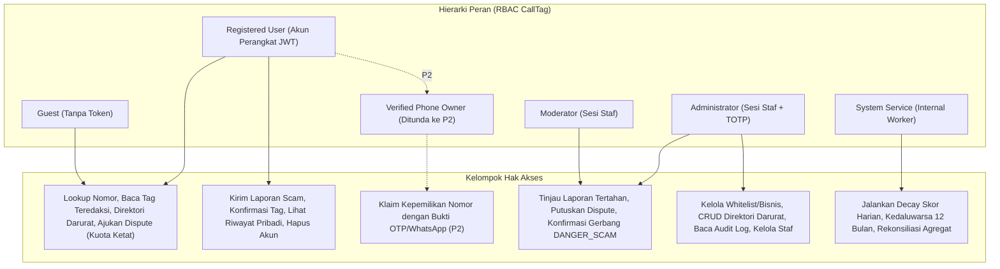

**Penjelasan:** `Guest` tidak dapat mengirim laporan spam (mencegah manipulasi skor anonim), namun tetap dapat melakukan pencarian nomor, mengakses nomor darurat, dan mengajukan sanggahan (*dispute*) dengan batas kuota ketat (OD-10).

---

## 6. Diagram Alir Autentikasi (Authentication Flowchart)

Menjelaskan alur pendaftaran perangkat tanpa nomor telepon (OD-02), verifikasi token pada request API, serta login staf dengan TOTP.

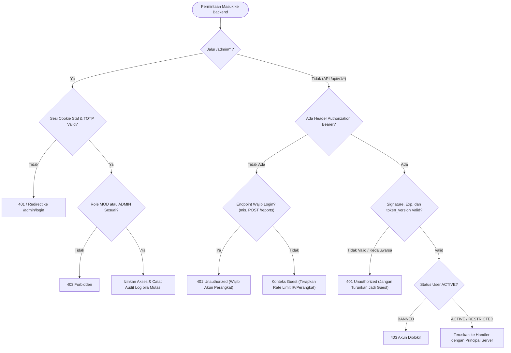

**Penjelasan:** Menutup celah temuan A02: token yang rusak atau kedaluwarsa langsung ditolak dengan `401 Unauthorized` dan tidak pernah diturunkan menjadi `Guest`.

---

## 7. Diagram Alir Pencarian Nomor (Phone Lookup Flowchart)

Menggambarkan logika pencarian nomor 2 dimensi (`availability` + `reputation_level`) sehingga nomor yang belum dikenal tidak pernah diklaim "Aman" (ADR-015).

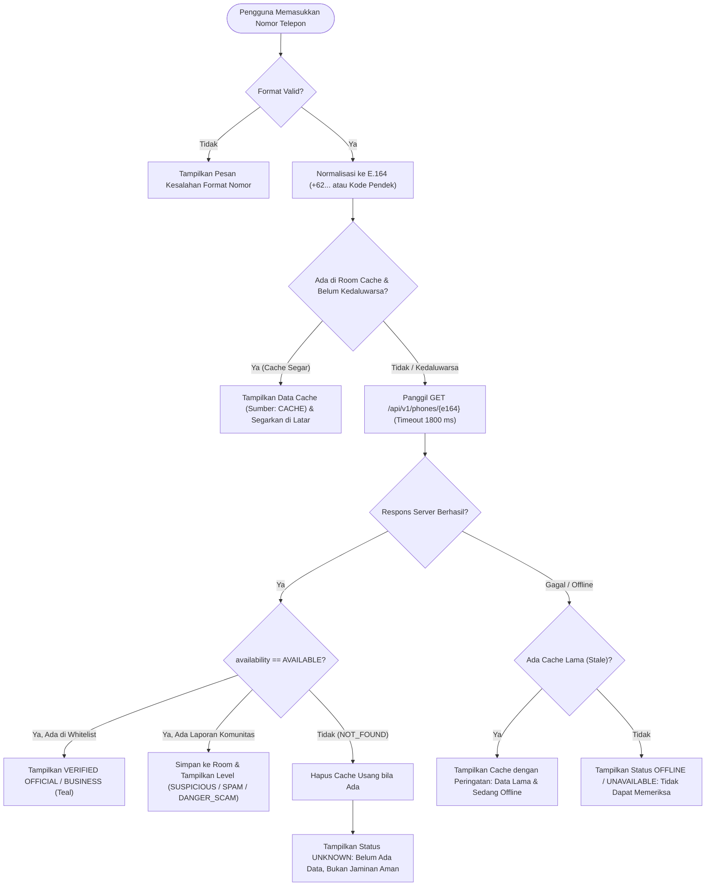

**Penjelasan:** Memisahkan secara tegas antara nomor resmi (`VERIFIED`), nomor belum terlapor (`UNKNOWN`), dan kegagalan jaringan (`OFFLINE/UNAVAILABLE`).

---

## 8. Diagram Urutan Pencarian Nomor (Phone Lookup Sequence Diagram)

Menunjukkan interaksi berurutan antara pengguna, UI Compose, `LookupRepository`, database Room, Backend Go, dan MongoDB.

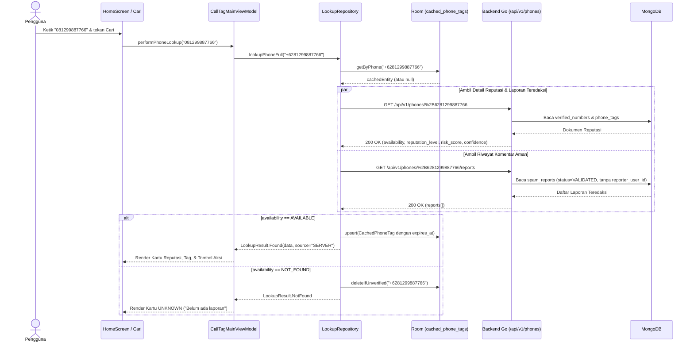

**Penjelasan:** Respons `/reports` telah disanitasi di server sehingga tidak pernah mengirimkan `reporter_user_id` ke klien publik (menutup risiko R11).

---

## 9. Diagram Alir Penyaringan Panggilan Masuk (Incoming Call Screening Flowchart)

Menggambarkan alur kritis `CallTagScreeningService` dengan batas waktu ketat `< 5 detik`, kebijakan *auto-block* konservatif (`OD-03` & `ADR-018`), dan mekanisme *fail-open*.

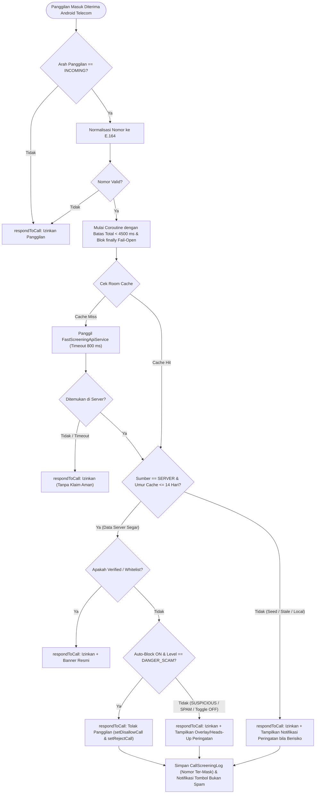

**Penjelasan:** Hanya nomor berstatus `DANGER_SCAM` (yang telah melewati ambang skor $\ge 70$, $\ge 5$ pelapor unik, dan gerbang konfirmasi moderator sesuai OD-03) dengan cache server segar ($\le 14$ hari) yang dapat diblokir otomatis bila pengguna mengaktifkan *toggle* Auto-Block.

---

## 10. Diagram Alir Pelaporan Komunitas (Community Reporting Flowchart)

Menggambarkan pengiriman laporan oleh pengguna terdaftar, perlindungan *idempotency*, penahanan otomatis pada lonjakan laporan, dan penyimpanan *outbox* saat offline.

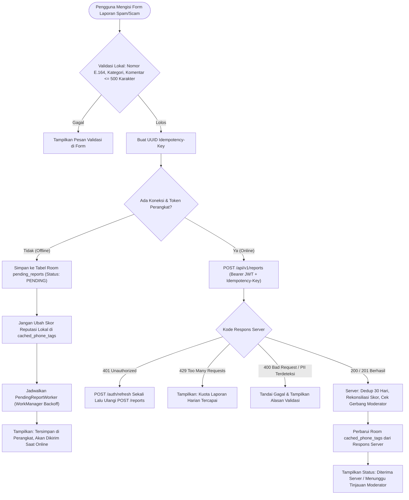

**Penjelasan:** Saat offline, laporan disimpan di `pending_reports` tanpa memalsukan kenaikan skor lokal (menutup temuan A04).

---

## 11. Diagram Alir Sanggahan dan Moderasi (Dispute and Moderation Flowchart)

Menggambarkan alur sanggahan pemilik nomor (termasuk *Guest* sesuai OD-10), antrean kasus di `moderation_cases`, gerbang konfirmasi `DANGER_SCAM` (OD-03), dan penyebaran koreksi ke klien.

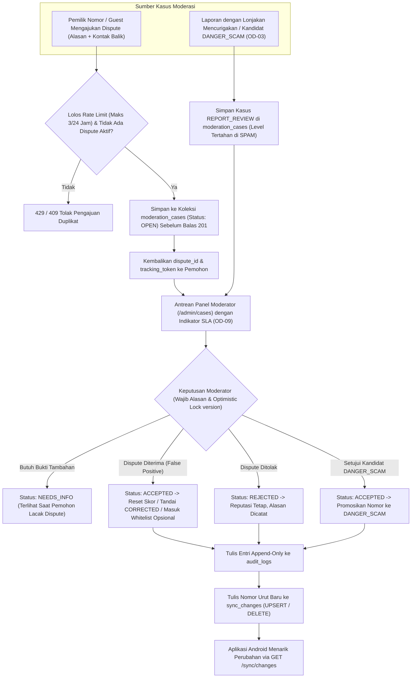

**Penjelasan:** Menutup temuan A03 (dispute wajib tersimpan di MongoDB sebelum merespons `201`) dan OD-03 (status `DANGER_SCAM` memerlukan pengesahan moderator).

---

## 12. Diagram Hubungan Entitas Basis Data (Database ER Diagram)

Menampilkan hubungan antar-11 koleksi MongoDB di backend dan 6 tabel Room v2 di Android.

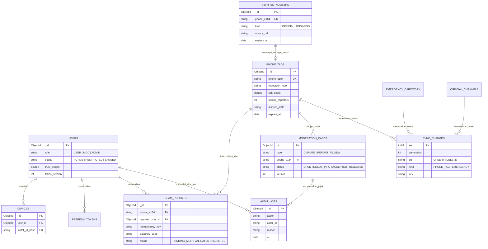

**Penjelasan:** Skema menggunakan *Idempotent Upsert* + rekonsiliasi dari `spam_reports` (OD-08) sehingga tetap konsisten baik di MongoDB *standalone* maupun *Replica Set*.

---

## 13. Diagram Sinkronisasi Offline (Offline Synchronisation Diagram)

Menunjukkan mekanisme sinkronisasi berbasis jurnal perubahan (`sync_changes`) dengan *cursor* opak (`generation:seq`) yang menutup bug kehilangan versi pada temuan A06.

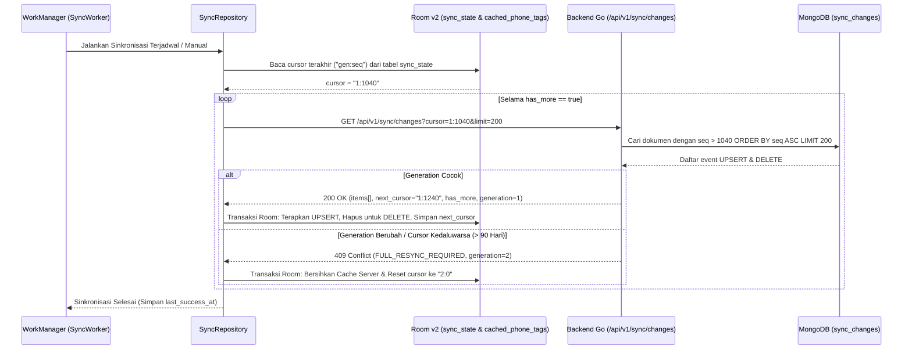

**Penjelasan:** Urutan halaman didasarkan pada nomor urut `seq` yang selalu naik, bukan `risk_score`, sehingga tidak ada nomor yang terlewat dan pencabutan status berbahaya (`DELETE`/tombstone) ikut tersinkronisasi ke perangkat.

---

## 14. Diagram Alur Kerja Admin (Admin Workflow Diagram)

Menggambarkan alur kerja Staf (`Moderator` dan `Administrator`) pada panel internal `/admin` untuk kurasi direktori wilayah pilot (OD-05), pengelolaan whitelist, dan peninjauan kasus.

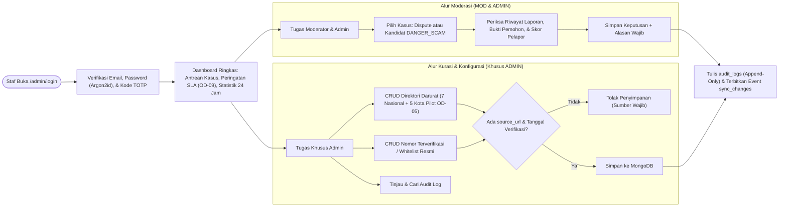

**Penjelasan:** Setiap perubahan data direktori darurat dan whitelist mewajibkan pencantuman `source_url` resmi (OD-05) dan tercatat di `audit_logs`.

---

## 15. Diagram Integrasi Website (Website Integration Diagram)

Menunjukkan bagaimana portal publik `calltag.github.io` dan `apidocs` berinteraksi dengan backend dan GitHub Releases.

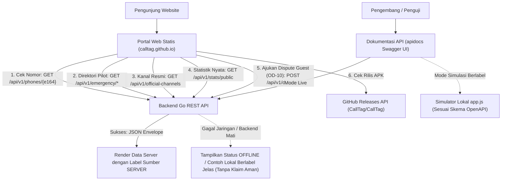

**Penjelasan:** Pengiriman laporan spam cepat dari web dinonaktifkan pada MVP untuk mencegah spam tanpa identitas perangkat, tetapi pengajuan sanggahan (*dispute*) oleh *Guest* tetap dibuka dengan *rate limit* ketat (OD-10).

---

## 16. Arsitektur Deployment (Deployment Architecture)

Menggambarkan skema deployment **Zero-Cost (Rp 0)** sesuai keputusan OD-06 untuk lingkungan pengembangan/demo lokal dan lingkungan staging/cloud opsional.

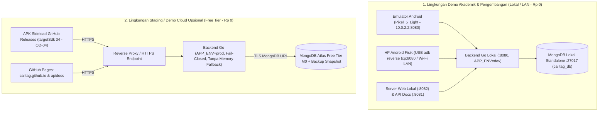

**Penjelasan:** Skema ini memastikan demo sidang kuliah 100% andal di jaringan lokal tanpa biaya sewa server, sekaligus mendukung koneksi cloud melalui MongoDB Atlas Free Tier dan GitHub Pages.

---

## 17. Diagram Alur CI/CD (CI/CD Diagram)

Menggambarkan pipeline pengujian otomatis pada setiap *Pull Request* dan pemisahan pembuatan rilis APK hanya ketika *git tag* versi diterbitkan (mencegah commit dokumentasi memicu rilis APK).

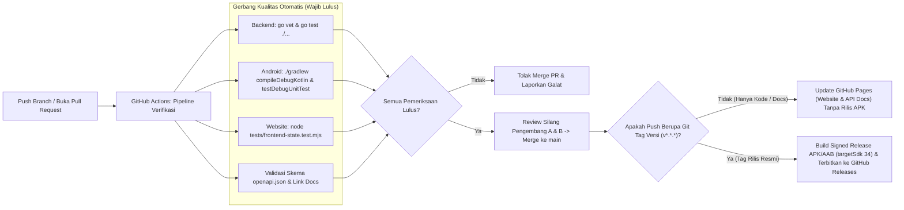

**Penjelasan:** Memperbaiki perilaku `.github/workflows/release-android.yml` agar pembaruan dokumentasi tidak lagi memicu pembuatan rilis APK baru secara tidak sengaja.
