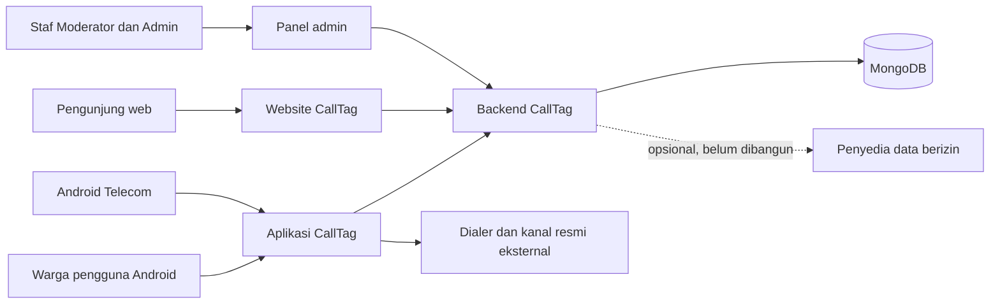
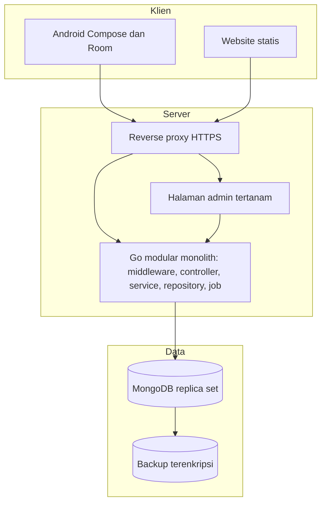
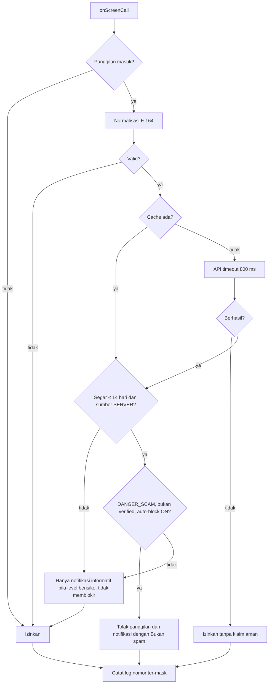
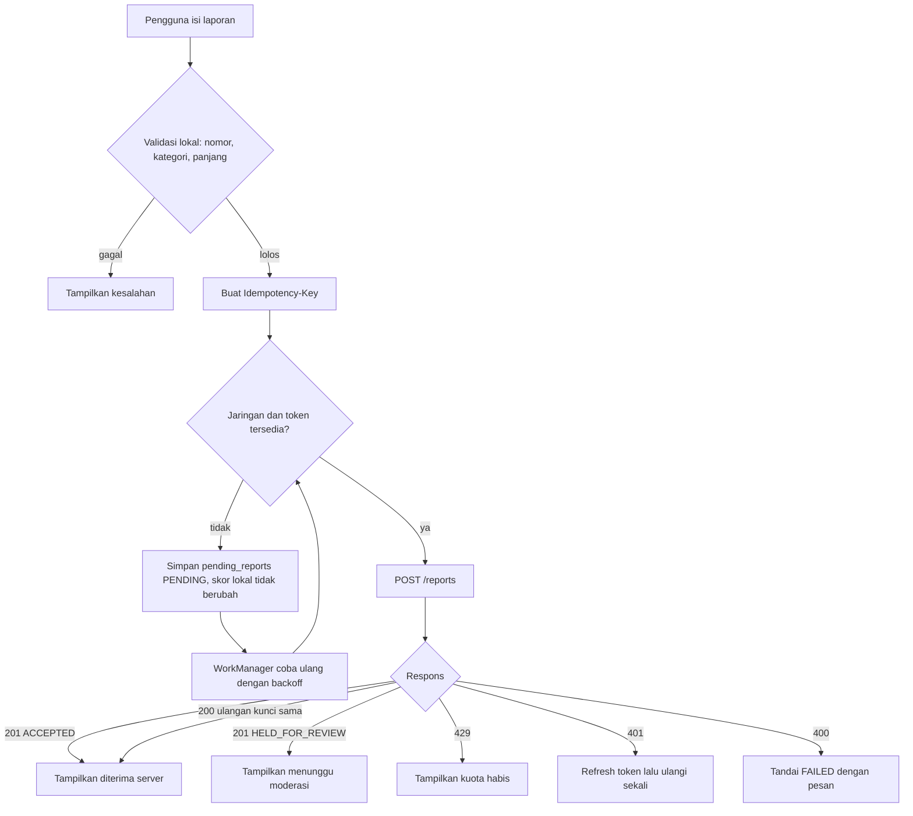
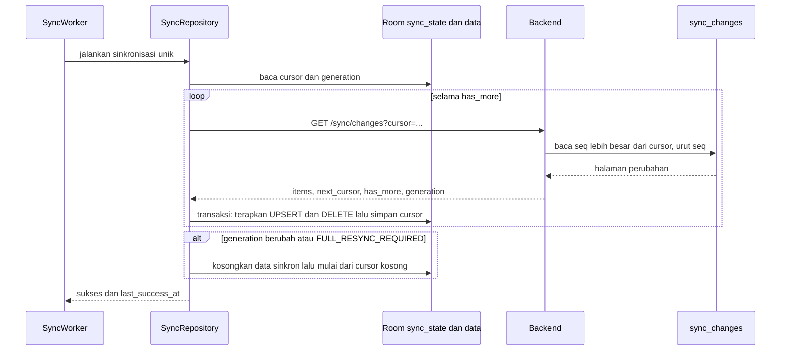
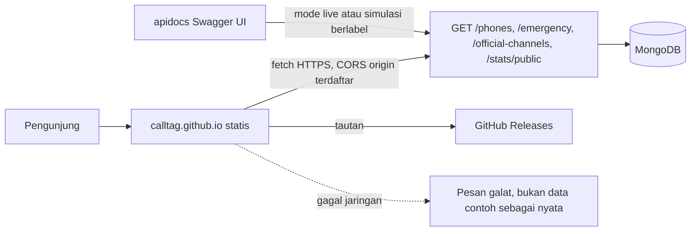
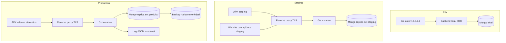
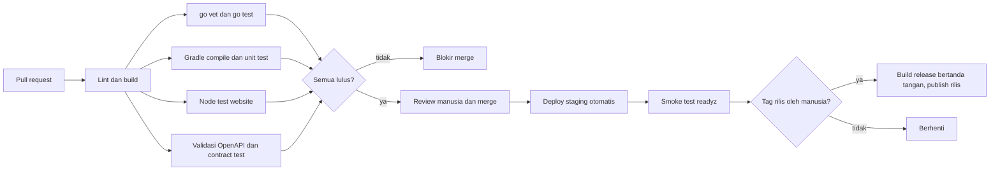

# 13. Diagram sistem

Status: **PROPOSED** (target). Diagram AS-IS yang sudah benar **tidak diduplikasi**: lihat [SYSTEM_ARCHITECTURE](../SYSTEM_ARCHITECTURE.md) (context/container/komponen/DFD/deployment as-is) dan [FLOWS_AND_DIAGRAMS](../FLOWS_AND_DIAGRAMS.md) (alur as-is dan sequence). Dokumen ini memuat diagram target yang belum ada dan indeks untuk yang sudah ditempatkan di dokumen topik.

## Indeks 17 diagram

| # | Diagram | Lokasi |
|---|---|---|
| 1 | System Context (target) | bagian 1 di bawah |
| 2 | High-Level Architecture | bagian 2 |
| 3 | Android Component | [05](05-ARSITEKTUR-SISTEM.md) bagian 1 |
| 4 | Backend Component | [05](05-ARSITEKTUR-SISTEM.md) bagian 2 |
| 5 | Role dan Permission | [02](02-ROLE-DAN-HAK-AKSES.md) bagian 3 |
| 6 | Authentication Flowchart | [02](02-ROLE-DAN-HAK-AKSES.md) bagian 4 |
| 7 | Phone Lookup Flowchart | [08](08-STRATEGI-PENCARIAN-NOMOR.md) bagian 2 |
| 8 | Phone Lookup Sequence | [08](08-STRATEGI-PENCARIAN-NOMOR.md) bagian 2 |
| 9 | Incoming Call Screening | bagian 3 |
| 10 | Community Reporting | bagian 4 |
| 11 | Dispute dan Moderation | [11](11-ADMIN-DAN-MODERASI.md) bagian 3 |
| 12 | Database ER | [06](06-DESAIN-DATABASE.md) bagian 3 |
| 13 | Offline Synchronisation | bagian 5 |
| 14 | Admin Workflow | [11](11-ADMIN-DAN-MODERASI.md) bagian 4 |
| 15 | Website Integration | bagian 6 |
| 16 | Deployment Architecture | bagian 7 |
| 17 | CI/CD | bagian 8 |

## 1. System Context (target)

Garis putus-putus menandai integrasi yang tidak dibangun pada MVP.

## 2. High-Level Architecture

## 3. Incoming Call Screening (target)

Aturan: seluruh jalur berakhir dengan respons ke Telecom dalam < 5 detik; `finally` menjamin `allow` bila terjadi kesalahan.

## 4. Community Reporting

## 5. Offline Synchronisation

## 6. Website Integration

## 7. Deployment Architecture

Host konkret (VPS/PaaS) belum diputuskan: OD-06.

## 8. CI/CD

Catatan: workflow rilis Android saat ini terpicu setiap push `main` ([SYSTEM_ARCHITECTURE](../SYSTEM_ARCHITECTURE.md), Catatan CI). Target: rilis hanya dari tag atau persetujuan manual; perubahan dokumen saja tidak memicu rilis.
