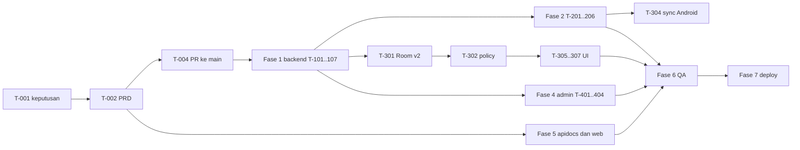

# 14. Roadmap pengembangan

Status: **PROPOSED**. Memperluas [IMPLEMENTATION_ROADMAP](../IMPLEMENTATION_ROADMAP.md) (B01 sampai B16) tanpa menggantikannya; kolom "B" memetakan ke backlog lama. Skala effort mengikuti dokumen itu: **S** = 0,5 sampai 1 hari-orang, **M** = 2 sampai 4, **L** = 5 sampai 8. Pemilik: **A** = backend/API/Mongo/keamanan, **B** = Android/UI/QA/dokumen. Estimasi adalah perkiraan awal dengan bantuan AI coding agent, belum divalidasi.

**Definition of Done (berlaku untuk semua tugas):** (1) kode di branch fitur dengan PR terpisah per repo, ditinjau manusia; (2) test baru lulus dan test lama tidak rusak; (3) acceptance criteria terpenuhi dengan bukti perintah/keluaran; (4) OpenAPI/dokumen terkait diperbarui; (5) tidak ada secret atau PII di commit/log; (6) tidak ada fitur di luar lingkup tugas.

## Fase 0: Finalisasi perencanaan

| ID | Deskripsi | Repo | Pri | Dep | Sulit | Effort | Hasil | Acceptance | Cara uji | B |
|---|---|---|---|---|---|---|---|---|---|---|
| T-001 | Persetujuan keputusan K1 sampai K7 dan OD-01 sampai OD-08 ([17](17-KEPUTUSAN-ARSITEKTUR.md)) | CallTag | P0 | - | Rendah | S | Keputusan tertulis | Semua OD berstatus Diputuskan | Review | - |
| T-002 | Perbarui PRD ke 1.2.0 dan sinkronkan OpenAPI target | CallTag, apidocs | P0 | T-001 | Rendah | S | PRD final | Tidak ada kontradiksi dengan planning | Tinjau silang | - |
| T-003 | Putuskan kanal distribusi dan target SDK (OD-04) | CallTag | P1 | T-001 | Rendah | S | Keputusan | Tertulis | Review | B14 |
| T-004 | Merge/PR strategi: promosikan feature branch backend/apidocs/web ke `main` setelah review | semua | P1 | T-002 | Rendah | S | `main` berisi kode | PR disetujui manusia | Diff review | - |

## Fase 1: Keamanan dan integritas data (backend, pemilik A)

| ID | Deskripsi | Repo | Pri | Dep | Sulit | Effort | Hasil | Acceptance | Cara uji | B |
|---|---|---|---|---|---|---|---|---|---|---|
| T-101 | Auth ketat: bearer tidak valid → 401; guest dilarang melapor; middleware authn | backend | P0 | T-004 | Sedang | M | Middleware auth | AC-02; T10 beralih PASS | Test Go: token rusak/kedaluwarsa/hilang | B01 |
| T-102 | Secret wajib dan kuat; hapus fallback dari source; startup gagal bila lemah | backend | P0 | - | Rendah | S | Konfigurasi strict | Proses keluar tanpa `JWT_SECRET` pada `APP_ENV=prod` | Test konfigurasi | B01 |
| T-103 | Principal dari klaim token; abaikan `X-Device-Id`; kuota 10/24 jam dan 3/5 menit | backend | P0 | T-101 | Sedang | M | Rate limit + kuota | 11 perangkat berbeda tidak bisa menghasilkan DANGER_SCAM (T11 beralih) | Test integrasi | B05 |
| T-104 | Idempotency key + unique index + dedup 30 hari + ID laporan persisten | backend | P0 | T-103 | Sedang | L | Laporan idempoten | AC-07; T09 beralih PASS | Test dua POST sama = 1 dokumen | B05 |
| T-105 | Persistensi dispute (`moderation_cases`) sebelum 201 | backend | P0 | T-104 | Sedang | M | Endpoint dispute nyata | AC-10; T12 beralih PASS | Baca ulang dari DB | B03 |
| T-106 | DTO publik teredaksi, filter PII komentar, log tanpa nomor/token | backend | P0 | - | Sedang | M | Respons aman | AC-04 | Test skema respons + grep log | B08 |
| T-107 | `/healthz` dan `/readyz` (ping Mongo); produksi tanpa memory fallback | backend | P0 | - | Rendah | S | Probe benar | T20 beralih PASS | Matikan Mongo → 503 | B07 |

## Fase 2: Backend dan database (A)

| ID | Deskripsi | Repo | Pri | Dep | Sulit | Effort | Hasil | Acceptance | Cara uji | B |
|---|---|---|---|---|---|---|---|---|---|---|
| T-201 | `sync_changes` journal + `GET /sync/changes` + FULL_RESYNC | backend | P0 | T-104 | Tinggi | L | Delta aman | AC-16; T15 beralih PASS | Dua versi satu detik, limit 1 | B06 |
| T-202 | `ScoringService` sesuai [03](03-SPESIFIKASI-FITUR.md) + test tabel U1 sampai U8 | backend | P0 | T-104 | Sedang | M | Skor deterministik | Semua kasus tabel lulus | Test tabel | B05 |
| T-203 | Refactor bertahap: router per metode, lapisan service/repository, middleware | backend | P1 | T-101 | Sedang | L | Struktur modular | Tes lama tetap lulus | Regresi | - |
| T-204 | Endpoint tambahan N1 sampai N3, N6 (refresh, me, hapus akun, lacak dispute) | backend | P1 | T-101, T-105 | Sedang | M | API akun | AC-02, AC-10 | Contract test | B02 |
| T-205 | `$jsonSchema` validator, migrasi data aman, transaksi/replica set atau rekonsiliasi | backend | P1 | T-104 | Tinggi | M | DB tervalidasi | Dry-run migrasi + restore di staging | Skrip uji | B10 |
| T-206 | Job decay, kedaluwarsa 12 bulan, retensi, rekonsiliasi agregat | backend | P2 | T-202 | Sedang | M | Job terjadwal | Skor menurun tanpa laporan baru | Test waktu terkontrol | B15 |

## Fase 3: Integrasi Android (B)

| ID | Deskripsi | Repo | Pri | Dep | Sulit | Effort | Hasil | Acceptance | Cara uji | B |
|---|---|---|---|---|---|---|---|---|---|---|
| T-301 | Room v2: `pending_reports`, `pending_disputes`, `sync_state`; migrasi tertulis; outbox | CallTag | P0 | T-104 | Tinggi | L | Outbox durable | AC-08, AC-09 | `MigrationTestHelper`, uji restart | B10 |
| T-302 | Kebijakan auto-block konservatif ([10](10-KEAMANAN-DAN-PRIVASI.md) bagian 5), default OFF | CallTag | P0 | T-303 | Sedang | M | `ScreeningPolicy` | AC-05, AC-06 | Unit test tabel keputusan | B04 |
| T-303 | `LookupResult` bertipe, cache `expires_at`/`source`, hapus CLEAN sintetis | CallTag | P0 | T-301 | Sedang | M | Lookup jujur | AC-03 | Unit test + UI manual | B02 |
| T-304 | `SyncRepository` + WorkManager memakai `/sync/changes` | CallTag | P0 | T-201, T-301 | Tinggi | L | Sync otomatis | AC-16 | Test + emulator airplane mode | B06 |
| T-305 | Onboarding, `AuthInterceptor`, penyimpanan token aman, hapus pengiriman `phone` | CallTag | P1 | T-101, T-204 | Sedang | M | Alur 1 dan 2 | AC-01, AC-02 | Uji emulator | B09 |
| T-306 | Isolasi fixture (debug saja), hapus teks "AMAN", masking log | CallTag | P1 | T-303 | Rendah | S | UI jujur | grep "NOMOR AMAN" kosong | Pencarian kode + UI | B11 |
| T-307 | Halaman Riwayat laporan, Sanggahan, Akun dan data; Proteksi gabungan | CallTag | P1 | T-301, T-105 | Sedang | L | UI sesuai [12](12-RANCANGAN-UI-UX.md) | State lengkap per halaman | Screenshot emulator | B09 |

## Fase 4: Admin panel (A, sebagian B)

| ID | Deskripsi | Repo | Pri | Dep | Sulit | Effort | Hasil | Acceptance | Cara uji | B |
|---|---|---|---|---|---|---|---|---|---|---|
| T-401 | Login staf (argon2id, TOTP), sesi cookie, CSRF, CLI `mkstaff` | backend | P1 | T-101 | Sedang | M | Auth staf | 403 untuk non-staf | Test RBAC | B12 |
| T-402 | Antrean kasus, detail, keputusan (`PATCH`), optimistic lock, audit | backend | P1 | T-105, T-401 | Tinggi | L | Moderasi | AC-11 | Test alur + audit | B12 |
| T-403 | CRUD whitelist/bisnis, direktori darurat, kanal resmi dengan sumber wajib | backend | P1 | T-401 | Sedang | M | Kurasi | AC-14 | Test validasi | B12 |
| T-404 | Halaman HTML tertanam: antrean, nomor, audit, dashboard ringkas | backend | P1 | T-402 | Sedang | M | UI admin | Alur 11 dan 14 dapat dijalankan manual | Demo | B12 |

## Fase 5: Landing page dan API docs (B)

| ID | Deskripsi | Repo | Pri | Dep | Sulit | Effort | Hasil | Acceptance | Cara uji | B |
|---|---|---|---|---|---|---|---|---|---|---|
| T-501 | OpenAPI: skema respons lengkap, tag Admin, perbaiki simulator atau beri label | apidocs | P1 | T-002 | Sedang | M | Kontrak akurat | Contract test lulus | Validator + test | B08 |
| T-502 | Website: status lookup jujur, matikan form lapor, enum `call_type` benar | calltag.github.io | P1 | T-303 | Rendah | M | Web konsisten | AC-15; test frontend diperluas | `node tests/` | B08 |
| T-503 | Landing sesuai [12](12-RANCANGAN-UI-UX.md) bagian 4; statistik nyata; unduhan terverifikasi | calltag.github.io | P2 | T-502 | Rendah | M | Situs final | Tanpa angka contoh | Review + tes | B13 |

## Fase 6: Quality assurance

| ID | Deskripsi | Repo | Pri | Dep | Sulit | Effort | Hasil | Acceptance | Cara uji | B |
|---|---|---|---|---|---|---|---|---|---|---|
| T-601 | Unit + integrasi backend (Mongo test terisolasi) | backend | P0 | Fase 1 | Sedang | L | Suite Go | Cakupan alur kritis | `go test` | B08 |
| T-602 | Contract test OpenAPI ↔ backend ↔ DTO Android | backend, apidocs | P1 | T-501 | Sedang | M | Gerbang CI | Gagal bila skema menyimpang | CI | B08 |
| T-603 | Unit test Android (policy, normalizer, mapper) + instrumented (Room, migrasi) | CallTag | P1 | T-301 | Sedang | L | Suite Android | `./gradlew testDebugUnitTest` bukan NO-SOURCE | Gradle | - |
| T-604 | Uji keamanan: auth bypass, RBAC, rate limit, PII, injeksi | backend | P0 | Fase 4 | Sedang | M | Laporan | Semua kasus negatif lulus | Skrip | B01 |
| T-605 | Uji perangkat fisik + operator (call screening nyata) | CallTag | P1 | T-302 | Sedang | M | Bukti | Panggilan nyata disaring atau diizinkan sesuai kebijakan | Perangkat | B11 |
| T-606 | Benchmark terukur (p50/p95) dengan dataset dan perangkat bernama | semua | P2 | Fase 3 | Sedang | S | Laporan | Angka terlapor | Skrip | - |

## Fase 7: Deployment dan finalisasi

| ID | Deskripsi | Repo | Pri | Dep | Sulit | Effort | Hasil | Acceptance | Cara uji | B |
|---|---|---|---|---|---|---|---|---|---|---|
| T-701 | Staging HTTPS (reverse proxy, Mongo replica set), build type `staging`/`release` tanpa cleartext | backend, CallTag | P1 | T-107 | Sedang | L | Staging hidup | `readyz` 200 via HTTPS | Smoke test | B14 |
| T-702 | Signing release, CI gate (test wajib), rilis hanya dari tag | CallTag | P1 | T-603 | Sedang | M | Pipeline | PR dokumen tidak memicu rilis | CI | B14 |
| T-703 | Backup terjadwal + uji restore + log/monitor dasar | backend | P1 | T-701 | Sedang | M | Operasi | Restore di staging berhasil | Latihan | B07 |
| T-704 | Dokumentasi penggunaan dan operasi (runbook) | CallTag | P2 | T-703 | Rendah | S | Panduan | Orang kedua dapat menjalankan | Uji walkthrough | - |

## Dependensi dan paralelisme

Pembagian dua orang tanpa konflik antar-repo: **A** memegang `backend` (Fase 1, 2, 4) dan **B** memegang `CallTag`, `apidocs`, `calltag.github.io` (Fase 3, 5). Titik sinkron wajib: kontrak OpenAPI dibekukan per milestone (T-002 → T-501); Android memakai mock server/contract fixture sampai endpoint backend siap, sehingga T-301/T-302/T-303 dapat berjalan paralel dengan T-101..T-105. Satu alur vertikal aktif per pengembang (aturan roadmap lama dipertahankan). Agen AI bekerja pada branch per tugas di repo pemilik; tidak ada agen yang menyentuh dua repo sekaligus tanpa PR terpisah.

