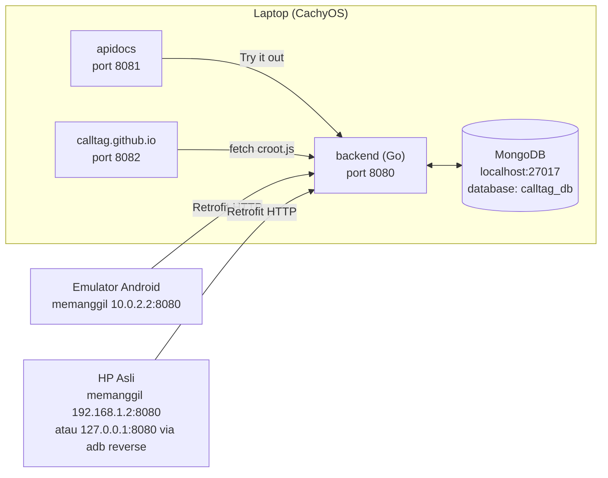
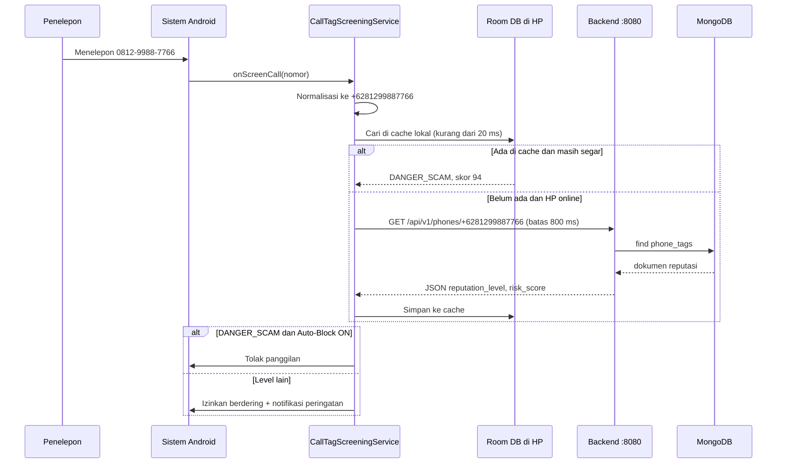

# Panduan Lengkap Menjalankan CallTag Indonesia (Dari Nol Sampai Jalan di Emulator & HP)

Panduan ini ditulis untuk laptop kamu saat ini (CachyOS Linux) dengan alur kerja **ngoding langsung di VS Code atau Antigravity** (tanpa perlu membuka project berat di Android Studio; Android Studio hanya dipakai emulatornya saja). Panduan ini menjelaskan semuanya dari awal: apa isi tiap folder, bagaimana aplikasi Android "nyambung" ke backend dan MongoDB, lalu langkah menjalankan satu per satu sampai bisa dites di **Emulator (`Pixel_5_Light`)** maupun **HP asli**.
 
> [!TIP]
> Kalau kamu hanya butuh **perintah cepat untuk menjalankan ulang aplikasi saat sedang revisi/ngoding**, langsung buka file pendamping: [CARA_RUN_APLIKASI.md](file:///home/ridwan/Documents/Kuliah/Semester5/CallTAG/CARA_RUN_APLIKASI.md).

---

## Daftar Isi

1. [Gambaran Besar: Apa Saja yang Ada dan Bagaimana Saling Terhubung](#1-gambaran-besar-apa-saja-yang-ada-dan-bagaimana-saling-terhubung)
2. [Cek Perlengkapan di Laptop](#2-cek-perlengkapan-di-laptop)
3. [Penjelasan Setiap Folder dan File](#3-penjelasan-setiap-folder-dan-file)
4. [Langkah 1: Nyalakan MongoDB](#4-langkah-1-nyalakan-mongodb)
5. [Langkah 2: Jalankan Backend (Go) Terhubung ke MongoDB](#5-langkah-2-jalankan-backend-go-terhubung-ke-mongodb)
6. [Langkah 3: Jalankan apidocs (Swagger UI)](#6-langkah-3-jalankan-apidocs-swagger-ui)
7. [Langkah 4: Jalankan Website calltag.github.io](#7-langkah-4-jalankan-website-calltaggithubio)
8. [Langkah 5A: Jalankan Aplikasi Android di Emulator](#8-langkah-5a-jalankan-aplikasi-android-di-emulator)
9. [Langkah 5B: Jalankan Aplikasi Android di HP Asli](#9-langkah-5b-jalankan-aplikasi-android-di-hp-asli)
10. [Cara Kerja Koneksi Saat Ada Telepon Masuk](#10-cara-kerja-koneksi-saat-ada-telepon-masuk)
11. [Troubleshooting (Masalah yang Sering Muncul)](#11-troubleshooting-masalah-yang-sering-muncul)
12. [Contekan Harian (Ringkas)](#12-contekan-harian-ringkas)
13. [Push ke GitHub, Auto-Release APK, dan GitHub Pages](#13-push-ke-github-auto-release-apk-dan-github-pages)

---

## 1. Gambaran Besar: Apa Saja yang Ada dan Bagaimana Saling Terhubung

Folder `CallTAG/` berisi **4 repositori** yang masing-masing punya tugas berbeda:

| Repo | Isinya Apa | Analogi Sederhana |
| :--- | :--- | :--- |
| `backend/` | Server REST API (bahasa Go). Menerima pertanyaan "nomor ini aman atau tidak?", menyimpan laporan, menghitung skor risiko. | **Dapur** restoran |
| MongoDB (sudah terinstal di laptop) | Database tempat backend menyimpan data nomor, laporan, posko darurat, kanal resmi. | **Gudang bahan** |
| `CallTag/` | Aplikasi Android (Kotlin + Jetpack Compose). Mendeteksi telepon masuk, menampilkan peringatan, direktori darurat. | **Pelayan** yang melayani pelanggan |
| `calltag.github.io/` | Website publik (landing page + cek nomor dari browser). | **Etalase** depan toko |
| `apidocs/` | Dokumentasi API interaktif (Swagger UI). Tempat mencoba endpoint backend lewat browser. | **Buku menu** |

### Diagram Koneksi



**Poin penting yang sering bikin bingung:**

- Aplikasi Android **tidak** bicara langsung ke MongoDB. Alurnya selalu: **Aplikasi &rarr; Backend (port 8080) &rarr; MongoDB**.
- Alamat backend yang dipakai aplikasi Android ditentukan saat **build**, lewat konstanta `BuildConfig.BASE_API_URL` di [app/build.gradle.kts](file:///home/ridwan/Documents/Kuliah/Semester5/CallTAG/CallTag/app/build.gradle.kts). Defaultnya `http://10.0.2.2:8080/` (khusus emulator).
- Aplikasi Android punya **database sendiri di HP** (Room/SQLite) berisi nomor darurat dan daftar scammer. Jadi walaupun backend mati atau HP offline, fitur darurat dan deteksi scammer yang sudah tersimpan **tetap jalan**.
- Website dan apidocs juga punya **mode fallback/demo**: kalau backend mati, mereka tetap menampilkan data contoh supaya bisa didemokan.

---

## 2. Cek Perlengkapan di Laptop

Hasil pengecekan di laptop kamu:

| Perlengkapan | Status di Laptop Kamu | Perintah Cek |
| :--- | :--- | :--- |
| Go | `go1.27.3` sudah ada | `go version` |
| MongoDB Server | `v8.3.9`, service bernama **`mongodb`**, sudah running di `127.0.0.1:27017` | `systemctl status mongodb` |
| MongoDB Shell | `mongosh` sudah ada | `mongosh --version` |
| Python 3 (untuk server statis) | sudah ada | `python3 --version` |
| Android SDK | `/home/ridwan/Android/Sdk` (platform `android-34` ada, sudah diatur di `CallTag/local.properties`) | `ls ~/Android/Sdk/platforms` |
| JDK 17 (untuk Gradle) | `/home/ridwan/.local/jdk17` (`17.0.20.1`, sudah diatur otomatis di `~/.gradle/gradle.properties`) | `~/.local/jdk17/bin/java -version` |
| Emulator (AVD) | **`Pixel_5_Light`** (Android 14 / API 34, bisa dinyalakan langsung dari terminal) | `emulator -list-avds` |
| ADB | `~/Android/Sdk/platform-tools/adb` | `adb version` |
| IP laptop di Wi-Fi | **`192.168.1.2`** (bisa berubah kalau router memberi IP baru) | `ip -4 addr show wlan0` |
| Firewall | **`ufw` aktif** (penting untuk HP asli via Wi-Fi) | `sudo ufw status` |

> [!NOTE]
> Kalau suatu saat IP laptop berubah (misal jadi `192.168.1.7`), ganti semua `192.168.1.2` di panduan ini dengan IP baru tersebut.

---

## 3. Penjelasan Setiap Folder dan File

### 3.1 Folder Induk

```text
CallTAG/
├── PANDUAN_MENJALANKAN.md        # Dokumen ini
├── backend/                      # Server API Go + koneksi MongoDB
├── apidocs/                      # Dokumentasi Swagger UI
├── calltag.github.io/            # Website publik
└── CallTag/                      # Aplikasi Android + PRD.md + DESIGN.md
```

### 3.2 `backend/` (Server API Go gocroot)

```text
backend/
├── main.go                 # Titik awal program. Menyalakan database lalu membuka server HTTP di port 8080.
├── main_test.go            # Unit test otomatis yang mengetes ke-11 endpoint.
├── go.mod / go.sum         # Daftar library Go (seperti package.json di Node.js).
├── config/
│   ├── config.go           # Membaca environment variable: MONGOSTRING, DB_NAME, PORT. Berisi nama-nama koleksi MongoDB.
│   └── db.go               # Koneksi ke MongoDB, membuat index, seed data awal, dan semua query (lookup, simpan laporan, statistik).
│                           # Kalau MongoDB tidak bisa dihubungi, otomatis pindah ke mode "in-memory" (data hilang saat server mati).
├── controller/             # "Penerima pesanan": satu fungsi per endpoint.
│   ├── auth.go             # POST /api/v1/auth/device (daftar perangkat, terbitkan token JWT)
│   ├── lookup.go           # GET /api/v1/phones/{e164} dan GET /api/v1/phones/{e164}/reports
│   ├── report.go           # POST /api/v1/reports (laporan baru) dan POST /api/v1/disputes (sanggahan)
│   ├── emergency.go        # GET /api/v1/emergency/national, /emergency/local, /official-channels
│   └── sync.go             # GET /api/v1/sync/offline-bundle, /stats/public, /health
├── helper/
│   ├── auth.go             # Pembuatan & pembacaan token JWT, hashing nomor (JWT_SECRET, HASH_SALT)
│   ├── response.go         # Format JSON standar + header CORS (supaya website boleh memanggil API)
│   └── scoring.go          # Rumus Risk Score dan penentuan level CLEAN / SUSPICIOUS / SPAM / DANGER_SCAM
├── model/model.go          # Struktur data (bentuk dokumen MongoDB dan bentuk JSON request/response)
├── route/route.go          # "Peta jalan": URL mana diarahkan ke controller mana
└── seeds/
    ├── emergency_seed.json           # 7 nomor darurat nasional + posko Damkar/Polres/RS beberapa kota
    ├── official_channels_seed.json   # 5 kanal lapor resmi (AduanNomor, IASC/CekRekening, OJK 157, Patroli Siber, LAPOR!)
    ├── scammers_seed.json            # 6 contoh nomor scammer untuk demo
    └── seeder.go                     # Pembaca file JSON di atas
```

**Koleksi MongoDB yang dibuat otomatis** (di database `calltag_db`):

| Koleksi | Isi |
| :--- | :--- |
| `users` | Perangkat/pengguna yang pernah login lewat `POST /api/v1/auth/device` |
| `phone_tags` | Ringkasan reputasi tiap nomor (skor, level, kategori, label teratas) |
| `spam_reports` | Setiap laporan individual dari pengguna |
| `emergency_directory` | Nomor darurat nasional + posko lokal |
| `official_channels` | Kanal lapor resmi pemerintah |

> [!NOTE]
> Endpoint `POST /api/v1/disputes` saat ini membalas status `UNDER_REVIEW` tetapi belum menyimpan sanggahan ke koleksi MongoDB tersendiri.

### 3.3 `apidocs/` (Dokumentasi Swagger UI)

```text
apidocs/
├── index.html      # Halaman dokumentasi. Ada dropdown "Target Try-It-Out".
├── openapi.json    # Spesifikasi OpenAPI 3.0.3 lengkap: 11 endpoint, parameter, contoh request/response.
├── app.js          # Memuat Swagger UI + mode fallback simulasi (kalau backend mati tetap bisa dicoba).
└── style.css       # Tampilan.
```

### 3.4 `calltag.github.io/` (Website Publik)

```text
calltag.github.io/
├── index.html                          # Struktur halaman (Hero, Cek Nomor, Statistik, Darurat, Lapor Resmi)
└── assets/
    ├── css/style.css                   # Desain sesuai DESIGN.md (Light/Dark, 4 warna reputasi)
    └── js/
        ├── app.js                      # Titik awal: cek status backend, tema, konfigurasi URL API
        ├── lib/croot.js                # Library kecil: getJSON, postJSON, setInner, onClick, dll.
        ├── utils/phone.js              # Normalisasi 08xx ke +628xx, daftar 4 level & 6 kategori scam
        ├── data/fallbackData.js        # Data demo saat backend mati
        └── modules/
            ├── releaseDownloader.js    # Ambil versi APK terbaru dari GitHub Releases
            ├── phoneLookup.js          # Cek nomor + form lapor
            ├── publicStats.js          # Statistik 6 kategori ancaman
            ├── emergencyDirectory.js   # 7 nomor darurat + direktori lokal + tombol WhatsApp
            └── officialChannels.js     # Panduan lapor resmi
```

### 3.5 `CallTag/` (Aplikasi Android)

```text
CallTag/
├── PRD.md                  # Dokumen kebutuhan produk (acuan semua repo)
├── DESIGN.md               # Panduan desain visual
├── settings.gradle.kts     # Daftar modul project (hanya modul "app")
├── build.gradle.kts        # Konfigurasi Gradle tingkat project
├── gradle.properties       # Pengaturan Gradle. Di sini nanti kamu bisa menambah baris baseApiUrl=...
├── gradle/libs.versions.toml   # Versi semua library (Compose, Room, Retrofit, dll.)
├── gradlew / gradle/wrapper/   # Gradle Wrapper (build tanpa perlu install Gradle manual)
├── .github/workflows/release-android.yml   # CI/CD: auto-tag versi + build APK/AAB + GitHub Release
└── app/
    ├── build.gradle.kts    # minSdk 26, targetSdk 34, BASE_API_URL, signing release, versionName/versionCode
    └── src/main/
        ├── AndroidManifest.xml     # Izin (INTERNET, READ_PHONE_STATE, dll.) + deklarasi CallTagScreeningService
        ├── res/values/             # strings.xml (nama app), themes.xml
        └── java/id/calltag/app/
            ├── CallTagApplication.kt   # Dijalankan pertama kali saat app dibuka: siapkan database & channel notifikasi
            ├── MainActivity.kt         # Layar utama, minta izin, pasang tema Compose
            ├── data/
            │   ├── local/              # DATABASE DI HP (Room/SQLite)
            │   │   ├── CallTagDatabase.kt      # Definisi database Room
            │   │   ├── OfflineSeedData.kt      # Data awal bawaan APK (nomor darurat + scammer) supaya jalan offline
            │   │   ├── entity/                 # Tabel: CachedPhoneTag, EmergencyContact, CallScreeningLog
            │   │   └── dao/                    # Query ke tabel-tabel di atas
            │   ├── remote/             # KONEKSI KE BACKEND
            │   │   ├── ApiService.kt           # Daftar endpoint Retrofit (/api/v1/phones/{e164}, /reports, dst.)
            │   │   ├── NetworkModule.kt        # Membuat Retrofit dengan BASE_API_URL; ada klien khusus timeout 800 ms
            │   │   └── dto/ApiDtos.kt          # Bentuk JSON yang dikirim/diterima dari backend
            │   ├── repository/CallTagRepository.kt  # PENGGABUNG: cek database HP dulu, kalau perlu baru tanya backend
            │   └── preferences/CallTagPreferences.kt # Pengaturan (Auto-Block, notifikasi, token, kota pilihan)
            ├── service/
            │   ├── CallTagScreeningService.kt  # MESIN DETEKSI: dipanggil Android setiap ada telepon masuk
            │   └── CallerIdNotifier.kt         # Menampilkan notifikasi peringatan saat telepon berdering
            ├── util/
            │   ├── PhoneNormalizer.kt          # Ubah 0812... menjadi +62812...
            │   └── RolePermissionManager.kt    # Minta izin "Caller ID & Spam" (ROLE_CALL_SCREENING, Android 10+)
            └── ui/                             # TAMPILAN (Jetpack Compose)
                ├── MainScaffold.kt             # Kerangka + 4 tab bawah
                ├── screens/HomeScreen.kt       # Tab "Cek & Riwayat"
                ├── screens/EmergencyScreen.kt  # Tab "Darurat RI"
                ├── screens/ReportAndHubScreen.kt # Tab "Lapor & Sanggah"
                ├── screens/SpamGuardScreen.kt  # Tab "Spam Guard"
                ├── components/CallerIdOverlayCard.kt # Kartu peringatan merah/oranye/kuning/hijau
                ├── theme/CallTagTheme.kt       # Warna & font
                └── viewmodel/CallTagMainViewModel.kt # Penghubung UI dengan Repository
```

---

## 4. Langkah 1: Nyalakan MongoDB

MongoDB di laptop kamu terinstal sebagai service **`mongodb`** (bukan `mongod`).

```bash
# Cek status (harus "active (running)")
systemctl status mongodb

# Kalau belum jalan:
sudo systemctl start mongodb

# Supaya otomatis jalan setiap laptop dinyalakan:
sudo systemctl enable mongodb

# Tes koneksi (harus keluar { ok: 1 })
mongosh --eval 'db.runCommand({ ping: 1 })'
```

Kamu **tidak perlu membuat database atau koleksi manual**. Backend akan membuat database `calltag_db`, semua koleksi, index, dan data awal secara otomatis saat pertama kali dijalankan.

---

## 5. Langkah 2: Jalankan Backend (Go) Terhubung ke MongoDB

### 5.1 Environment Variable yang Dibaca Backend

| Variabel | Fungsi | Default kalau tidak diisi |
| :--- | :--- | :--- |
| `MONGOSTRING` (atau `MONGODB_URI`) | Alamat MongoDB | kosong &rarr; **mode in-memory** (data tidak tersimpan permanen) |
| `DB_NAME` | Nama database | `calltag_db` |
| `PORT` | Port server | `8080` |
| `JWT_SECRET` | Kunci tanda tangan token login | nilai bawaan pengembangan |
| `HASH_SALT` | Garam untuk hash nomor/perangkat | nilai bawaan pengembangan |

> [!IMPORTANT]
> Kalau `MONGOSTRING` tidak di-set, backend **tetap jalan** tapi memakai memori (data laporan hilang saat server dimatikan). Karena MongoDB kamu sudah terpasang, selalu jalankan dengan `MONGOSTRING`.

### 5.2 Jalankan Unit Test (Opsional tapi Disarankan)

Buka **Terminal 1**:

```bash
cd ~/Documents/Kuliah/Semester5/CallTAG/backend
go vet ./...
go test -v ./...
```

Hasil yang benar: `--- PASS: TestBackendPRDEndpoints`.

### 5.3 Nyalakan Server

Masih di **Terminal 1**:

```bash
cd ~/Documents/Kuliah/Semester5/CallTAG/backend

export MONGOSTRING="mongodb://localhost:27017"
export DB_NAME="calltag_db"
export PORT="8080"
export JWT_SECRET="ganti-dengan-rahasia-kamu"

go run main.go
```

**Log yang benar saat pertama kali** (seed hanya terjadi kalau koleksi masih kosong):

```text
[config/db] Terhubung ke MongoDB database: calltag_db
[config/db] Berhasil melakukan seed 23 data EmergencyDirectory ke MongoDB.
[config/db] Berhasil melakukan seed 5 data OfficialChannels ke MongoDB.
[config/db] Berhasil melakukan seed 6 data awal PhoneTags ke MongoDB.
[CallTag Backend gocroot] Server berjalan pada http://localhost:8080
```

Kalau yang muncul `MONGOSTRING belum diset` atau `beralih ke fallback in-memory`, berarti backend **tidak** tersambung ke MongoDB. Lihat bagian [Troubleshooting](#11-troubleshooting-masalah-yang-sering-muncul).

> [!TIP]
> Biar tidak mengetik `export` terus, buat file `backend/run-dev.sh`:
> ```bash
> #!/usr/bin/env bash
> export MONGOSTRING="mongodb://localhost:27017"
> export DB_NAME="calltag_db"
> export PORT="8080"
> export JWT_SECRET="ganti-dengan-rahasia-kamu"
> cd "$(dirname "$0")" && go run main.go
> ```
> Lalu `chmod +x backend/run-dev.sh` dan jalankan `./run-dev.sh`. Jangan commit rahasia asli ke GitHub.

Biarkan Terminal 1 tetap terbuka. Untuk mematikan server: tekan `Ctrl + C`.

### 5.4 Tes Backend dengan `curl`

Buka **terminal baru**:

```bash
# 1. Status server (harus "storage_mode": "mongodb-connected")
curl -s http://localhost:8080/health | python3 -m json.tool

# 2. Cek nomor scammer contoh (Pinjol Ilegal)
curl -s http://localhost:8080/api/v1/phones/+6281299887766 | python3 -m json.tool

# 3. Cek nomor yang belum pernah dilaporkan (hasil: CLEAN)
curl -s http://localhost:8080/api/v1/phones/+6281111111111 | python3 -m json.tool

# 4. Kirim laporan baru
curl -s -X POST http://localhost:8080/api/v1/reports \
  -H "Content-Type: application/json" \
  -d '{"phone":"081377776666","category_code":"IMPERSONATION","custom_tag":"CS BCA Palsu Minta OTP","comment":"Mengaku CS bank","call_type":"CELLULAR_CALL"}' \
  | python3 -m json.tool

# 5. Nomor darurat nasional & direktori lokal Bandung
curl -s http://localhost:8080/api/v1/emergency/national | python3 -m json.tool
curl -s "http://localhost:8080/api/v1/emergency/local?city=Bandung" | python3 -m json.tool

# 6. Kanal lapor resmi, paket sync offline, statistik publik
curl -s http://localhost:8080/api/v1/official-channels | python3 -m json.tool
curl -s "http://localhost:8080/api/v1/sync/offline-bundle?since_version=0" | python3 -m json.tool
curl -s http://localhost:8080/api/v1/stats/public | python3 -m json.tool
```

### 5.5 Melihat Isi MongoDB

```bash
# Hitung dokumen di setiap koleksi
mongosh calltag_db --eval 'db.getCollectionNames().forEach(c => print(c, db[c].countDocuments()))'

# Lihat 3 nomor dengan skor tertinggi
mongosh calltag_db --eval 'db.phone_tags.find({}, {phone_e164:1, reputation_level:1, risk_score:1, _id:0}).sort({risk_score:-1}).limit(3)'

# Lihat laporan terbaru
mongosh calltag_db --eval 'db.spam_reports.find().sort({created_at:-1}).limit(3)'
```

Kalau ingin tampilan grafis, kamu bisa memakai **MongoDB Compass** dan sambungkan ke `mongodb://localhost:27017`.

### 5.6 Reset Database ke Kondisi Awal

```bash
# Hentikan backend dulu (Ctrl + C di Terminal 1), lalu:
mongosh calltag_db --eval 'db.dropDatabase()'
# Jalankan backend lagi, seed akan dibuat ulang otomatis.
```

---

## 6. Langkah 3: Jalankan apidocs (Swagger UI)

Buka **Terminal 2**:

```bash
cd ~/Documents/Kuliah/Semester5/CallTAG/apidocs
python3 -m http.server 8081
```

Buka browser: **http://localhost:8081**

1. Di kanan atas ada dropdown **"Target Try-It-Out"**:
   - `Otomatis (Localhost / Fallback Seed)`: pakai backend kalau hidup, kalau mati pakai simulasi.
   - `Live Server (http://localhost:8080)`: **pilih ini** supaya benar-benar memanggil backend + MongoDB kamu.
   - `Simulasi Seed (GitHub Pages)`: data simulasi saja, tanpa backend.
2. Klik salah satu endpoint, misal `GET /api/v1/phones/{e164}` &rarr; **Try it out** &rarr; isi `+6281299887766` &rarr; **Execute**.
3. Token JWT (opsional): jalankan `POST /api/v1/auth/device` &rarr; salin nilai `token` dari respons &rarr; klik tombol **Authorize** (ikon gembok) &rarr; tempel token. Saat ini endpoint laporan tetap menerima request tanpa token, tetapi dengan token laporan tercatat atas nama perangkat tersebut.

> [!WARNING]
> Jangan buka `index.html` dengan klik dua kali (`file:///...`). Browser akan memblokir pemuatan `openapi.json`. Selalu lewat `python3 -m http.server`.

---

## 7. Langkah 4: Jalankan Website calltag.github.io

Buka **Terminal 3**:

```bash
cd ~/Documents/Kuliah/Semester5/CallTAG/calltag.github.io
python3 -m http.server 8082
```

Buka browser: **http://localhost:8082**

Yang bisa dicek:

1. **Badge di kanan atas header**:
   - Hijau `BACKEND AKTIF (http://localhost:8080)` &rarr; website tersambung ke backend + MongoDB.
   - Kuning `MODE DEMO INTERAKTIF (Fallback Aktif)` &rarr; backend mati, website memakai data contoh.
   - Tombol **Konfigurasi API** untuk mengganti alamat backend (tersimpan di browser).
2. **Cek Nomor Cepat**: ketik `081299887766` &rarr; **Periksa Nomor**. Kartu berwarna sesuai level.
3. **+ Laporkan Nomor Ini**: isi form &rarr; **Kirim Laporan Komunitas**. Kalau backend hidup, laporan masuk ke koleksi `spam_reports` di MongoDB (cek dengan perintah di [5.5](#55-melihat-isi-mongodb)).
4. **Statistik**, **Direktori Darurat** (filter provinsi/kota, tombol Telepon & WhatsApp), dan **Pusat Lapor Resmi**.
5. **Tombol Unduh APK** mengambil versi dari GitHub Releases. Sebelum ada rilis di GitHub, tombol akan diarahkan ke halaman Releases (normal).

---

## 8. Langkah 5A: Jalankan Aplikasi Android di Emulator (Ngoding di VS Code / Antigravity)

Kamu **tidak perlu** membuka project `CallTag` di Android Studio. Semua proses ngoding, build, install, dan membuka aplikasi bisa dilakukan langsung dari terminal **VS Code / Antigravity**.

JDK 17 (`/home/ridwan/.local/jdk17`) sudah diset otomatis di `~/.gradle/gradle.properties` dan lokasi Android SDK sudah diset di `CallTag/local.properties`, sehingga `./gradlew` langsung jalan tanpa perlu `export` apa pun lagi.

### 8.1 Nyalakan Emulator `Pixel_5_Light` (Pilih Salah Satu Cara)

**Cara A: Nyalakan langsung dari Terminal VS Code / Antigravity (tanpa buka Android Studio sama sekali)**

```bash
# Menyalakan emulator di background agar terminal tetap bisa dipakai:
nohup emulator -avd Pixel_5_Light >/dev/null 2>&1 &
```

**Cara B: Lewat Virtual Device Manager di Android Studio (tanpa buka project)**

1. Buka aplikasi **Android Studio** sampai muncul jendela awal (**Welcome to Android Studio**).
2. Jangan klik Open Project. Klik **More Actions (`...`)** &rarr; **Virtual Device Manager**.
3. Klik tombol **Play (segitiga)** pada **`Pixel_5_Light`** (Android 14 / API 34).

Setelah jendela HP emulator menyala dan masuk ke layar beranda (Home screen), cek dari terminal apakah emulator sudah siap:

```bash
adb devices
# Harus muncul:
# emulator-5554   device
```

### 8.2 Kenapa Emulator Memakai `10.0.2.2`?

Di dalam emulator, `localhost` artinya **emulator itu sendiri**, bukan laptop. Android menyediakan alamat khusus **`10.0.2.2`** yang berarti "localhost milik laptop". Karena itu default `BASE_API_URL` adalah `http://10.0.2.2:8080/`, dan **kamu tidak perlu mengubah apa pun** untuk emulator.

### 8.3 Build, Install, dan Buka Aplikasi dari Terminal VS Code / Antigravity

Pastikan **backend sudah jalan** (Terminal 1), lalu jalankan di terminal VS Code / Antigravity:

```bash
cd ~/Documents/Kuliah/Semester5/CallTAG/CallTag
./gradlew installDebug && adb shell am start -n id.calltag.app/.MainActivity
```

Apa yang dilakukan perintah di atas:
1. `./gradlew installDebug`: mengompilasi kode Kotlin + Jetpack Compose menjadi APK debug lalu langsung meng-install ke emulator yang sedang menyala.
2. `adb shell am start -n id.calltag.app/.MainActivity`: otomatis membuka aplikasi CallTag di layar emulator begitu install selesai.

### 8.4 Siklus Revisi / Edit Kode di VS Code atau Antigravity

Setiap kali kamu mengubah kode di folder `CallTag/app/src/main/java/id/calltag/app/...` (misalnya mengubah tampilan di `ui/screens/` atau logika di `data/`):

1. Simpan file di VS Code / Antigravity (`Ctrl + S`).
2. Di terminal, tekan **Panah Atas (`↑`) lalu Enter** untuk menjalankan ulang:
   ```bash
   ./gradlew installDebug && adb shell am start -n id.calltag.app/.MainActivity
   ```
   Build kedua dan seterusnya hanya memakan waktu sekitar **5 sampai 10 detik** karena memakai incremental cache Gradle.
3. Kalau ingin memantau log error / crash secara live dari terminal:
   ```bash
   adb logcat -s CallTagScreening AndroidRuntime
   ```

### 8.5 Pertama Kali Membuka Aplikasi

1. Tab **Cek & Riwayat** terbuka. Di bagian status ada tulisan `Role CallScreeningService: Belum Aktif`.
2. Tekan **Setujui Role Caller ID** &rarr; akan muncul dialog sistem "Setel CallTag sebagai aplikasi ID penelepon & spam default?" &rarr; pilih **CallTag** / **Setel sebagai default**.
3. Tekan **Izin Runtime** &rarr; izinkan Telepon, Log Panggilan, dan Notifikasi.
4. Setelah keduanya aktif, status berubah menjadi `Disetujui Sistem` dan `Lengkap`.

### 8.6 Tes Koneksi ke Backend dari Emulator

Cara paling cepat memastikan emulator bisa menjangkau backend: buka **Chrome di emulator** dan kunjungi `http://10.0.2.2:8080/health`. Kalau muncul JSON, koneksi aman.

Lalu di aplikasi:

1. Tab **Cek & Riwayat** &rarr; ketik `081299887766` &rarr; cari. Muncul kartu merah **DANGER_SCAM**.
2. Ketik nomor acak, misal `081234000999` &rarr; hasilnya **CLEAN** (diambil dari backend).
3. Tab **Lapor & Sanggah** &rarr; kirim laporan &rarr; cek di MongoDB:
   ```bash
   mongosh calltag_db --eval 'db.spam_reports.find().sort({created_at:-1}).limit(1)'
   ```
4. Tab **Spam Guard** &rarr; tekan **Sinkronkan Offline Bundle Sekarang** &rarr; jumlah "Top Scammer" dan "Versi Sync Lokal" akan ter-update dari `GET /api/v1/sync/offline-bundle`.

### 8.7 Simulasi Telepon Masuk dari Scammer

1. Tab **Spam Guard** &rarr; nyalakan **Auto-Block Nomor DANGER_SCAM** (kalau ingin panggilan langsung ditolak) dan **Heads-Up Notification & Caller ID Overlay**.
2. Di jendela emulator, klik **`...` (Extended Controls)** &rarr; menu **Phone**.
3. Isi nomor, contoh:
   - `+6281299887766` &rarr; Pinjol Ilegal, **DANGER_SCAM**
   - `+6285711223344` &rarr; Penipu Kurir File APK, **DANGER_SCAM**
   - `+6289655443322` &rarr; Promosi Judi Online, **SPAM**
4. Klik **Call Device**.
5. Hasil:
   - Auto-Block **ON** + nomor DANGER_SCAM &rarr; panggilan langsung ditolak, muncul notifikasi, tercatat di riwayat.
   - Auto-Block **OFF** &rarr; telepon tetap berdering dan muncul notifikasi peringatan berwarna sesuai level.

---

## 9. Langkah 5B: Jalankan Aplikasi Android di HP Asli (Dari Terminal VS Code / Antigravity)

### 9.1 Siapkan HP

1. **Settings &rarr; About phone** &rarr; ketuk **Build number** 7 kali sampai muncul "You are now a developer".
2. **Settings &rarr; System &rarr; Developer options** &rarr; aktifkan **USB debugging**.
3. Colok HP ke laptop dengan kabel data &rarr; di HP pilih **Allow USB debugging** (centang "Always allow").
4. Cek di terminal:
   ```bash
   adb devices
   # Harus muncul:  XXXXXXXX    device
   ```
   Kalau tertulis `unauthorized`, cabut-colok kabel dan setujui dialog di HP.

> [!IMPORTANT]
> Fitur "Caller ID & Spam" (Role Call Screening) butuh **Android 10 atau lebih baru**. Di Android 8/9 aplikasi tetap bisa dibuka (cek nomor, darurat, lapor), tetapi deteksi telepon masuk otomatis tidak aktif.

### 9.2 Masalahnya: HP Tidak Bisa Memakai `10.0.2.2`

`10.0.2.2` hanya berlaku di emulator. Karena kita menjalankan dari terminal VS Code / Antigravity, kita bisa langsung mengirim parameter `-PbaseApiUrl=...` saat menjalankan `./gradlew installDebug` **tanpa perlu mengedit file `gradle.properties`**. Ada **2 cara**, pilih salah satu:

### Cara 1 (Paling Mudah & Stabil): Kabel USB + `adb reverse`

Perintah `adb reverse` membuat `127.0.0.1:8080` di HP diteruskan lewat kabel USB ke `localhost:8080` di laptop. Tidak perlu Wi-Fi yang sama dan tidak perlu membuka firewall.

Jalankan langsung di terminal VS Code / Antigravity:

```bash
# 1. Sambungkan port 8080 HP ke port 8080 laptop lewat kabel USB
adb reverse tcp:8080 tcp:8080

# 2. Build, install ke HP, dan langsung buka aplikasi
cd ~/Documents/Kuliah/Semester5/CallTAG/CallTag
./gradlew installDebug -PbaseApiUrl="http://127.0.0.1:8080/" && adb shell am start -n id.calltag.app/.MainActivity
```

Tes dari HP: buka Chrome di HP &rarr; `http://127.0.0.1:8080/health`.
Kekurangan: begitu kabel dicabut, koneksi ke backend lokal terputus (tetapi fitur offline tetap jalan).

### Cara 2: Lewat Wi-Fi yang Sama (Bisa Cabut Kabel Setelah Install)

1. Pastikan HP dan laptop tersambung ke **Wi-Fi yang sama**.
2. Cek IP laptop:
   ```bash
   ip -4 addr show wlan0
   # contoh hasil: inet 192.168.1.2/24
   ```
3. Buka port 8080 di firewall `ufw` (cukup sekali saja):
   ```bash
   sudo ufw allow 8080/tcp
   ```
4. Tes dari HP: buka Chrome di HP &rarr; `http://192.168.1.2:8080/health`. Harus muncul JSON.
5. Build, install ke HP, dan buka aplikasi dari terminal:
   ```bash
   cd ~/Documents/Kuliah/Semester5/CallTAG/CallTag
   ./gradlew installDebug -PbaseApiUrl="http://192.168.1.2:8080/" && adb shell am start -n id.calltag.app/.MainActivity
   ```
6. Setelah ter-install, kamu boleh mencabut kabel USB dan aplikasi di HP tetap terhubung ke backend laptop selama masih satu Wi-Fi.

> [!TIP]
> **Bagaimana kalau Emulator dan HP Asli sama-sama nyala/tercolok?**
> Cek daftar device dengan `adb devices` (misal muncul `emulator-5554` dan `RR8N123456`). Tambahkan `ANDROID_SERIAL=<id_device>` di depan perintah supaya tidak salah sasaran:
> ```bash
> # Contoh target khusus ke emulator:
> ANDROID_SERIAL=emulator-5554 ./gradlew installDebug && adb -s emulator-5554 shell am start -n id.calltag.app/.MainActivity
>
> # Contoh target khusus ke HP asli:
> adb -s RR8N123456 reverse tcp:8080 tcp:8080
> ANDROID_SERIAL=RR8N123456 ./gradlew installDebug -PbaseApiUrl="http://127.0.0.1:8080/" && adb -s RR8N123456 shell am start -n id.calltag.app/.MainActivity
> ```

### 9.3 Kalau Hanya Ingin Membuat File `.apk` (Tanpa Colok HP)

```bash
cd ~/Documents/Kuliah/Semester5/CallTAG/CallTag
./gradlew assembleDebug -PbaseApiUrl="http://192.168.1.2:8080/"
```

File APK hasil build ada di `CallTag/app/build/outputs/apk/debug/app-debug.apk` dan bisa dikirim lewat WhatsApp/Telegram/Drive ke HP untuk di-install manual.

### 9.4 Setelah Terpasang di HP

Lakukan sama seperti [8.5](#85-pertama-kali-membuka-aplikasi): **Setujui Role Caller ID** dan **Izin Runtime**.

### 9.5 Tes Telepon Masuk Sungguhan di HP

Di HP asli kamu tidak bisa "memalsukan" nomor penelepon seperti di emulator. Cara mengujinya:

1. Minta teman meneleponmu. Pastikan **nomor teman tidak tersimpan di kontak HP kamu** (Android hanya meneruskan nomor non-kontak ke aplikasi Caller ID).
2. Tandai nomor teman sebagai scammer langsung di MongoDB (ganti `+628xxxxxxxxxx` dengan nomor teman format +62):
   ```bash
   mongosh calltag_db --eval '
   db.phone_tags.updateOne(
     { phone_e164: "+628xxxxxxxxxx" },
     { $set: {
         phone_e164: "+628xxxxxxxxxx",
         country_code: "ID",
         carrier: "Uji Coba",
         reputation_level: "DANGER_SCAM",
         risk_score: 90,
         primary_category: "APK_SNIFFING",
         primary_category_label: "Penipuan Modus File APK",
         is_danger: true,
         top_community_label: "UJI COBA: Penipu Kurir File APK",
         tags: [{ tag: "UJI COBA: Penipu Kurir File APK", count: 5 }],
         category_breakdown: { APK_SNIFFING: 5 },
         unique_reporters: 5,
         total_reports: 5,
         is_official_blacklisted: false,
         is_whitelisted_verified: false,
         sync_version: 9999,
         updated_at: new Date()
     } },
     { upsert: true }
   )'
   ```
3. Cek dulu lewat curl: `curl -s http://localhost:8080/api/v1/phones/+628xxxxxxxxxx`
4. Minta teman menelepon lagi. Aplikasi akan menampilkan peringatan **DANGER_SCAM** (atau menolak otomatis kalau Auto-Block ON).
5. Setelah selesai, kembalikan nomor teman:
   ```bash
   mongosh calltag_db --eval 'db.phone_tags.deleteOne({ phone_e164: "+628xxxxxxxxxx" })'
   ```

> [!NOTE]
> Kalau nomor teman sudah pernah dicek sebelumnya, aplikasi bisa memakai hasil cache lokal (berlaku sampai 24 jam). Untuk memastikan data terbaru, tekan **Sinkronkan Offline Bundle Sekarang** di tab Spam Guard, atau hapus data aplikasi (**Settings &rarr; Apps &rarr; CallTag &rarr; Storage &rarr; Clear data**).

---

## 10. Cara Kerja Koneksi Saat Ada Telepon Masuk



Penjelasan singkat:

1. Android memanggil `CallTagScreeningService` begitu ada telepon dari nomor yang tidak ada di kontak.
2. Service menormalisasi nomor (`PhoneNormalizer.kt`).
3. `CallTagRepository.kt` cek **Room DB di HP** dulu (cepat, bisa offline).
4. Kalau belum ada, baru tanya **backend** dengan batas waktu ketat **800 ms** (`NetworkModule.fastScreeningApiService`). Kalau backend lambat/mati, aplikasi tidak macet, cukup pakai data lokal.
5. Backend membaca koleksi `phone_tags` di **MongoDB** dan mengirim JSON balik.
6. Hasilnya disimpan ke Room supaya telepon berikutnya dari nomor yang sama langsung dikenali.

**Alur laporan**: Aplikasi/website &rarr; `POST /api/v1/reports` &rarr; backend simpan ke `spam_reports` &rarr; hitung ulang skor &rarr; update `phone_tags`. Level naik bertahap: butuh beberapa pelapor unik (minimal 5 untuk DANGER_SCAM) supaya satu orang tidak bisa sembarangan menjatuhkan nomor orang lain.

---

## 11. Troubleshooting (Masalah yang Sering Muncul)

| Gejala | Penyebab | Solusi |
| :--- | :--- | :--- |
| Log backend: `MONGOSTRING belum diset` | Lupa `export MONGOSTRING` di terminal yang sama | Jalankan ulang perintah `export` di [5.3](#53-nyalakan-server) di terminal tempat `go run` |
| Log backend: `MongoDB tidak merespons ping` | Service MongoDB mati | `sudo systemctl start mongodb` lalu jalankan ulang backend |
| `listen tcp :8080: bind: address already in use` | Backend lama masih jalan | `ss -ltnp \| grep 8080` lihat PID, lalu `kill <PID>` |
| `/health` menunjukkan `"storage_mode": "in-memory-seeded"` | Backend tidak tersambung MongoDB | Sama dengan dua baris pertama |
| Website badge kuning `MODE DEMO` | Backend mati atau URL di **Konfigurasi API** salah | Nyalakan backend, set URL `http://localhost:8080`, klik **Simpan & Sinkronkan** |
| Emulator: hasil cek nomor tidak berubah walau MongoDB diubah | Hasil diambil dari cache Room | Sinkronkan di tab Spam Guard atau Clear data aplikasi |
| Emulator: tidak bisa konek | Backend mati, atau memakai `localhost` bukan `10.0.2.2` | Tes `http://10.0.2.2:8080/health` di Chrome emulator; hapus `baseApiUrl` dari `gradle.properties` lalu Run ulang |
| HP asli: `Failed to connect to /192.168.1.2:8080` | Firewall, beda Wi-Fi, atau IP laptop berubah | `sudo ufw allow 8080/tcp`; pastikan satu Wi-Fi; cek IP lagi; tes `/health` dari Chrome HP. Atau pakai Cara 1 (`adb reverse`) |
| HP asli dengan Cara 1 tiba-tiba tidak konek | Kabel dicabut / HP restart, `adb reverse` hilang | Jalankan lagi `adb reverse tcp:8080 tcp:8080` |
| Wi-Fi kampus/kos: HP tidak bisa menjangkau laptop | Router mengaktifkan **AP/Client Isolation** | Pakai Cara 1 (`adb reverse`), atau hotspot dari HP ke laptop |
| `adb devices` kosong | Kabel hanya untuk charging, atau USB debugging mati | Ganti kabel data, aktifkan USB debugging, pilih mode "File transfer" |
| Tombol **Setujui Role Caller ID** tidak memunculkan dialog | Android di bawah 10, atau sudah ada app Caller ID default lain | Cek versi Android; di **Settings &rarr; Apps &rarr; Default apps &rarr; Caller ID & spam app** pilih CallTag |
| Telepon dari teman tidak terdeteksi | Nomor teman tersimpan di kontak | Hapus dari kontak dulu, atau tes dengan nomor lain |
| Gradle gagal: `Unsupported Java` / JDK | `~/.gradle/gradle.properties` belum menunjuk ke JDK 17 | Pastikan `~/.gradle/gradle.properties` berisi `org.gradle.java.home=/home/ridwan/.local/jdk17` |
| Build pertama kali lama | Mengunduh cache library | Tunggu selesai. Build berikutnya hanya 5-10 detik |
| apidocs blank / error memuat spec | Dibuka via `file://` | Jalankan `python3 -m http.server 8081` |

---

## 12. Contekan Harian (Ringkas)

Setiap mau ngoding/demo di VS Code atau Antigravity, buka terminal:

```bash
# Terminal 1: Backend + MongoDB
sudo systemctl start mongodb        # kalau belum enable
cd ~/Documents/Kuliah/Semester5/CallTAG/backend
export MONGOSTRING="mongodb://localhost:27017" DB_NAME="calltag_db" PORT="8080"
go run main.go

# Terminal 2: apidocs
cd ~/Documents/Kuliah/Semester5/CallTAG/apidocs && python3 -m http.server 8081

# Terminal 3: Website
cd ~/Documents/Kuliah/Semester5/CallTAG/calltag.github.io && python3 -m http.server 8082
```

Lalu di **Terminal 4 (Android)**:

| Mau Apa | Caranya (Langsung dari Terminal VS Code / Antigravity) |
| :--- | :--- |
| Lihat dokumentasi API | http://localhost:8081 (pilih **Live Server**) |
| Lihat website | http://localhost:8082 |
| Nyalakan emulator tanpa buka project AS | `nohup emulator -avd Pixel_5_Light >/dev/null 2>&1 &` |
| Run / Update app di Emulator | `cd ~/Documents/Kuliah/Semester5/CallTAG/CallTag && ./gradlew installDebug && adb shell am start -n id.calltag.app/.MainActivity` |
| Run / Update app di HP via Kabel USB | `adb reverse tcp:8080 tcp:8080 && cd ~/Documents/Kuliah/Semester5/CallTAG/CallTag && ./gradlew installDebug -PbaseApiUrl="http://127.0.0.1:8080/" && adb shell am start -n id.calltag.app/.MainActivity` |
| Run / Update app di HP via Wi-Fi | `sudo ufw allow 8080/tcp && cd ~/Documents/Kuliah/Semester5/CallTAG/CallTag && ./gradlew installDebug -PbaseApiUrl="http://192.168.1.2:8080/" && adb shell am start -n id.calltag.app/.MainActivity` |
| Lihat log error Android live | `adb logcat -s CallTagScreening AndroidRuntime` |
| Cek isi database | `mongosh calltag_db` |
| Reset database | `mongosh calltag_db --eval 'db.dropDatabase()'` lalu restart backend |

---

## 13. Push ke GitHub, Auto-Release APK, dan GitHub Pages

### 13.1 Auto-Release APK & AAB (repo `CallTag`)

Workflow [release-android.yml](file:///home/ridwan/Documents/Kuliah/Semester5/CallTAG/CallTag/.github/workflows/release-android.yml) jalan otomatis setiap `git push origin main`:

1. **Job `auto-tag`**: membaca tag terakhir (awal `v1.0.0`), menaikkan versi dari pesan commit (`feat:` &rarr; minor, `fix:`/lainnya &rarr; patch, `BREAKING CHANGE` atau `!:` &rarr; major), lalu push tag baru.
2. **Job `build-and-release`**: build `app-release.apk` dan `app-release.aab`, lalu membuat **GitHub Release** dengan kedua file sebagai unduhan.

Bisa juga dijalankan manual: tab **Actions &rarr; Release Android APK & AAB &rarr; Run workflow**.

> [!WARNING]
> APK dari GitHub Release memakai `BASE_API_URL` default (`http://10.0.2.2:8080/`), jadi di HP asli tidak akan menjangkau backend laptop kamu. Untuk APK publik, nanti backend perlu di-deploy ke server dengan domain HTTPS, lalu set `BASE_API_URL` lewat environment variable di workflow atau `-PbaseApiUrl=...`.

**Opsional: keystore produksi** (tanpa ini, APK release ditandatangani dengan debug key):
Repo `CallTag` &rarr; **Settings &rarr; Secrets and variables &rarr; Actions** &rarr; tambahkan:
- `KEYSTORE_BASE64`: hasil `base64 -w 0 release.keystore`
- `KEYSTORE_PASSWORD`, `KEY_ALIAS`, `KEY_PASSWORD`

### 13.2 GitHub Pages (repo `apidocs` dan `calltag.github.io`)

1. Push ke branch `main`.
2. Di GitHub: **Settings &rarr; Pages &rarr; Build and deployment &rarr; Source: Deploy from a branch** &rarr; branch `main`, folder `/ (root)` &rarr; **Save**.
3. Hasil:
   - Website: `https://calltag.github.io/`
   - Dokumentasi: `https://calltag.github.io/apidocs/`

> [!NOTE]
> Di GitHub Pages, website dan apidocs berjalan dengan **mode demo/fallback**, karena `localhost:8080` hanya ada di laptop kamu. Ini normal dan tetap layak untuk demo.
